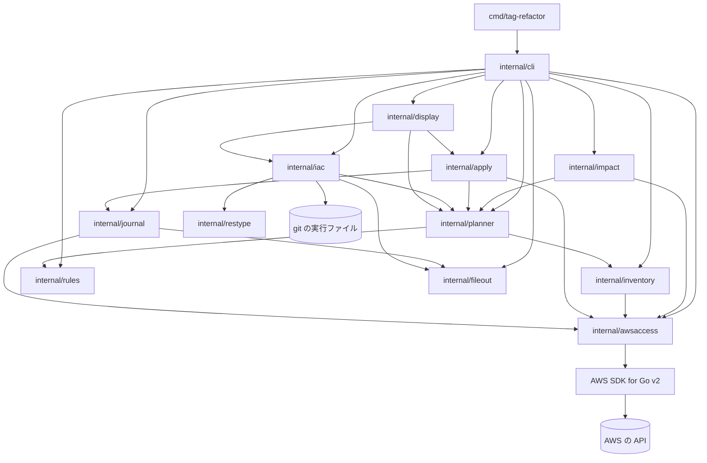
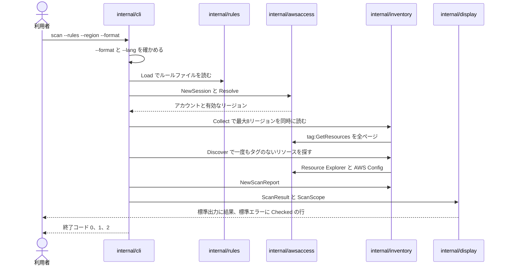
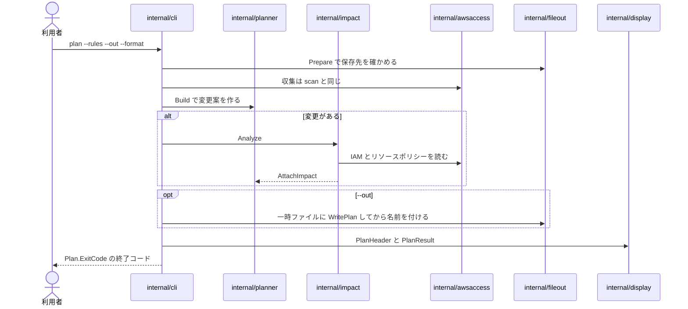
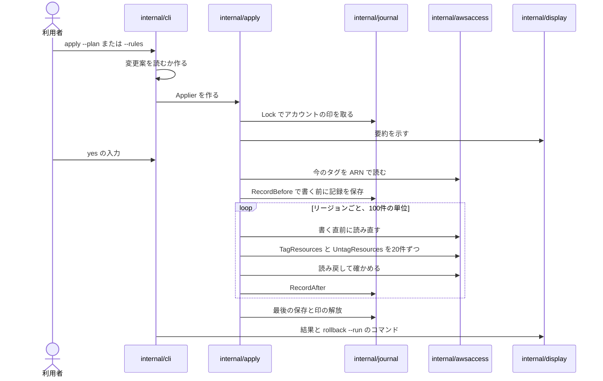
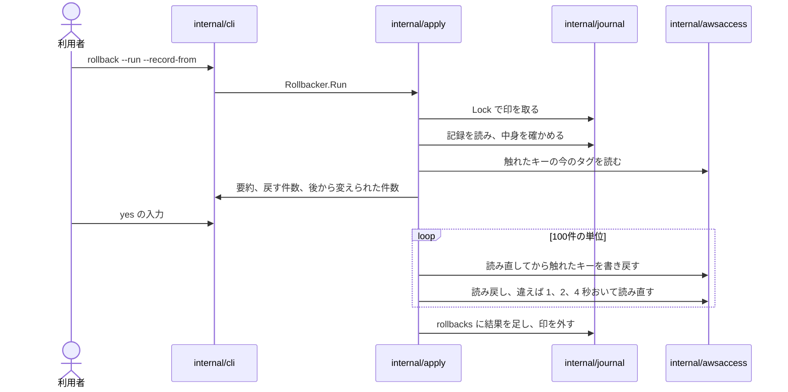
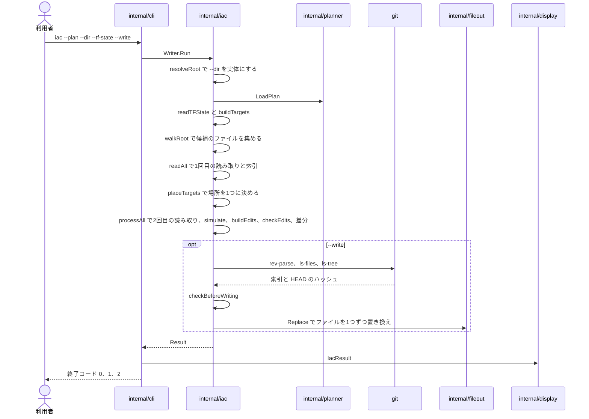

# アーキテクチャ

## Architecture Analysis

### System Overview

`tag-refactor` は、1つの Go モジュールからビルドする1つの静的なバイナリ(`CGO_ENABLED=0`)です。入口の `cmd/tag-refactor` が `internal/cli` を呼び、`internal/cli` が6つのコマンド(`scan`、`plan`、`rules suggest`、`apply`、`rollback`、`iac`)ごとに必要な部品だけを組み立てます。AWS との通信は `internal/awsaccess` に、出力は `internal/display` に、ファイルの保存は `internal/fileout` に集めています。`iac` は AWS に触れず、手元のファイルと利用者の `git` だけを使います。

### Architectural Style

- **モノリスのコマンドラインのツール**(層に分けた構成): 入口 → コマンドの組み立て(`cli`)→ 業務の部品(`inventory`、`rules`、`planner`、`impact`、`apply`、`journal`、`iac`)→ 外部への出入り口(`awsaccess`、`fileout`、`display`)。証拠: `go list` の依存は一方向で、`cmd/tag-refactor` の依存は `internal/cli` だけです。
- **能力を型で絞る**: `cli/commands.go` の `tagReaders`、`readers`、`apply.go` の `applyReaders` は、コマンドごとに使える AWS のインタフェースだけを持ちます。読み取りの `awsaccess.Session` には書き込みのメソッドがなく、書き込みの `awsaccess.Writer` は `apply` と `rollback` だけが作ります。`iac` の `iacRunner` 型には AWS の接続を入れる場所がありません。
- **依存の向きの逆転**: 影響分析のインタフェース `planner.ImpactAnalyzer` は `planner` が定義し、`impact` が実装します(依存は `impact` → `planner`)。進み具合は `inventory.ProgressSink`、`apply.ProgressSink` として受け手(`display.Printer`)が実装します。
- **形式の差を1つのインタフェースに閉じ込める**: `iac` の3つの読み取り(YAML、JSON、HCL)は `parsedFile`(`refs`、`site`、`allTags`)を実装し、変更の適用、範囲の書き換え、差分は形式を知りません。

### Component Relationships

<!-- Text fallback: cmd/tag-refactor -> internal/cli. internal/cli -> inventory, rules, planner, impact, apply, journal, iac, awsaccess, display, fileout, errkind. planner -> inventory, rules. impact -> planner, awsaccess. inventory -> awsaccess. apply -> awsaccess, journal, planner. journal -> awsaccess, fileout. iac -> planner, restype, fileout; iac runs the user's git. display -> iac, apply, planner, inventory, journal, awsaccess. awsaccess -> AWS SDK -> AWS APIs. errkind is used by almost every package. -->

`internal/errkind` はほとんどのパッケージが使うため、図から外しています。

### Data Flow

- **入力**: コマンドラインのオプション、ルールファイル(YAML、64 KiB まで)、保存した変更案(JSON、契約 C2、`plan --out` で書き `apply --plan` と `iac --plan` が読む)、実行の記録(JSON、契約 C4、手元か S3)、`terraform show -json` の出力(`iac --tf-state`)、IaC のソース(`iac --dir`)。
- **AWS から**: `tag:GetResources`(収集、書き換えの前後の読み直し)、IAM と5つのサービスのポリシー(影響分析)、AWS Config と Resource Explorer(一度もタグのないリソース)、`sts:GetCallerIdentity`、`ec2:DescribeRegions`。
- **AWS へ**: `tag:TagResources`、`tag:UntagResources`、記録と印の S3 のオブジェクト(`apply` と `rollback` だけ)。
- **出力**: 標準出力に結果だけ(一覧、差分、JSON、Markdown、iac の差分と一覧)、標準エラーに進み具合、警告、エラー(2行)、終了コードの行。保存するファイルは一時ファイルに書いてから名前を付けます(`fileout`)。

### Key Design Decisions

| 決定 | 理由とその影響 |
|---|---|
| AWS の SDK は `awsaccess` だけが使う | エラーの文に SDK の文言を出さない(`errkind` が道具の書いた欄だけを出す)。テストは HTTP の層の偽の AWS で SDK 全体を通す |
| 読み取りと書き込みを型で分ける | `scan`、`plan`、`rules suggest` は書き込みの口を持たない。偽の AWS は `AllowWrites` なしの書き込みでテストを失敗させる |
| 変更案をファイルにする(契約 C2、`version: 1`) | `plan` と `apply`/`iac` を分け、レビューと再現を可能にする。読み込みは `ParsePlan` が厳しく検査し、影響の印は読み直すたびに計算し直す |
| 書き換える前に記録を保存し、印で同時実行を防ぐ | `rollback` を可能にする。S3 の記録と印は「なければ作る」の条件付きの書き込み |
| iac は範囲だけを書き換え、書いたあとに読み直して確かめる | コメント、改行、BOM などを1バイトも変えない。確かめに通らないファイルは書かずに `unreadableFile` として一覧に出す |
| iac の `--write` は git で確かめる(読み取りのコマンドだけ) | `git status` はフィルターや fsmonitor を動かしうるため使わず、ハッシュを自分で比べる。リポジトリの設定のプログラムを動かさない |
| 出力は `display` だけ、終了コードは `cli` だけ | 表示の一貫(言語、色、サニタイズ)と、終了コードの規則の一元化。テストがソースを調べて守る |

### Improvement Opportunities

- `internal/display` が `iac.Result`、`apply` の結果などの型を直接読むため、新しい機能(CDK、プルリクエスト)を足すと表示のパッケージにも手が入ります。結果を表示用の中立な形にする層を挟む余地があります。
- `iac` の「場所を探す」部分(`source.go` の `placeIndex`)は、CloudFormation の論理 ID と Terraform のアドレスの2つの鍵を前提にしています。CDK を足すなら、生成された論理 ID からコンストラクトのソースへの対応(例: `cdk.out` のメタデータ)という第3の鍵の作り方を決める必要があります。
- 外部のプロセスの呼び出しは `iac/git.go` に閉じていますが、プルリクエストの作成で `git` の書き込みと `gh` を使うなら、環境変数の整理、時間の上限、差し替えの口をもつ共通の実行の部品にまとめる余地があります。
- 公開(GitHub Releases、チェックサム)のワークフローがリポジトリにありません。チームの方針(タグの push での公開)とリポジトリの状態の対応は確かめが要ります。

## Interaction Diagrams

### scan

<!-- Text fallback: user runs scan -> cli checks --format/--lang, loads the rule file if given -> awsaccess.NewSession and Resolve (STS, EC2 DescribeRegions) -> inventory.Collect reads tag:GetResources for up to 8 regions at once -> inventory.Discover looks for never-tagged resources (Resource Explorer aggregator, AWS Config, Resource Explorer) -> NewScanReport groups key variants and missing required tags -> display prints the result to stdout and the Checked line to stderr -> exit code 0, 1 or 2. -->

### plan

<!-- Text fallback: plan checks --format, prepares --out, loads rules -> collect (session, account, regions, inventory.Collect) -> planner.Build makes changes c-000001.. -> if there are changes, impact.Analyzer reads IAM policies and resource policies through stoppingPolicyReader -> plan.AttachImpact -> with --out, fileout writes the plan through SafeJSONWriter (WritePlan) -> display prints the plan in the chosen format -> exit code from Plan.ExitCode. -->

### apply

<!-- Text fallback: apply loads the plan (--plan, account must match) or makes one (--rules) -> journal.Lock takes the account lock -> summary and yes confirmation (or --yes / --allow-impact) -> apply.Applier reads current tags (tag:GetResources by ARN), skips changed or missing resources, works out the tags to set and keys to remove -> journal RecordBefore saves the record before any write -> regions in parallel (4), batches of 20, units of 100 read again before writing and read back after -> journal saves every 5 seconds and at the end -> lock released -> result with the rollback command. -->

### rollback

<!-- Text fallback: rollback checks --run -> journal.Lock -> read and check the run record (account, run ID, ARNs, keys) -> judge each entry from current tags (already restored, restore, changed after apply) -> summary and yes -> write touched keys back in units read again just before, read back with waits of 1, 2 and 4 seconds -> add the result to rollbacks in the same record -> release the lock. -->

### iac

<!-- Text fallback: iac checks --plan and --dir -> resolveRoot -> planner.LoadPlan (200 MB) -> readTFState (optional) -> buildTargets decides CloudFormation (stack-name and logical-id tags) or Terraform (exact ARN in state) or unmanaged -> walkRoot lists candidates -> readAll parses each file once for its index -> placeTargets finds one place per target -> processAll reads each file again (same SHA-256), simulate applies changes, buildEdits, checkEdits re-parses, unifiedDiff -> with --write: checkGit (rev-parse, ls-files, ls-tree), checkBeforeWriting, fileout.Replace per file -> display.IacResult -> exit code 0, 1 or 2. -->

