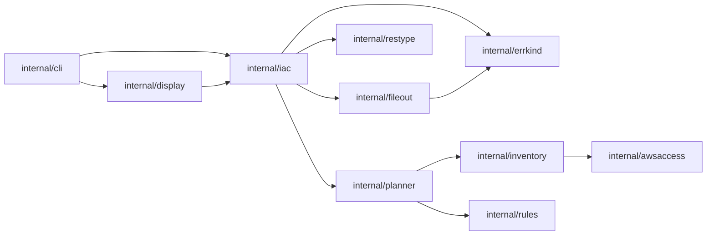

# 依存の関係

## 外部の依存

### Go のモジュール

直接の依存は 22(`go.mod` の最初の `require`)、間接の依存は 24、ツールの依存は1つ(`govulncheck`)です。版の一覧は `technology-stack.md` にあります。

| まとまり | モジュール | 取り込むパッケージ |
|---|---|---|
| AWS | `aws-sdk-go-v2` と 11 のサービス、`config`、`credentials`、`smithy-go` | `internal/awsaccess` だけ |
| コマンドライン | `spf13/cobra`(間接に `spf13/pflag`、`inconshreveable/mousetrap`) | `internal/cli` |
| YAML(ルールファイル) | `goccy/go-yaml` | `internal/rules` |
| YAML(CloudFormation) | `go.yaml.in/yaml/v3` | `internal/iac` |
| HCL(Terraform) | `hashicorp/hcl/v2`(間接に `zclconf/go-cty`、`agext/levenshtein`、`apparentlymart/go-textseg`、`mitchellh/go-wordwrap`) | `internal/iac` |
| 並行 | `golang.org/x/sync` | `internal/inventory`、`internal/impact`(`errgroup`)、`internal/iac`(`semaphore`) |
| 端末 | `golang.org/x/term`、`golang.org/x/sys` | `internal/cli`、`internal/display` |
| 脆弱性 | `golang.org/x/vuln`(ツール) | CI だけ |

決まり:

- AWS の SDK を取り込むのは `internal/awsaccess` だけです。`internal/iac` と `internal/restype` は SDK に依存しません(`restype` のコメントと、テスト `TestImportsNoAWSDirectly`)。
- `go mod verify` と、`go mod tidy` で差分が出ないことを CI の `modcheck` で確かめます。テストとビルドは `-mod=readonly` です。
- 更新は Dependabot が毎週 PR を作ります(gomod と github-actions)。

### 外部のサービスとプログラム

| 相手 | 使うコマンド | 方向 |
|---|---|---|
| AWS の API(STS、EC2、Resource Groups Tagging、IAM、S3、KMS、SQS、SNS、Secrets Manager、AWS Config、Resource Explorer) | `scan`、`plan`、`rules suggest`、`apply`、`rollback` | 読み取り。書き込みは `apply` と `rollback` のタグと S3 の記録だけ |
| ファイルシステム | すべて | ルールファイル、変更案、記録、印、ログ、IaC のソースの読み書き |
| `git`(利用者の実行ファイル) | `iac --write` | 読み取りの `rev-parse`、`ls-files -s -z`、`ls-tree -z HEAD` だけ |
| `terraform` | 呼ばない | 利用者が `terraform show -json` を動かし、その出力を `--tf-state` で渡す |
| `gh`、GitHub | 呼ばない | 今はなし(意図で足す予定) |

## パッケージの間の依存

`go list` の取り込みから作った、`internal` の中の依存です(テストを除く)。

```
cmd/tag-refactor  -> internal/cli
internal/cli      -> apply, awsaccess, display, errkind, fileout, iac, impact, inventory, journal, planner, rules
internal/display  -> apply, awsaccess, errkind, iac, inventory, journal, planner
internal/apply    -> awsaccess, errkind, journal, planner
internal/impact   -> awsaccess, errkind, planner
internal/planner  -> errkind, inventory, rules
internal/iac      -> errkind, fileout, planner, restype
internal/journal  -> awsaccess, errkind, fileout
internal/inventory-> awsaccess, errkind
internal/fileout  -> errkind
internal/awsaccess-> errkind
internal/rules    -> errkind
internal/errkind  -> (none)
internal/restype  -> (none)
internal/testutil -> (none in internal)
```

<!-- Text fallback: same as the list above. iac depends on planner (to read the plan), restype (type table), fileout (Replace) and errkind. display depends on iac to print its result. -->



上の図は、今回の意図に関わる `internal/iac` のまわりだけを示します。`internal/iac` は `planner` を通して `inventory` と `rules` の型も間接に取り込みますが、`inventory` が `awsaccess` に依存するため、`iac` のバイナリの中の依存の木には AWS の SDK が入ります(パッケージとして直接は取り込まない)。

## 依存の特徴と注意

- **一方向**: 循環はありません。`planner` と `impact` の間は、`planner` がインタフェース `ImpactAnalyzer` を定義し `impact` が実装する形で、依存を `impact` → `planner` に向けています。
- **表示が機能の型に依存する**: `internal/display` が `iac.Result`、`apply` の結果、`journal` の型を直接読みます。iac に CDK やプルリクエストの結果を足すと、`display/iac.go` のメッセージの一覧と出力も変わります。
- **差し替えの口**: 外部への出入り口はパッケージの変数で差し替えられます(`iac` の `openFile`、`replaceFile`、`lookGit`、`runGit`、`gitCheck`。`fileout` の `replaceRename` など。`cli.Deps.iac`)。テストはこれで AWS も実際の git も使わずに流れを確かめます(git は実際のものを使うテストもある)。
- **今回の意図での新しい依存の候補**: TypeScript と Python のソースの読み取りの部品、`gh` と `git` の書き込みの呼び出し。前者は Go のモジュールの追加、後者は外部のプロセスの追加になります。どちらも CI の「実際の外部のサービスを呼ばない」と3つの OS の条件の中でテストできる形が要ります。
