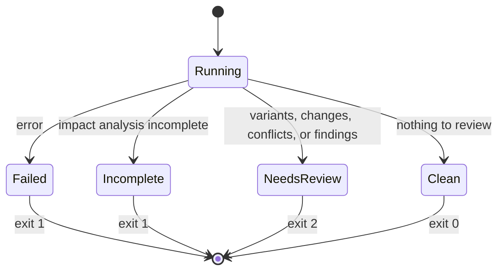
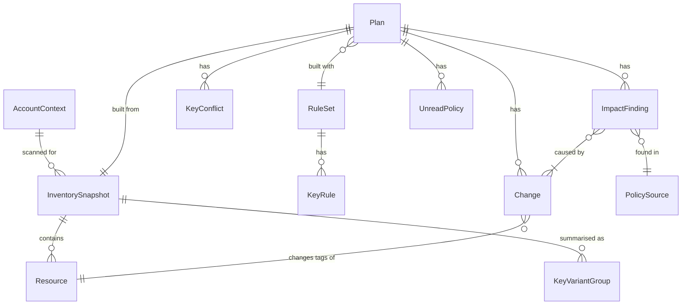

# 機能仕様: U1 最小の一本

U1 の `scan` と `plan` の流れと、終了コードの決まり方を定めます。この文書は、流れ(手順の順番)と状態の移り変わりの正本です。データの形は `entities.md`、判断の規則は `rules.md` が正本で、この文書の図と規則の表は、そこから作った見やすい形です。

出典: `functional-design-questions.md` Q1〜Q5、`inception/units-generation/unit-of-work.md`(U1)、`inception/refined-mockups/mockups.md`(画面2・画面4)、契約 C1・C5〜C7・C9・C11・C12。

## U1 の範囲

| 入るもの | 入らないもの(後の作業単位) |
|---|---|
| 1つのリージョンのタグの付いたリソースの収集 | 全リージョン、一度もタグが付いていないリソース、進み具合の詳しい表示(U2) |
| 大文字・小文字と区切り文字だけの表記ゆれのまとめ | 略語の辞書、`rules suggest`(U2・U3) |
| ルールファイルのキーの別名と、名前の変更 | 値の変更、必須タグ、削除、変更案の保存、4つの形式、日本語(U3・U4) |
| 付いている、利用者が作った IAM の管理ポリシーの、リソースのタグの条件キーの照合 | インラインポリシー、リソースポリシー、他の条件キー(U5) |
| ビルド、テスト、lint、CI(Linux、macOS、Windows) | 配布(別の作業) |

## 流れ W1: scan

1. Cli が `scan [--profile P] [--region R]` を受け付ける。それ以外のオプションは誤りで、契約 C5 にあるが U1 で扱わないもの(`--rules`、`--format`、`--lang`)は「この版では使えない」と案内する(BR1.7、終了コード 1)。
2. AwsAccess が、プロファイル(BR1.2)とリージョン(BR1.1)を決め、認証情報を確かめる(BR1.3)。STS で呼び出し元を確かめ、`AccountContext` を作る。
3. Cli が標準エラーに「Account <id> · region <R>」を出す(BR6.1)。
4. Inventory が、読み取りの口(TagReader)だけを使い(BR1.5)、リージョン R のタグの付いたリソースを最後まで読む(BR2.1)。読み始めと読み終わりを進み具合の通知口(C11)に伝え、Cli が標準エラーに出す。
5. 読み取りが拒否されたら、足りない API の名前つきのエラーで終える(BR1.6、終了コード 1)。
6. `aws:` で始まるキーを除き、キーを正規化してまとめ(BR2.2)、`KeyVariantGroup` を作る(BR2.3)。
7. Display が標準出力に表を出す。
   - 表記ゆれがあれば、まとまりごとに「最も多い書き方」と各書き方の件数を出す(モックアップ 画面2 の形)。
   - なければ「No issues found」と件数を出す(BR2.4)。
8. Cli が終了コードを決め(状態 S1、BR6.3)、「Exit code」の行を標準エラーに出す(BR6.1)。表記ゆれがあれば 2、なければ 0。

出力の例(標準出力):

```
Tag key variants (same key except for case and separators)
  env                  208 resources
    env                  150
    Env                   58
  cost-center           97 resources
    cost-center           60
    cost_center           37

Summary: 412 resources scanned in 1 region (us-east-1) · 2 variant groups
```

出力の例(標準エラー):

```
Account 123456789012 · region us-east-1
scan: us-east-1 started
scan: us-east-1 done (412 resources)
Checked: only the resources that the tagging API returns in us-east-1
Exit code: 2 (issues found)
```

## 流れ W2: plan

1. Cli が `plan --rules F [--profile P] [--region R]` を受け付ける。`--rules` がなければ誤り。それ以外のオプションの扱いは W1 の1と同じ(BR1.7、終了コード 1)。
2. RuleEngine がルールファイルを読む(BR3.1〜BR3.3)。ファイルがない、読めない、壊れている、内容に誤りがある場合は、ファイル名、行番号、キー、直し方を標準エラーに出して終える(終了コード 1)。警告は標準エラーに出して続ける。
3. W1 の 2〜5 と同じく、接続とリソースの収集を行う。
4. Planner が、リソースごと・正しいキーごとに、付いているキーを調べる(BR4.1、BR4.2)。
   - 別名だけが付いている → 名前の変更。
   - 2つ以上が付いていて値がすべて同じ → 別名を正しいキーにまとめる名前の変更(`mergesIntoExisting`)。
   - 値が違う → ぶつかり(変更は作らない)。
5. Planner が changeId を振る(BR4.3)。変更もぶつかりもなければ、影響分析をせずに「No changes needed」と件数を出し、終了コード 0 で終える(BR4.4)。
6. Planner が、変更を `TagChangeInput` にして影響分析(C9 のインターフェース)を呼ぶ。ImpactAnalyzer は次のことを行い、`ImpactResult` を返す。
   - 付いている、利用者が作った管理ポリシーを読む(BR5.1)。
   - 条件ごとに BR5.2〜BR5.4 で照合する。
   - 結果を `ImpactFinding` にする(BR5.6)。
   - 読めなかったものは `UnreadPolicy` にする(BR5.5)。
7. Planner が、影響のある変更に `impacted` を付け、`ImpactResult.complete` を `impactAnalysisComplete` に写す。
8. Display が標準出力に表を出す(モックアップ 画面4 の形の最小版)。
   - 影響分析が不完全なら、先頭に「! Impact analysis is incomplete」と、読めなかった種類と理由を出す。
   - 名前の変更は、`fromKey -> toKey` ごとの件数を出す。まとめる変更には「(merge into existing)」を付ける。
   - ぶつかりは、リソースごとに、付いているキーと値を出す。
   - 影響は、`!` か `?`、ポリシーの ARN、ステートメント、条件、原因の変更を出す。
   - 要約は「<n> to change · <n> conflicts · <n> affected · <n> undecided」の形で出す。
9. Cli が終了コードを決め(状態 S1、BR6.3)、「Exit code」の行を標準エラーに出す。

出力の例(標準出力。アカウントの行と「Exit code: 2 (review needed)」の行は、W1 と同じく標準エラーに出る):

```
Changes: 208 resources
  ~ rename key   env -> Environment            150 resources
  ~ rename key   Env -> Environment             55 resources
  ~ rename key   Env -> Environment              3 resources  (merge into existing)
  (A resource with several changes is counted once in the total.)

Conflicts (not changed; values differ): 2 resources
  arn:aws:ec2:us-east-1:123456789012:instance/i-0abc   env="dev"  Environment="prod"
  ...

Impact (references that use the tags being changed)
  ! IAM policy  arn:aws:iam::123456789012:policy/DevAccess
      Statement "AllowDevEC2"  Condition StringEquals aws:ResourceTag/env = "dev"
      affected by: rename key env -> Environment
  ? IAM policy  arn:aws:iam::123456789012:policy/TeamAccess
      Statement "#0"  Condition StringEquals aws:ResourceTag/${aws:PrincipalTag/team}
      cannot decide (policy variable)

Summary: 208 to change · 2 conflicts · 1 affected · 1 undecided
```

## 流れ W3: エラー

1. 部品はエラーを種類つき(C12)で返す。U1 で起きる種類は次のとおり。
   - `InvalidInput`(オプション、リージョン、ルールファイルの内容や書式の誤り)
   - `UnsupportedVersion`(ルールファイルの version)
   - `NotFound`(ルールファイルがない)
   - `StorageFailed`(ルールファイルを読めない)
   - `CredentialsMissing`(認証情報がない、または期限切れ)
   - `AccessDenied`(タグの読み取りの拒否。ポリシーの読み取りの拒否はエラーではなく不完全、BR5.5)
   - `Transient`(既定の再試行を使い切った一時的な失敗、BR1.8)
   - `Internal`(どの種類にも当てはまらない想定外のエラー。NFR の設計 `security-design.md` §5 で契約 C12 に追加)
2. Cli だけが、エラーを2行の案内(何が起きたか、どう直すか)にして、標準エラーに出す。認証情報は含めない(BR1.4)。
3. 終了コードは 1。標準出力には何も出さない。

## 状態 S1: 終了コードの決まり方

`CommandOutcome` の3つの印(error、incomplete、needsReview)から終了コードが決まります(BR6.3)。



文章での説明: エラーで止まったか、影響分析が不完全なら 1 です。そうでなく、表記ゆれ、変更、ぶつかり、影響のどれかがあれば 2 です。どれもなければ 0 です。不完全で、しかも要確認のものがある場合も 1 です(1 が最優先)。

## エンティティの関係(entities.md から作った図)



文章での説明: 1つのアカウントの1回の収集が、リソースと、キーのまとまりを持ちます。変更案は、1つの収集と1つのルールファイルから作られ、名前の変更、ぶつかり、影響、読めなかったポリシーを持ちます。影響は、1つのポリシーにあり、1つ以上の変更が原因です。

## 規則のまとめ(rules.md から作った表)

| 流れ | 使う規則 |
|---|---|
| 接続(W1・W2) | BR1.1、BR1.2、BR1.3、BR1.5、BR1.6、BR1.7、BR1.8 |
| 収集とまとめ(W1) | BR2.1、BR2.2、BR2.3、BR2.4 |
| ルールファイル(W2) | BR3.1、BR3.2、BR3.3 |
| 変更案(W2) | BR4.1、BR4.2、BR4.3、BR4.4 |
| 影響分析(W2) | BR5.1〜BR5.6 |
| 出力と終了コード(すべて) | BR1.4、BR6.1、BR6.2、BR6.3 |

## 業務の場面

| 場面 | 結果 |
|---|---|
| 正常: 表記ゆれのないリージョンで scan | 「No issues found」と件数。終了コード 0 |
| 正常: env と Env があるリージョンで scan | 1つのまとまりとして件数を出す。終了コード 2 |
| 正常: env を Environment にする plan、IAM の管理ポリシーが aws:ResourceTag/env を使う | 名前の変更と `!` の影響。終了コード 2 |
| 正常: env を Env にする plan(大文字・小文字だけ) | 名前の変更は出る。aws:ResourceTag/env の条件は影響なし、ec2:ResourceTag/env のようなサービス固有の条件は影響あり(見逃さない側)。終了コード 2 |
| 正常: 条件のキーが aws:ResourceTag/env* | env を Environment にする変更は、env に当てはまるため影響あり |
| 正常: 変更が1件もない plan | 「No changes needed」と件数。ポリシーは読まない。終了コード 0 |
| 正常でない: 認証情報の期限切れ | 期限切れであることと再ログインの方法。終了コード 1 |
| 正常でない: 存在しないリージョンを --region に指定 | そのリージョンは使えないことと指定の方法。終了コード 1 |
| 正常でない: ルールファイルがない、または YAML として壊れている | ファイル名と、行番号つきの直し方。終了コード 1 |
| 正常でない: U1 で扱わないオプション(例 --format json) | 「この版では使えない」。終了コード 1 |
| 正常でない: 認証情報がない | 足りないものと設定方法。終了コード 1 |
| 正常でない: リージョンが決まらない | --region か AWS_REGION の案内。終了コード 1 |
| 正常でない: tag:GetResources が拒否される | 足りない API の名前。終了コード 1 |
| 正常でない: iam:ListPolicies が拒否される | 変更案は出し、「影響分析は不完全」。終了コード 1 |
| 正常でない: ルールファイルに知らないキー(例 `aliasses`) | 行番号、キー、近い綴りの案内。終了コード 1 |
| 正常でない: 同じリソースに env="dev" と Environment="prod" | ぶつかりとして示し、変えない。終了コード 2 |
| 境目: リソースが0件 | 「No issues found」と「0 resources」。終了コード 0 |
| 境目: 同時に動く他の処理 | U1 は読み取りだけなので、同時実行の制御はしない |

## Assumptions & Open Questions

- U1 の検証は、人が承認する Construction 検証コマンドで行い、そのコマンドは U1 のチェックポイントで決める(`delivery-planning-questions.md` Q7)。[assumption]
- U1 のオプション名は `--profile`、`--region`、`--rules` に確定する(契約の未決事項 C5 のうち scan と plan の分。BR1.7)。`--region` は契約 C5 の一覧にない、U1 で足したオプションである。U2 では、既定を全リージョンにし、`--region` を繰り返して指定できるように広げる。
- サービス固有の条件キー(`ec2:ResourceTag/<キー>` など)でも、タグのキーの大文字・小文字が区別されないかは、AWS のドキュメントで確かめられていない。そのため BR5.3 では、見逃さない側に倒している。検証用アカウントで `env` と `Env` を使った条件の動作を確かめることを、U1 の検証の確認事項に入れる。[assumption]
- Go の最小バージョン(要件 OQ2)は、U1 の NFR の設計で決める。[assumption]
