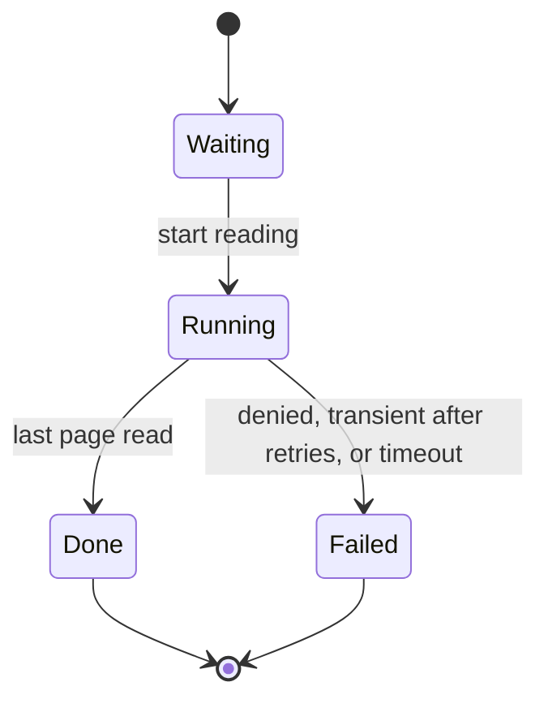
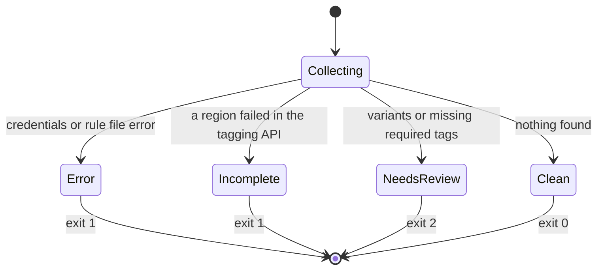
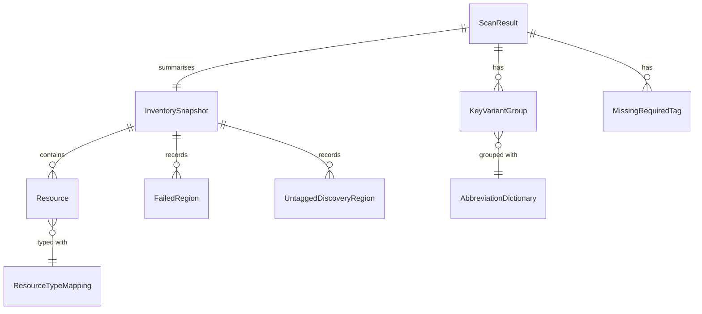

# 機能仕様: U2 収集

U2 で完成させる `scan` と、`plan` の収集の流れと状態を定めます。流れと状態の移り変わりはこの文書が正本です。データの形は `entities.md`、判断の規則は `rules.md` が正本です。U1 の流れ(`construction/u1-walking-skeleton/functional-design/functional-spec.md`)のうち、ここで書き換えない部分(接続、認証情報、エラーの2行の案内、出力先、ルールファイルの安全な読み方)はそのまま使います。

出典: `functional-design-questions.md` Q1〜Q3、要件 FR1・FR7、ストーリー US1.1・US1.2、モックアップ 画面1・画面2、契約 C3・C5・C6・C7・C11・C12、AWS のドキュメント。レビュー(`reviews/review-01.md`)の R-01〜R-15 を受けて改訂しました。

## U2 の範囲

| 入るもの | 入らないもの |
|---|---|
| 全リージョンの収集、--region の繰り返し(scan と plan) | 一覧以外の形式(JSON、Markdown)、日本語、色(U4) |
| 一度もタグが付いていないリソースの検出(集約の索引、Config、Resource Explorer) | rules suggest、required の値と条件の評価、値の別名(U3) |
| 読めなかったリージョン、タグを変更できない種類、CloudFormation の印 | plan への CloudFormation の印の表示、必須タグを付ける変更(U4) |
| 略語の辞書による表記ゆれのまとめ | 影響分析の完成(U5) |
| --rules の required のキーの欠落の件数 | 利用者が辞書を足すこと(範囲外) |
| すべての呼び出しの、待ち時間を延ばす再試行 | |
| 進み具合(端末と、端末でない場合) | |
| 読み取り用の IAM ポリシーの例の更新(BR7.1) | |

## U2 で新しく呼ぶ AWS の操作

正確な操作の名前は NFR の設計で確かめ、読み取り用の IAM ポリシーの例に足します(BR7.1)。すべて読み取りです。

| 目的 | 呼ぶ API の操作 | 必要な IAM の操作 |
|---|---|---|
| AWS Config が記録しているか、どの種類を記録しているか | `DescribeConfigurationRecorders`、`DescribeConfigurationRecorderStatus` | `config:DescribeConfigurationRecorders`、`config:DescribeConfigurationRecorderStatus` |
| AWS Config で、利用者のタグがないリソースを探す | `SelectResourceConfig` | `config:SelectResourceConfig` |
| Resource Explorer の索引(集約かどうか)とビュー(既定のビューと、その絞り込みの条件) | `ListIndexes`、`GetDefaultView`、`GetView` | `resource-explorer-2:ListIndexes`、`resource-explorer-2:GetDefaultView`、`resource-explorer-2:GetView` |
| Resource Explorer で `tag:none` のリソースを、件数の上限なく読む | `ListResources`(1,000 件までに限られる API の `Search` は呼ばない) | `resource-explorer-2:Search`(AWS が `ListResources` に求める権限) |

## 流れ W1: scan

1. Cli が `scan [--profile P] [--region R]... [--rules F] [--debug]` を受け付ける。`--rules` を受け付けるようになる(U1 では誤りにしていた)。
2. `--rules` があれば、ルールファイルを読む(U1 の BR3.1〜BR3.3)。scan で使うのは `required` のキーの名前だけ(BR5.2)。
3. 接続し、アカウントと有効なリージョンの一覧を得る。読むリージョンを決める(BR1.1)。無効な `--region` は、ここで誤りにする。
4. 進み具合の表示を始める(BR6.1)。すべてのリージョンを「待ち」にする。
5. リージョンを同時に読む(BR2.4)。タグの取得の API で最後まで読む(BR2.1)。各リージョンは「実行中」→「済み」または「失敗」になる。
   - タグの取得で読めなかったリージョンは、理由を記録して続ける(BR4.1)。
   - 呼び出し回数の上限は、待ち時間を延ばしながら再試行する(BR4.2)。
   - 認証情報の誤りは、途中でも全体を止める。部分的な結果は出さない(BR4.3)。
6. グローバルなリソースの重複を除き(BR2.2)、種類を ARN の形にそろえ(BR2.5)、CloudFormation の印を付ける(BR2.3)。
7. 「discovering never-tagged resources」を進み具合に出し、一度もタグが付いていないリソースを探す(BR3.1)。集約の索引があればそのリージョンで1回、なければリージョンごとに Config、Resource Explorer の順で試す。リージョンごとの方法と状態を記録する。全体の状態(complete、partial、unavailable)を決める(BR3.2)。タグを変更できない種類を数える(BR3.3)。
8. 表記ゆれをまとめる(BR5.1)。`--rules` があれば必須タグの欠落を数える(BR5.2)。
9. 結果を標準出力に出す(下の例)。タグの取得で読めなかったリージョンがあれば、先頭に「! Results are incomplete」とリージョンと理由を出す。
10. 終了コードを決める(BR5.3、状態 S2)。調べた範囲の `Checked:` の行(BR5.7)、かかった時間と件数、終了コードの行を標準エラーに出す。

出力の例(標準出力。モックアップ 画面2 に合わせた形):

```
Tag key variants (candidates; confirm them in your rule file)
  environment          4,102 resources
    env                  2,950
    Env                    811
    environment            341
  costcenter             903 resources
    cost-center            512
    cost_center            391
  production              12 resources  (abbreviation match)
    prod                    12

Required tags missing (from tagrules.yaml)
  Owner         1,244 resources  (12 more on resource types that cannot be tagged)
  CostCenter      903 resources

Resources with no user tags: 380
Untagged-resource discovery: partial (not checked in me-south-1: AccessDenied resource-explorer-2:Search)
  Required tag counts are a lower bound.
Resource types not supported for tag changes: 2 types, 37 resources
  ec2:example-thing   30
  AWS::Example::Other  7

Summary: 9,812 resources scanned in 17 of 17 regions · 2 variant groups · 2 required tags missing
```

- まとまりの見出しは、まとめた正式な形(`normalizedKey`)にし、その下に実際の書き方と件数を出す。
- `(abbreviation match)` は辞書を使って初めてまとまったもので、終了コードの理由にしない(BR5.1)。この例の `production` は書き方が1つだけなので、本当はまとまりとして出す意味が薄い。出すのは、辞書の対応を利用者が確かめられるようにするため。
- `--rules` がないときは「Required tags missing: not checked (no rule file)」と出す。
- 一度もタグが付いていないリソースを全く探せなかったときは「Untagged-resource discovery: unavailable」と理由を出す(モックアップ 画面2)。

進み具合の例(標準エラー、端末のとき。同じ場所を書き換える):

```
Account 123456789012 · 17 regions
  [done]     us-east-1        2,431 resources
  [running]  eu-west-1          612 resources so far
  [waiting]  sa-east-1
  [failed]   me-south-1       AccessDenied (tag:GetResources)
  9/17 regions · elapsed 01:12
```

端末でないとき(1行ずつ追記):

```
scan: us-east-1 done (2,431 resources)
scan: eu-west-1 started
scan: discovering never-tagged resources
```

## 流れ W2: plan の収集

1. `plan` も、W1 の 3〜6 と同じく全リージョン(または `--region` で絞ったリージョン)を読む(BR5.6)。
2. 一度もタグが付いていないリソースは探さない(名前の変更は、タグの付いたリソースだけが対象)。
3. タグの取得で読めなかったリージョンがあれば、結果の先頭に「! Results are incomplete」とリージョンと理由を出し、終了コード 1 にする(U1 の BR6.3 と同じく 1 が最優先)。
4. 変更案と影響分析は U1 のまま。`Checked:` の行は BR5.7 の新しい形にする。
5. U1 の受け入れテストのうち、既定のリージョン(1つ)と `Checked:` の文言を見ているものは、U2 の規則に合わせて直す。直すのは期待する値だけで、確かめる振る舞い(出力先、終了コード、認証情報を出さないなど)は変えない。

## 状態 S1: リージョンの状態(タグの取得)



文章での説明: リージョンは「待ち」から「実行中」になり、最後のページまで読めば「済み」、拒否・再試行を使い切った失敗・時間切れなら「失敗」になります。1つでも「失敗」があれば、結果は不完全です。一度もタグが付いていないリソースの検出の状態は、これとは別に、リージョンごとに complete、unavailable、failed で持ちます。

## 状態 S2: scan の終了コード



文章での説明: 認証情報やルールファイルの誤り、またはタグの取得で読めなかったリージョンがあれば 1 です。そうでなく、表記ゆれ(辞書だけのまとまりを除く)か必須タグの欠落があれば 2 です。どちらもなければ 0 です。一度もタグが付いていないリソースを探せなかったこと、それが見つかったこと、タグを変更できない種類があることは、終了コードを変えません(BR5.3)。

## エンティティの関係(entities.md から作った図)



文章での説明: 1回の収集が、リソース、読めなかったリージョン、一度もタグが付いていないリソースの検出のリージョンごとの結果を持ちます。scan の結果は、その収集をまとめ、表記ゆれのまとまりと必須タグの欠落を持ちます。表記ゆれは略語の辞書でまとめ、リソースの種類は種類の対応表でそろえます。

## 規則のまとめ(rules.md から作った表)

| 流れの手順 | 使う規則 |
|---|---|
| W1 1〜3. 読むリージョン | BR1.1、BR1.2 |
| W1 5〜6. 収集 | BR2.1〜BR2.5、BR4.1〜BR4.3 |
| W1 7. 一度もタグが付いていないリソース | BR3.1〜BR3.3 |
| W1 8. 表記ゆれと必須タグ | BR5.1、BR5.2 |
| W1 9〜10. 結果と終了コード | BR5.3〜BR5.5、BR5.7 |
| W2. plan の収集 | BR5.6、BR5.7 |
| W1 4〜7. 進み具合 | BR6.1 |
| 権限 | BR7.1 |

## 業務の場面

| 場面 | 結果 |
|---|---|
| 正常: 17リージョンすべてを読めた | 「17 of 17 regions」。問題があれば終了コード 2、なければ 0(AC1.1.1、AC1.1.8) |
| 正常: env、Env、environment がある | 1つのまとまり「environment」に3つの書き方と件数(AC1.1.6) |
| 正常: --rules で Owner を必須にしている | Owner が付いていないリソースの件数。一度もタグが付いていないリソースも数える。タグを変更できない種類は別に示す(AC1.1.7) |
| 正常: AWS Config がすべての種類を記録している | タグのないリソースも結果に入り、「Resources with no user tags」に件数が出る(AC1.1.2) |
| 正常: Config は一部の種類だけを記録し、Resource Explorer もある | 両方の結果を合わせる(BR3.1) |
| 正常: Config も Resource Explorer も使えない | 「unavailable」と理由。残りの結果は出し、終了コードはこれだけでは変わらない(AC1.1.3) |
| 正常: 一部のリージョンでだけ探せなかった | 「partial」とリージョンと理由。必須タグの件数は下限と示す(BR3.2) |
| 正常でない: 1つのリージョンでタグの取得が拒否される | 先頭に「Results are incomplete」とリージョンと理由。終了コード 1(AC1.1.5、AC1.2.2) |
| 正常でない: 呼び出し回数の上限 | 待ってから再試行し、最後まで終わる(AC1.1.10) |
| 正常でない: 認証情報がない、または途中で期限切れ | 全体を止め、設定の方法を示して終了コード 1。部分的な結果は出さない(AC1.2.3、BR4.3) |
| 正常でない: 有効でない --region を1つでも含む | AWS のリソースを読む前に誤り。終了コード 1(BR1.1) |
| 正常: plan で1つのリージョンを読めなかった | 先頭に「Results are incomplete」。変更案は出すが終了コード 1(BR5.6) |
| 境目: リソースが0件 | 「No issues found」と「0 resources」。終了コード 0 |
| 境目: 同じグローバルなリソースが2つのリージョンから返る | 1件として数え、region は名前の順で最初のもの(BR2.2) |
| 境目: prod だけが付いたリソース | 「production (abbreviation match)」と示すが、終了コードの理由にしない(BR5.1) |

## Assumptions & Open Questions

- タグの取得の API が対応する種類の一覧と、AWS Config の種類の形から ARN の形への対応表(BR2.5、BR3.3)は、ツールが持ち、版ごとに更新する。AWS に一覧を返す API がないため。[assumption]
- 次の AWS の振る舞いは、NFR の設計で AWS のドキュメントを確かめ、さらに U2 のチェックポイントで検証用アカウントでも確かめる。[assumption]
  - AWS Config の問い合わせで、利用者のタグがないリソースを選ぶ条件の書き方と、記録する種類を絞っているかの判定。
  - Resource Explorer の集約の索引があるときの `ListResources` の範囲と、リージョンごとの索引のときの扱い。
  - `tag:none` が、`aws:` のタグだけを持つリソースを含むこと(AWS のドキュメントでは、AWS が付けるタグは `tag:none` の対象外とある)。
- 1万件を10分以内に読む(NFR1)ための同時に読むリージョンの数(BR2.4)は、NFR の設計で決める。[assumption]
