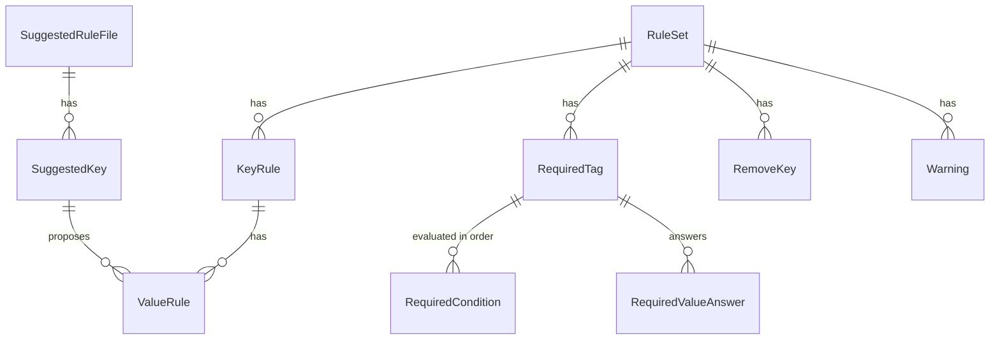

# 機能仕様: U3 ルール

U3 で完成させるルールファイルの読み込みと `rules suggest` の流れを定めます。流れと状態の移り変わりはこの文書が正本です。データの形は `entities.md`、判断の規則は `rules.md` が正本です。U1 の流れ(接続、認証情報、エラーの2行の案内、出力先、ルールファイルの安全な読み方)と、U2 の収集の流れ(全リージョン、読めなかったリージョンの扱い)は、そのまま使います。

出典: `functional-design-questions.md` Q1〜Q6、要件 FR2.1〜FR2.5、FR3.3、FR3.4、ストーリー US2.1、契約 C1・C5・C7・C8・C12、U2 の機能設計(表記ゆれのまとめ方、略語の辞書、種類の対応表)。

## U3 の範囲

| 入るもの | 入らないもの |
|---|---|
| ルールファイルの `keys`(別名と値)、`required`(`default` と `when`)、`remove` をすべて読み、形と矛盾を確かめる | 必須タグの値、値の別名、消すキーを変更案に組み込むこと(U4。Q2) |
| 必須タグの値、正しい値、消すかどうかを答える照会の部品(U4 が使う) | 値が未指定の必須タグの一覧、消す候補の表示(U4。FR3.3、FR3.4) |
| `rules suggest`(下書きを標準出力に出す) | 下書きの日本語のコメント、`--lang`(U4) |
| 契約 C1 の未決事項(条件が複数当てはまるとき)を決める | 利用者が略語の辞書を足すこと(範囲外) |

AC2.1.3 と AC2.1.4 は、`plan` の変更案として確かめる受け入れ条件です。U3 では、その判断の規則(BR3.2、BR4.2)を照会の部品として作り、単体テストで確かめます。`plan` からの受け入れ条件のテストは U4 で行います(Q2)。

## 契約への変更

- **C1:** `when` の評価の順を「上から順に、最初に当てはまったもの」と決めます(未決事項を閉じる)。`match.resourceType` の例を、CloudFormation の形(`AWS::EC2::Instance`)から scan と同じ形(`ec2:instance`、`s3`)に直します(Q6)。`match.tags` は別名を置き換えたあとのタグと比べることを書き足します(BR3.2)。
- **C5:** `rules suggest` のオプションに `--region`(繰り返し可)を足します。scan と plan と同じく、全リージョンを既定にし、絞るときに使います。
- **C8:** `RuleSet` の項目名を、U1 のコードと `entities.md` に合わせて `requiredTagRules` から `requiredTags` に直します。`removeKeys` はキーと行の組(`RemoveKey`)の一覧にします。`keyRules` に `values` を持たせ、照会の約束(必須タグの値、正しい値、消すかどうか)を足します(下の「照会の約束」)。

## 流れ W1: ルールファイルの読み込み(scan、plan、後の apply)

1. U1 のとおり、ファイルの種類と大きさ、改行、入れ子の深さ、YAML の構文と禁止した機能(アンカー、別名、統合キー、タグ、重複したキー)を確かめる。
2. `version` を確かめる(BR1.4)。
3. 一番上の階層から順に読む(`keys`、`required`、`remove`)。各階層で、知らないキー(BR1.2)、型(BR1.3)、文字数(BR1.5)を確かめる。
   - `keys`: 正しいキー名ごとに `aliases` と `values` を読む。
   - `required`: キーごとに `default` と `when` を読む。`when` の各条件の `match`(BR3.3〜BR3.5)と `value` を読む。
   - `remove`: キーの一覧を読む。
   - `aws:` で始まるキーの規則は、その場で無視して警告する(BR5.1)。
4. すべて読んだあとで、項目どうしの矛盾を確かめる: 別名(BR2.1)、値の別名(BR2.2)、必須タグのキー(BR3.1)、条件のタグ(BR3.6)、消すキー(BR4.1)。
5. 誤りがあれば、最初の1つで止め、ファイル名、行番号、キー、何が誤りか、直し方を示す(BR1.1)。警告は `RuleSet.warnings` に入れ、コマンドが標準エラーに出す。

U4 までの扱い: `plan` は `values`、`required` の値、`remove` をまだ変更案に使いません。U1 では読み込みの部品が「使われない」という警告を出していましたが、U3 からは読み込みの部品は警告を出さず、`plan` が「values / required / remove are read but not applied to the plan yet」の1行を標準エラーに出します(U4 で消す)。

### 誤りの例(標準エラー)

| ルールファイルの誤り | 知らせ方(行、キー、直し方) |
|---|---|
| `requried:`(綴りの誤り) | `line 5, key "requried": unknown key "requried"` / `did you mean "required"? (allowed keys here: version, keys, required, remove)` |
| `aliases: env`(一覧でない) | `line 4: "aliases" must be a list` / `write the items as [a, b] or one "- item" per line` |
| 同じ別名が2つのキーの下にある | `line 9, key "env": the alias "env" is listed under "Environment" (line 3) and "Stage" (line 8)` / `keep the alias under one canonical key only` |
| `resourceType: AWS::EC2::Instance` | `line 14, key "resourceType": write the resource type as scan shows it` / `write "ec2:instance"` |
| `resourceType: AWS::Example::Thing`(対応表にない種類) | `line 14, key "resourceType": this resource type cannot be used in a condition` / `only types that scan shows as "service" or "service:type" (for example s3, sqs, ec2:instance) can be used` |
| `match: {tags: {env: prod}}` で `env` が別名 | `line 15, key "env": "env" is an alias of "Environment"; conditions compare tags after aliases are renamed` / `write "Environment" here` |
| `match: {}` | `line 13, key "match": a condition needs at least one of resourceType, region or tags` / `use "default" for a value that applies to every resource` |
| `remove: [env]` で `env` が別名 | `line 20, key "env": "env" is an alias of "Environment"` / `the alias is renamed by the plan; remove it from "remove"` |
| `version: 2` | `line 1, key "version": rule file version 2 is not supported` / `this version of tag-refactor reads rule file version 1` |

文言は U1 の形(英語、2行)のままです。日本語の表示は U4 で足します。

## 流れ W2: rules suggest

1. Cli が `rules suggest [--profile P] [--region R]... [--debug]` を受け付ける(`--rules` は受け付けない)。
2. 接続し、U2 の収集(タグの付いたリソース)で全リージョン、または指定したリージョンを読む。一度もタグが付いていないリソースは探さない。進み具合は U2 のとおり標準エラーに出す。
3. 認証情報の誤りなどで止まったら、U1 のとおり2行の案内を出し、下書きは出さない(終了コード 1)。
4. キーをまとめる(U2 のまとめ方と略語の辞書。`aws:` で始まるキーは除く)。まとまりごとに正しいキー名と別名を決める(BR6.1)。書き方が1つのキーも入れる(BR6.2)。
5. まとまりごとに値をまとめる(BR6.3)。
6. 下書きを組み立て、64 KiB に収まるか測る。収まらなければ、値の候補を件数の少ないキーから外す(BR6.7)。
7. 下書きを C1 の形で標準出力に出す(BR6.4、BR6.5。下の例)。読めなかったリージョンがあれば、先頭のコメントに「# Results are incomplete: <リージョン>」を足す。タグの付いたリソースが1つもなければ `keys: {}` で出す。
8. 読めなかったリージョンがあれば、標準エラーにも「Results are incomplete」とリージョンを出し、終了コード 1。キーだけで 64 KiB を超えたときも、警告して終了コード 1。どちらでもなければ 0(BR6.6、BR6.7)。調べた範囲の行(`Checked: tagged resources in <済みの数> of <有効な数> regions (tagging API)`)と、かかった時間を標準エラーに出す。

### 下書きの例(標準出力)

```yaml
# generated by tag-refactor v0.1.0
# account 123456789012, 17 of 17 regions, 2026-10-24T09:00:00Z
# Review each key: the most used spelling is proposed as the canonical key
# and the other spellings as its aliases.
version: 1
keys:
  "env":
    aliases: ["Env", "environment"]
    values:
      "prod": ["Prod", "production"]
  "cost-center":
    aliases: ["cost_center"]
    # values not suggested: more than 20 different values
  "Name": {}
# required:
#   "Owner":
#     default: "platform-team"
#     when:
#       - match: { resourceType: "ec2:instance" }
#         value: "infra-team"
# remove: ["tmp-owner"]
```

- 書き方が1つで値の候補もないキーは `{}` と書く(読み込むと、別名のない正しいキー名になる)。
- 値の候補を出さなかったキーは、その理由をコメントで書く。

### 状態 S1: rules suggest の終了コード

| 条件 | 終了コード |
|---|---|
| 認証情報、接続、入力の誤り(下書きは出さない) | 1 |
| 下書きを出したが、タグの取得で読めなかったリージョンがある | 1 |
| 下書きを出したが、キーだけで 64 KiB を超え、そのままでは読み込めない | 1 |
| 下書きを出し、すべてのリージョンを読めた(表記ゆれがあっても) | 0 |

## 照会の約束(U4 が使う)

| 照会 | 入力 | 答え | 規則 |
|---|---|---|---|
| 必須タグの値 | 必須タグのキー、リソース(種類、リージョン、グローバルかどうか、タグ) | `RequiredValueAnswer`(値と決めた行、または未指定) | BR3.2 |
| 正しい値 | 正しいキー名、値 | 正しい値と決めた行、または「変えない」 | BR2.3 |
| 消すかどうか | キー | 消す(決めた行)/ 消さない | BR4.2 |

照会は AWS を呼ばず、ルールファイルの中身だけで答えます。同じ入力には常に同じ答えを返します。必須タグの値の照会に渡すタグは、収集したままのタグです。照会の中で、キーの別名と値の別名を置き換え、消すキーを除いてから条件と比べます(BR3.2)。そのため、U4 は置き換えの順を自分で決める必要がありません。

## エンティティの関係(entities.md から作った図)



文章での説明: ルールファイルは、正しいキー名(別名と正しい値を持つ)、必須タグ(条件ごとの値を上から順に評価する)、消すキー、警告を持ちます。必須タグは、リソースごとに値の照会の答えを返します。下書きは、キーのまとまりごとに正しいキー名、別名、値の候補を持ちます。

## 規則のまとめ(rules.md から作った表)

| 群 | 規則 | 内容 |
|---|---|---|
| 読み込み | BR1.1〜BR1.5 | 誤りは行・キー・直し方つきで最初の1つで止める。知らないキー、型、版、文字数 |
| キーと値 | BR2.1〜BR2.3 | 別名と値の別名の重なりを誤りに。値の照会 |
| 必須タグ | BR3.1〜BR3.6 | 別名や消すキーと重ならない。when を上から、次に default、なければ未指定。tags は置き換えたあとのタグと比べる。match の書き方 |
| 消すキー | BR4.1〜BR4.2 | 正しいキー名や別名と重ならない。完全一致で答える |
| aws: | BR5.1 | 規則は無視して警告。match.tags では使える |
| 下書き | BR6.1〜BR6.7 | 最多の書き方を正しいキー名に。すべてのキー。値の候補は20個まで。読み戻せる引用。不完全なら終了コード 1。64 KiB に収める |

## 業務の場面

| 場面 | 期待する振る舞い |
|---|---|
| 正常: 表記ゆれのあるアカウントで `rules suggest` | 下書きに env、Env、environment が1つのまとまりで出て、そのまま `plan --rules` に渡すと読み込める(AC2.1.1) |
| 正常: 下書きの別名のまま `plan` | `Env` と `environment` が `env` へのキー名の変更になる(AC2.1.2。U1 の plan の名前の変更) |
| 正常: `Owner` の default と ec2:instance の条件 | EC2 のインスタンスの照会は条件の値、ほかの種類は default を返す(AC2.1.3 の規則。plan での確認は U4) |
| 正常: `remove: [tmp-owner]` | `tmp-owner` の照会だけが「消す」を返す(AC2.1.4 の規則。plan での確認は U4) |
| 正常: `match: {resourceType: s3}` と `match: {resourceType: sqs}` | S3 のバケットと SQS のキューの照会が、それぞれの条件の値を返す(scan が示す種類の形のまま書ける) |
| 正常: `match: {tags: {Environment: production}}` で、リソースが `env: prod` を持ち、`env` が `Environment` の別名、`prod` が `production` の値の別名 | 置き換えたあとのタグ `Environment: production` と比べるので、条件に当てはまる |
| 境界: グローバルなリソース(IAM のロールなど)と `match: {region: us-east-1}` | region の条件には当てはまらず、次の条件か default を使う |
| 境界: タグの付いたリソースが0件 | `keys: {}` の下書きを出し、終了コード 0。そのまま読み込める |
| 境界: キーと値の候補が多く、下書きが 64 KiB を超える | 件数の少ないキーから値の候補を外して収める。キーだけで超えるときは警告して終了コード 1 |
| 誤り: 綴りの誤った、または形の誤ったルールファイルで `plan` | 行番号、キー、直し方が出て、終了コード 1。AWS は呼ばない(AC2.1.5) |
| 境界: 値が20個を超えるキー(例 `Name`) | 値の候補を出さず、その旨をコメントで書く |
| 境界: 制御文字や `:` を含むキー | 二重引用符と \uXXXX で書き、読み込むと元のキーに戻る |
| 境界: 1つのリージョンが読めない | 下書きは出し、「Results are incomplete」と終了コード 1 |

## Assumptions & Open Questions

- `rules suggest` の件数は、ARN で重複を除いたリソースの数で数える。グローバルなリソースは1回だけ数える(U2 の収集のまま)。[assumption]
- 下書きの日時は UTC で書く。下書きを作り直すと日時の行だけが変わる。[assumption]
- 値の候補の上限(異なる値が20個)は、ID や名前のように値がばらばらのキーを除くための目安。U3 のチェックポイントで、検証用アカウントの下書きを見て妥当か確かめる。[Q4]
