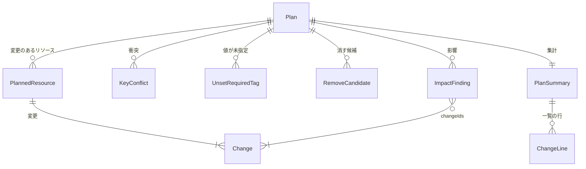

# 機能仕様: U4 変更案

U4 は、ルールファイルのすべての項目(キーの別名、値の別名、必須タグ、消すキー)を使って変更案を作り、一覧、差分、JSON、Markdown の4つの形式と、英語と日本語で出力します。変更案は `--out` でファイルに保存でき、U6(apply)と U8(IaC への反映)が読みます。この文書は、流れと状態の正本です。データの形は `entities.md`、判断の規則は `rules.md` が正本で、下の図と表はそこから作ったものです。

出典: 要件 FR3.1〜FR3.8、FR7.2〜FR7.5、NFR11、ストーリー US3.1・US6.1、U3 から引き継いだ AC2.1.3・AC2.1.4、契約 C2・C3・C5・C8・C9・C12、詳細なモックアップの画面2・4〜6と表示の決まり・操作の仕様、`functional-design-questions.md` Q1〜Q8。

## U4 の範囲

| U4 で作る | U4 で作らない |
|---|---|
| 変更案の4つの種類(キー名の変更、値の変更、必須タグの追加、削除)と衝突 | 影響分析の中身を広げること(IAM のすべての種類、リソースポリシー。U5) |
| 値が未指定の必須タグ、消す候補、IaC の警告、タグを変更できない種類 | 保存した変更案を使った書き換え(U6)と IaC への反映(U8) |
| `plan` の `--format`(table、diff、json、markdown)と `--out`、`scan` の `--format`(table、json、markdown) | `apply` と `rollback` のヘルプと使い方(U6、U7) |
| すべてのコマンドの `--lang`(en、ja)と、日本語の文言(`--help` を除く) | `--help` の日本語(Q7) |
| 色と `NO_COLOR`、件数の3桁区切り | |
| 保存した変更案の読み込みと確かめ(U6、U8 が使う部品) | |

U1 で入れた「values / required / remove are read but not applied to the plan yet」の1行と、`--format`、`--out`、`--lang` の「この版では使えない」の扱いは、U4 で消します。

## 契約への変更

| 契約 | 変更 | 理由 |
|---|---|---|
| C2 | `keyConflicts` を足す。各項目は `arn`(必須)、`canonicalKey`(必須)、`presentTags`(必須。キーから収集したままの値への対応表)。項目を足すだけなので `version` は 1 のまま | 保存した変更案でも、変えなかったリソースを確かめられるようにする(BR4.2) |
| C2 | `renameKey` に `mergesIntoExisting`(真偽値、必須)を足し、kind の表の `renameKey` の意味を「`mergesIntoExisting` が false なら `toKey` に `fromKey` の値を付けてから `fromKey` を消す。true なら `toKey` に書かず `fromKey` を消すだけ」に改める | 値の別名で、既にある正しいキー名の値と別名の値の書き方が違うことがあるため。U6 の書き込みと変更後のタグ(BR1.9)を一致させる |
| C2 | `changeValue` の `fromKey` が、同じリソースの `renameKey` の `toKey` になることがあると明記する。`renameKey` と `removeKey` にも参考として `fromValue` を書く | 重なる変更を2つの変更で表す(Q1) |
| C3 | plan の `details` に `keyConflicts`(C2 と同じ形)を入れる。`summary` に `conflictResources` と `unsetRequiredResources` を足す。`failedRegions` と `unsupportedResourceTypes` は scan と plan のどちらにも入れる | 4つの形式で衝突と値が未指定の件数を一致させる(BR3.4) |
| C3 | Markdown の形を決める(BR3.5) | 契約 C3 の未決事項 |
| C5 | `plan --format`、`--out`、`scan --format`、すべてのコマンドの `--lang` を使えるようにする。`plan` の終了コード2の条件を BR2.6 のとおりにする(消す候補だけなら0) | Q4 |

U6・U8 の設計が読めるよう、この表の C2・C3 の変更は `inception/contract-design/contract-summary.md` の C2・C3 にも書きました。C3 の plan の `details` には、作成日時などを JSON でも表すため `planId`、`createdAt`、`regions` も入れます(項目を足すだけ)。

`renameKey` の書き込みを改めるのは、U1 で決めた形の意味を変えることになります。U1 の変更案は値の別名を使わないため、`mergesIntoExisting` が true のときの値はいつも同じで、どちらの意味でも書き換え後のタグは同じです。保存した変更案を読む部品はまだ U6 にないため、`version` は 1 のままにします。

## 流れ W1: plan

1. 使い方を確かめる。`--format` と `--lang` の値、`--out` の先に既にファイルがないこと、保存先のフォルダに一時ファイルを作れること(BR3.1、BR3.8、BR4.1)。誤りなら AWS を呼ばずに終了コード1。
2. 言語と色を決める(BR3.7、BR3.8)。
3. ルールファイルを読む(U3)。誤りなら AWS を呼ばずに終了コード1。警告は標準エラーに出す。
4. 接続し、アカウントとリージョンを確かめ、収集する(U1、U2)。
5. リソースごとに変更を作る(ARN の順)。
   1. タグを変更できない種類なら飛ばす(BR1.7)。
   2. 正しいキー名ごとに、値の別名を当ててから比べ、キー名の変更か衝突を作る(BR1.1、BR1.2)。
   3. 正しいキー名の値が値の別名なら、値の変更を作る(BR1.3)。
   4. 付いていない必須タグに、値の照会で決まった値を付ける。決まらなければ「値が未指定」に入れる(BR1.4)。
   5. 消すキーを消す(BR1.5)。
   6. どの規則にもないキーを、消す候補として数える(BR2.3)。
   7. `aws:` のキーは、どの段でも変えない(BR1.6)。
6. 変更に順に `changeId` を振る(BR1.8)。
7. 変更が1つもなければ、影響分析をしない(BR2.7)。あれば影響分析を呼び(契約 C9)、変更に印を付ける(BR2.5)。
8. 集計する(BR2.1〜BR2.4)。
9. `--out` があれば保存する(流れ W2)。
10. `--format` の形式で結果を標準出力に出す(BR3.1〜BR3.6)。不完全なら、その旨を結果の先頭に出す。一覧と Markdown では Summary の行で結果を終える。
11. 終了コードの意味と次の手順を標準エラーに出す(どの形式でも同じ。BR3.10)。終了コードは BR2.6。

## 出力先の表(BR3.10)

| 出力 | 一覧・差分 | Markdown | JSON |
|---|---|---|---|
| アカウント・リージョン・作成日時 | 標準エラー(U1 の出力先の決まり) | 標準出力(結果の `## 対象` の節) | 標準出力(`accountId`。plan は `details` の `planId`、`createdAt`、`regions`) |
| 進み具合、警告、ルールファイルの警告 | 標準エラー | 標準エラー | 標準エラー |
| 不完全の印(Results are incomplete、Impact analysis is incomplete) | 標準出力(結果の先頭) | 標準出力(結果の先頭) | 標準出力(`complete` の項目) |
| 変更、衝突、値が未指定、消す候補、IaC、影響 | 標準出力 | 標準出力 | 標準出力 |
| Summary の行 | 標準出力(結果の最後) | 標準出力(`## 要約` の節) | 標準出力(`summary` の項目) |
| Exit code の行 | 標準エラー | 標準エラー | 標準エラー |
| 次の手順(例: 変更案を保存する) | 標準エラー | 標準エラー | 標準エラー |
| Saved plan の行 | 標準エラー | 標準エラー | 標準エラー |
| エラー | 標準エラー | 標準エラー | 標準エラー |

そのため、`plan --format markdown > plan.md` や `plan --format json > plan-view.json` のファイルには、案内の行は入りません。

## 流れ W2: plan --out

1. 流れ W1 の 1 で、保存先に既にファイルがあれば止める(上書きしない)。保存先のフォルダに一時ファイルを作り、作れなければ止める(収集に時間をかけたあとで保存に失敗しないようにする)。
2. 流れ W1 の 8 のあと、その一時ファイルに契約 C2 の JSON を書き、保存先の名前を付ける。既にファイルができていれば付けずに止める(`rules suggest --output` と同じ方法)。
3. 保存に失敗したら、一時ファイルを消し、標準出力には何も出さずに終了コード1(StorageFailed)。
4. 成功したら、標準エラーに「Saved plan to plan.json (5,341 resources, account 123456789012).」を出し、流れ W1 の 10 に進む。

## 流れ W3: scan --format

`scan` は `table`(既定)、`json`、`markdown` を受け付けます(契約 C5。`diff` は使い方の誤り)。表記ゆれ、必須タグの欠落、不完全の印、一度もタグが付いていないリソースの探し方を、同じデータから3つの形式で出します(BR3.4、BR3.5)。

## 流れ W4: 言語と色の決め方

1. `--lang` があればそれを使う。なければ `LC_ALL`、`LC_MESSAGES`、`LANG` の順に最初の空でない値を見て、`ja` で始まれば日本語、それ以外は英語。Windows で3つとも空なら、OS の表示言語で決める(BR3.8)。
2. 標準出力と標準エラーのそれぞれで、`NO_COLOR` が空でない値で設定されているか、端末でないかを確かめ、どちらかなら色を出さない(BR3.7)。
3. 決めた言語は、結果、進み具合、案内、警告、エラー、`rules suggest` の下書きのコメントに使う。`--help` は英語(BR3.9)。

## 状態 S1: plan の終了コード

| 状態 | 終了コード | 表示 |
|---|---|---|
| 使い方の誤り、ルールファイルの誤り、認証情報、権限、保存の失敗 | 1 | エラーの2行。標準出力は空 |
| 収集が不完全、または影響分析が不完全 | 1 | 結果を出し、先頭に「Results are incomplete」または「Impact analysis is incomplete」 |
| 変更、衝突、値が未指定、影響のある参照のどれかがある | 2 | 結果と「review needed」 |
| 上のどれもない(消す候補だけはありうる) | 0 | 「No changes needed」と件数。消す候補があれば案内 |

## 表示の例

### 一覧の形(日本語、`--lang ja`)

標準エラー(結果の前):

```
アカウント 123456789012 · 17 リージョン · 変更案の作成 2026-10-19 21:04(現地時刻)
```

標準出力:

```
変更: 5,341 リソース

  ~ キー名の変更  env -> Environment            2,950 リソース
  ~ 値の変更      Environment: Prod -> prod        640 リソース
  + 追加          Owner = (ルールの値)           1,189 リソース
  - 削除          tmp-owner                         52 リソース
  (複数の変更があるリソースも、総数では1件と数えます。)

必須タグの値が未指定(変更しません): 55 リソース
  CostCenter   55 リソース(default も当てはまる条件もありません)

消す候補(ルールにないキー。変更しません): 3 キー
  Name(812)、team(40)、tmp(3)

IaC で管理されています(次のデプロイで元に戻るおそれがあります): 214 リソース

影響(変更するタグを使っている参照)
  ! IAM ポリシー  arn:aws:iam::123456789012:policy/DevAccess
      ステートメント "AllowDevEC2"  条件 aws:ResourceTag/env = "dev"
      原因: キー名の変更 env -> Environment

要約: 変更 5,341 · 影響あり 1 · 判定できない 0 · IaC 214
```

標準エラー(結果の後):

```
終了コード: 2(要確認)
変更案を保存する: tag-refactor plan --rules tagrules.yaml --out plan.json
```

### 差分の形(重なる変更。Q1)

```
arn:aws:ec2:ap-northeast-1:123456789012:instance/i-0abc
  - env         = "Prod"
  + Environment = "prod"
  + Owner       = "compute-team"

arn:aws:s3:::my-logs-bucket   [IaC: CloudFormation stack "logging"]
  ~ Env -> Environment = "dev"
```

1つ目のリソースの変更案は、`renameKey`(`env` → `Environment`)、`changeValue`(`Environment`: `Prod` → `prod`)、`addRequired`(`Owner` = `compute-team`)の3つです。差分の形は、変更前と変更後のタグ(BR1.9)を比べて表示します。

### 値の別名があるときのキー名の変更(BR1.1、BR1.3、BR1.9)

ルール: `Environment` の別名は `env` と `ENV`、`Environment` の値 `prod` の別の書き方は `Prod`。

| 変更前のタグ | 変更(この順) | 変更後のタグ |
|---|---|---|
| `env=Prod` | `renameKey env→Environment`(mergesIntoExisting=false)、`changeValue Environment: Prod→prod` | `Environment=prod` |
| `env=Prod`、`Environment=prod` | `renameKey env→Environment`(mergesIntoExisting=true。`Environment` に書かず `env` を消すだけ) | `Environment=prod` |
| `env=Prod`、`ENV=prod`(正しいキー名なし) | `renameKey env→Environment`(false。`Environment=Prod` を付ける)、`renameKey ENV→Environment`(true。`ENV` を消すだけ)、`changeValue Environment: Prod→prod` | `Environment=prod` |
| `env=Prod`、`Environment=dev` | なし(衝突。BR1.2) | 変わらない |

U6 は変更をこの順に、この意味で書き込みます。書き換え後に期待するタグ(契約 C4 の `plannedAfterTags`)は、右の列と同じになります。1行目のように、途中で `Environment=Prod` を付けてから `prod` に付け直すと、途中の値は `beforeTags` とも `plannedAfterTags` とも違うため、rollback の判定(契約 C4)で「後から変えられた」に当たりえます。U6 は、同じキーへの書き込みをまとめて、変更後のタグ(BR1.9)の最終の値を直接書いてよいものとします(書き込みの方法は U6 の設計で決めます)。

### Markdown の形(Q6)

```markdown
## 対象
アカウント `123456789012` · 17 リージョン · 2026-10-19T12:04:00Z

## 変更(5,341 リソース)
| 種類 | 内容 | リソース |
|---|---|---|
| キー名の変更 | `env` → `Environment` | 2,950 |

## 値が未指定の必須タグ
...

<details><summary>リソースごとの変更(5,341 件)</summary>

| ARN | 変更 | IaC | 影響 |
|---|---|---|---|
| `arn:aws:ec2:...:instance/i-0abc` | `env` → `Environment`、`Environment`: `Prod` → `prod` | | |

</details>
```

## 保存した変更案の読み込み(U6、U8 が使う)

| 入力 | 答え | 規則 |
|---|---|---|
| 変更案のファイルのパス | `Plan`、または InvalidInput(項目の場所と直し方)、UnsupportedVersion(ファイルの版とツールの版、読める版)、NotFound、StorageFailed | BR4.4 |

読み込みは AWS を呼びません。知らない項目は無視し、知らない列挙の値は誤りにします(契約の決まり)。変更後のタグを求める規則(BR1.9)も、U6 が書き換え後に期待するタグに使えるように、同じ部品で提供します。

## エンティティの関係(entities.md から作った図)



文字の図: 変更案は、変更のあるリソースを0件以上持ち、それぞれ1件以上の変更を持つ。変更案は衝突、値が未指定、消す候補、影響を持ち、影響は原因の変更を `changeIds` で指す。集計は変更案ごとに1つで、一覧の行を持つ。

## 規則のまとめ(rules.md から作った表)

| グループ | 規則 |
|---|---|
| 変更の作り方 | BR1.1 キー名の変更(値の別名を当てて比べる)、BR1.2 衝突、BR1.3 値の変更、BR1.4 必須タグの追加と値が未指定、BR1.5 削除、BR1.6 `aws:` を変えない、BR1.7 タグを変更できない種類を飛ばす、BR1.8 順と `changeId`、BR1.9 変更後のタグ |
| 集計 | BR2.1 総数と行、BR2.2 値が未指定、BR2.3 消す候補、BR2.4 IaC、BR2.5 影響の印、BR2.6 終了コード、BR2.7 影響分析を省くとき |
| 出力 | BR3.1 4つの形式、BR3.2 一覧、BR3.3 差分、BR3.4 JSON、BR3.5 Markdown、BR3.6 3桁区切り、BR3.7 色、BR3.8 言語の決め方、BR3.9 日本語の範囲、BR3.10 標準出力と標準エラー |
| 保存と読み込み | BR4.1 `--out`、BR4.2 保存する中身、BR4.3 変更案のID、BR4.4 読み込みの確かめ |

## 業務の場面

| 場面 | 期待する結果 |
|---|---|
| 正常: 4種類の変更が起こるルールとタグ | 4種類の変更が正しい件数で出る(AC3.1.1) |
| 正常: 1つのリソースにキー名の変更と値の変更が重なる | 変更は2つ、総数では1件(AC3.1.2、Q1) |
| 正常: 必須タグ `Owner` の default と `ec2:instance` の条件 | EC2 のインスタンスには条件の値、ほかの種類には default が付く(AC2.1.3) |
| 正常: `remove: [tmp-owner]` | `tmp-owner` だけが削除になる(AC2.1.4) |
| 正常: 既に `Owner = data-team` が付いている | 変えない(Q2) |
| 正常: `env = Prod` と `Environment = prod`(`Prod` は `prod` の別の書き方) | 衝突にせず、`env` を `Environment` に合わせる(Q3) |
| 正常: 変更も問題もなく、ルールにないキーだけある | 「No changes needed」と消す候補の案内、終了コード0(Q4) |
| 正常: 4つの形式で出力する | 変更の件数と影響の件数が一致する(AC3.1.5) |
| 正常: `--out plan.json` | 契約 C2 の項目がそろったファイルができ、標準出力にはいつもの結果が出る(AC3.1.6、Q5) |
| 正常: CloudFormation のスタックのリソースが対象 | IaC の警告が出る(AC3.1.7) |
| 正常: `--format json > plan-view.json` | ファイルは正しい JSON で、案内は混ざらない。`exitCode` は実際の終了コードと同じ(AC3.1.8、AC6.1.5) |
| 正常: `--format markdown > plan.md` | ファイルには結果の節と要約だけが入り、終了コードと次の手順の行は入らない(AC3.1.8) |
| 正常: `scan --format json` で問題がある | `exitCode` は 2 で、実際の終了コードも 2(AC6.1.4) |
| 正常: 値の別名と別名が重なる3つの形(「値の別名があるときのキー名の変更」の表) | 変更後のタグはどれも `Environment=prod` になる(BR1.1、BR1.9) |
| 正常: 必須タグの値をルールで値の別名の書き方(`Prod`)で書いた | 付ける値は正しい値(`prod`)。apply のあとに plan を動かすと「変更は不要」(BR1.4) |
| 正常: 衝突だけがある | 影響分析は呼ばず、衝突を示して終了コード2(BR2.6、BR2.7) |
| 正常: キー `AWS:Foo` が付いている | 変更にも消す候補にも入らない(BR1.6) |
| 正常: `LANG=ja_JP.UTF-8` で `scan` | 日本語で出る。`LANG=fr_FR.UTF-8` なら英語(AC6.1.2) |
| 正常: `NO_COLOR=1` で `plan` | 色は出ず、記号と文字で意味が分かる(AC6.1.3) |
| 異常: どの条件にも当てはまらない必須タグ | 「値が未指定」に出て、そのリソースの他の変更は残る(AC3.1.3) |
| 異常: 別名に違う値(書き方の違いでない) | 衝突として変えない(BR1.2) |
| 異常: `--out` の先にファイルがある、または保存先のフォルダがない | 上書きせず終了コード1。AWS を呼ばない(Q5、BR4.1) |
| 異常: `--out` を付けて、収集の途中でルールファイルの誤りや Ctrl+C で終わる | 保存先のフォルダに一時ファイルが残らない(BR4.1) |
| 異常: 保存した変更案の `kind` が知らない値、または `changeId` が重なる | InvalidInput で項目の場所を示す(BR4.4) |
| 異常: `--format diff` を `scan` に付ける、`--lang fr` | 使い方の誤りで終了コード1 |
| 異常: 保存した変更案の `version` が 2 | UnsupportedVersion で止まり、ツールの版を案内する(BR4.4) |
| 異常: リージョンやポリシーを読めなかった | 結果は出し、先頭に不完全の印、終了コード1 |

## Assumptions & Open Questions

- AC6.1.1(5つのサブコマンドのヘルプ)のうち、`scan`、`rules suggest`、`plan` のヘルプは U4 で確かめる。`apply` と `rollback` のヘルプは、そのコマンドを作る U6・U7 で確かめる。引き継ぎ先がはっきりするよう、`inception/units-generation/unit-of-work-story-map.md` の「複数の作業単位にまたがるもの」に、ヘルプの行を足した。[assumption]
- AC6.1.4(scan の終了コード)の決まりは U1 で作ったもので、U4 では `scan --format json` の `exitCode` が実際の終了コードと同じことを確かめる(BR3.4)。
- 消す候補のリソースの数は表示にだけ使い、契約 C2・C3 の `removeCandidates` はキー名だけのまま。[assumption]
- 保存する変更案のファイルの大きさの上限と、読み込みの上限は NFR の設計で決める。
- 日本語の文言の具体的な表現は、モックアップの英語の文言と同じ情報を持つように、コード生成で作る。
