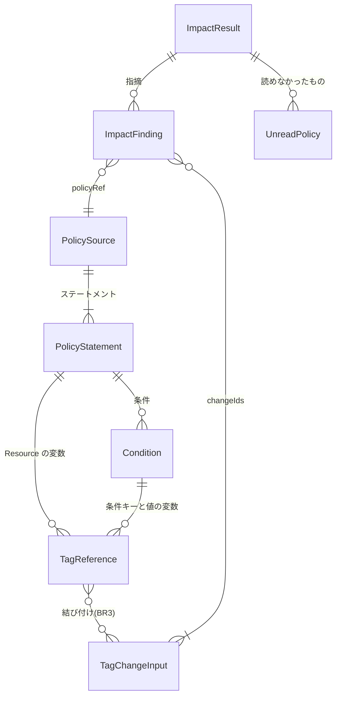

# 機能仕様: U5 影響分析

U5 は、U1 で作った影響分析の最小版を完成させます。IAM のインラインポリシーと、S3、KMS、SQS、SNS、Secrets Manager のリソースポリシーも読み、タグに関する条件キーのすべての種類と、条件の値や `Resource` の中のポリシー変数を、4種類の変更すべてについて照合します。結果は U4 の変更案にそのまま入り(U4 の規則 2.5)、影響のある変更に `!`、判定できない変更に `?` が付きます。この文書は流れの正本です。データの形は `entities.md`、判断の規則は `rules.md` が正本で、下の図と表はそこから作ったものです。

出典: 要件 FR4.1〜FR4.7、FR3.8、NFR2、NFR3、CON3、ストーリー US3.2(AC3.2.1〜AC3.2.6)、契約 C2・C3・C9・C12、`functional-design-questions.md` Q1〜Q6、U1 の影響分析の規則 5.1〜5.6、U4 の規則 2.5〜2.7、3.10。

## U5 の範囲

| U5 で作る | U5 で作らない |
|---|---|
| IAM の管理ポリシー(U1)とインラインポリシー、5種類のリソースポリシーの読み込み | ロールの信頼ポリシー、AWS が管理するポリシー、SCP と RCP など(BR1.4、CON3) |
| `ResourceTag/`、`RequestTag/`、`PrincipalTag/`、`TagKeys` の照合と、ポリシー変数の照合 | `Resource` の ARN と変更のリソースの照合(Q3。IAM のポリシーはキーのすべての変更に結び付ける) |
| 4種類の変更(キー名の変更、値の変更、必須タグの追加、削除)の判定 | 影響の表示の形(U4 の一覧、差分、JSON、Markdown のまま) |
| 読めなかったポリシーの記録(リージョンつき) | apply での影響の扱い(U6) |
| README の読み取り用の IAM ポリシーの例と、影響分析で読むもの・読まないもの | |

## 契約への変更

| 契約 | 変更 | 理由 |
|---|---|---|
| C2、C3 | `unreadPolicies[]` に `policyRef`(1つのポリシーのとき、BR1.6 の形)と `region`(リソースポリシーのリージョン)を足す。どちらも省略できる。項目を足すだけなので `version` は 1 のまま | 読めなかったものを特定できるようにする(FR4.7)。U1 では部品の中にだけあった `policyRef` を、保存した変更案と JSON の出力にも書く |
| C2、C3 | `impactFindings[]` に `conditionOperator`(書いたままの演算子)を足す(省略できる。項目を足すだけなので `version` は 1 のまま) | 同じ条件キーで演算子だけが違う指摘を、保存した変更案と JSON の出力でも区別できるようにする(BR5.1) |
| C2 | `impactFindings[].policyRef` の説明に、インラインポリシーの形(`<ユーザー・ロール・グループの ARN>#<ポリシーの名前>`)を書き足す。`conditionKey` が `Resource` か `NotResource` のとき、`conditionOperator` は空で、`conditionValue` はそのすべての値を「, 」でつないだものとする | BR1.6、BR5.1 |
| C9 | シグネチャは変えない。影響分析の部品は、作るとき(`impact.New`)にポリシーを読む部品と変更案のリージョンを受け取る | 契約 C9 の U1 での改訂(読む部品は実装が持つ)と同じ考え方。Planner は AWS にもリージョンの決め方にも依存しない |

この表の C2・C3 の変更は、U6・U8 の設計が読めるよう、`inception/contract-design/contract-summary.md` の C2 にも書きました。

## 流れ W1: 影響分析(`Analyze`)

前提: U4 の plan が変更案を作り、変更が1件以上ある(U4 の規則 2.7)。

1. 変更が0件なら、何も読まずに「完全、指摘なし」を返す。
2. 変更の索引を作る: 変更のキー(BR4.1)を小文字にしたものから変更へ、リソースの ARN から変更へ、IAM のユーザーとロールの変更の一覧(BR3.3)。
3. ポリシーを、sourceKind の順(BR5.2)に読む。
   1. IAM の管理ポリシー(BR1.1)。一覧を読めなければ UnreadPolicy を1件にして次の種類へ。
   2. IAM のインラインポリシー(BR1.2)。ユーザー、ロール、グループの一覧のうち読めなかったものは、その一覧ごとに UnreadPolicy にし、読めた一覧は続ける。
   3. リソースポリシー(流れ W2)。
4. 読んだ文書ごとに(BR1.7 で JSON として読む。読めなければ BR1.5):
   1. ステートメントごとに、条件キー(BR2.1)、条件キーの中・条件の値の中の変数(BR2.4)、`Resource`・`NotResource` の中の変数(BR2.4)から、タグへの参照(TagReference)を作る。
   2. 参照ごとに、結び付ける候補の変更を決める(BR3.1〜BR3.3)。
   3. 候補の変更ごとに、判定する(BR4.1〜BR4.7)。結果は affected、undecided、影響なしのどれか。
   4. affected と undecided を、指摘のまとまり(BR5.1)に入れる。
   5. 文書は捨てる(覚えておくのは指摘だけ)。
5. 指摘と UnreadPolicy を BR5.2 の順に並べ、UnreadPolicy が1件でもあれば complete = false にして返す。
6. 途中で Ctrl+C などで止められたら、エラーを返す(BR5.4)。

## 流れ W2: リソースポリシーを読む(BR1.3)

| sourceKind | 探し方 | ポリシーの読み方 | 「ポリシーなし」の扱い |
|---|---|---|---|
| `s3Bucket` | バケットの一覧を1回読む(全リージョン分が、バケットのリージョンとともに返る。リージョンが無いバケットはバケットの場所を読む)。変更案のリージョンに入るバケットだけ | そのバケットのリージョンでバケットポリシーを読む | ポリシーが付いていないという答えは、ポリシーなし |
| `kmsKey` | リージョンごとにキーの一覧を読み、キーの情報で利用者が作ったキーだけを選ぶ | キーポリシー(名前は `default`)を読む | キーには必ずポリシーがある |
| `sqsQueue` | リージョンごとにキューの一覧を読む | キューの属性 `Policy` と `QueueArn` を読む | `Policy` がなければポリシーなし |
| `snsTopic` | リージョンごとにトピックの一覧を読む | トピックの属性 `Policy` を読む | `Policy` がなければポリシーなし |
| `secretsManagerSecret` | リージョンごとにシークレットの一覧を読む | シークレットのリソースポリシーを読む | 答えにポリシーがなければポリシーなし |

- 一覧はページが分かれていても最後まで読みます。一覧を読めなければ、その(sourceKind、リージョン)の UnreadPolicy を1件作り(S3 の一覧はリージョンなし)、ほかのリージョンと種類は続けます(BR1.5)。
- 1つのリソースのポリシーを読めなければ、そのリソースの ARN を policyRef にした UnreadPolicy を作ります。
- 呼ぶ操作はすべて読み取りです(BR5.3)。

## 判定の表(rules.md の BR4 から作った表)

参照の場所と変更の種類ごとの判定です。「キーが当てはまる」は BR4.1・BR2.2、「値を比べる」は BR4.7 です。

| 参照 | renameKey | removeKey | changeValue | addRequired |
|---|---|---|---|---|
| 条件キー(`ResourceTag/` など)、キーが当てはまる | affected(`aws:ResourceTag` で大文字・小文字だけの変更は影響なし) | affected | `Null` は影響なし。ほかは fromValue か toValue と値を比べ、当てはまれば affected、`${` かその他の演算子なら undecided、どちらでもなければ影響なし | `Null`、`IfExists` 付き、`ForAnyValue:`・`ForAllValues:` 付きは affected。ほかは toValue と値を比べる(changeValue と同じ) |
| 条件キーのタグのキーに `${` | undecided(`aws:ResourceTag` で大文字・小文字だけの変更は影響なし) | undecided | undecided | undecided |
| `TagKeys` | 否定の演算子か `ForAllValues:` なら affected。ほかは値が fromKey か toKey に当てはまれば affected | 値が fromKey に当てはまれば affected | 影響なし | 否定の演算子か `ForAllValues:` なら affected。ほかは値が toKey に当てはまれば affected |
| 変数(条件キーの中、条件の値の中、`Resource`・`NotResource` の中)、キーが当てはまる | affected(大文字・小文字だけの変更も) | affected | undecided | affected |

「`TagKeys`」と「条件キー」の行の「値を比べる」で当てはまらなかったときも、値に `${` があるかその他の演算子なら undecided です(BR4.4、BR4.5)。

結び付ける変更(BR3):

| ポリシー | `ResourceTag`、`RequestTag`、`TagKeys` | `PrincipalTag` |
|---|---|---|
| IAM(管理、インライン) | そのキーのすべての変更 | IAM のユーザーとロールの変更だけ |
| リソースポリシー | そのポリシーが付いたリソースの変更だけ | IAM のユーザーとロールの変更だけ |

## 表示の例

表示の形は U4 のままです。U5 で増えるのは、ポリシーの種類と参照の場所です(英語、一覧の形。抜粋)。

```text
Impact (3 affected, 1 undecided)
  ! arn:aws:iam::123456789012:role/app#allow-env   (iamInline)
      statement AllowEnv: StringEquals aws:ResourceTag/env = "prod"
      changes: c-000001, c-000002
  ! arn:aws:s3:::logs-bucket   (s3Bucket)
      statement DenyNonProd: StringNotEquals aws:ResourceTag/Stage = "Prod"
      changes: c-000007
  ! arn:aws:iam::123456789012:policy/team-data   (iamManaged)
      statement #0: Resource = "arn:aws:s3:::data/${aws:PrincipalTag/team}/*"
      changes: c-000012
  ? arn:aws:iam::123456789012:policy/abac   (iamManaged)
      statement Abac: StringEquals aws:ResourceTag/team = "${aws:PrincipalTag/team}"
      changes: c-000013
Impact analysis is incomplete: sqsQueue in eu-west-1: access denied to sqs:ListQueues
```

具体的な文言と日本語の表示はコード生成で U4 の表示の決まりに合わせて作ります。

## エンティティの関係(entities.md から作った図)



文字の図: 1つのポリシーは1つ以上のステートメントを持ち、ステートメントは条件を持つ。タグへの参照は、条件(条件キーと値の中の変数)か、ステートメントの `Resource`・`NotResource` の中の変数から作る。参照は規則 BR3 で変更に結び付く。結果は指摘と読めなかったものを持ち、指摘は1つのポリシーと、1つ以上の原因の変更を指す。

## 規則のまとめ(rules.md から作った表)

| グループ | 規則 |
|---|---|
| 読むポリシー | BR1.1 管理ポリシー、BR1.2 インラインポリシー、BR1.3 リソースポリシー、BR1.4 読まないもの、BR1.5 読めなかったとき、BR1.6 policyRef の形、BR1.7 文書の読み方 |
| 参照を見つける | BR2.1 条件キー、BR2.2 キーの比べ方、BR2.3 演算子の種類、BR2.4 ポリシー変数 |
| 結び付け | BR3.1 IAM のポリシー、BR3.2 リソースポリシー、BR3.3 `PrincipalTag` |
| 判定 | BR4.1 変更のキー、BR4.2 キー名の変更と削除、BR4.3 値の変更、BR4.4 必須タグの追加、BR4.5 `TagKeys`、BR4.6 キーの中の変数、BR4.7 値の比べ方 |
| 結果 | BR5.1 指摘のまとめ方、BR5.2 順、BR5.3 読み取りだけ、BR5.4 止められたとき |

## 検出率100%のテスト用の参照(NFR2、AC3.2.6)

テスト用のポリシーは、次の組み合わせをすべて含めます。どの組み合わせも、少なくとも1つの変更で affected か undecided になることを確かめ、1つでも見逃せばテストは失敗します。

- **ポリシーの種類(7):** `iamManaged`、`iamInline`(ユーザー、ロール、グループのそれぞれ)、`s3Bucket`、`kmsKey`、`sqsQueue`、`snsTopic`、`secretsManagerSecret`
- **参照(7):** `aws:ResourceTag/<キー>`、サービス固有の `<サービス>:ResourceTag/<キー>`、`aws:RequestTag/<キー>`、`aws:TagKeys`、`aws:PrincipalTag/<キー>`、条件キーの中の変数、条件の値か `Resource` の中の変数
- **変更(4):** キー名の変更、値の変更、削除、必須タグの追加(`TagKeys` と値の変更の組み合わせは、BR4.5 で影響なしが正しい答え)
- **演算子(8):** `StringEquals`、`StringNotEquals`、`StringEqualsIgnoreCase`、`StringLike`、`Null`、`IfExists` 付き、`ForAnyValue:`・`ForAllValues:` 付き、その他(例 `ArnLike`)。ポリシーの種類と参照の組み合わせのすべてに入れる必要はなく、演算子ごとに、4つの変更のそれぞれで期待する判定を表にする

検出したかどうかは、テスト用の参照ごとに期待する判定(affected、undecided、影響なし)を表にして比べます。結び付け(BR3)のテストのため、リソースポリシーの参照には、そのリソース自身の変更と、ほかのリソースの変更の両方を用意します。

## 業務の場面

| 場面 | 期待する結果 |
|---|---|
| 正常: ロールのインラインポリシーが `aws:ResourceTag/env` を使い、`env` を `Environment` に変える | そのポリシーが `!` で、ポリシー(`<ロールの ARN>#<名前>`)、ステートメント、条件とともに出る(AC3.2.1) |
| 正常: S3 のバケットポリシーが `aws:ResourceTag/Stage` の値 `Prod` を使い、そのバケットの `Prod` を `prod` に変える | バケットポリシーが `!` で出る(AC3.2.2) |
| 正常: 上と同じバケットポリシーで、別のバケットの `Stage` の値だけを変える | 影響なし(BR3.2) |
| 正常: `StringEqualsIgnoreCase` で値 `prod` の条件に、`Prod` を `PROD` に変える | `!`(BR4.7) |
| 正常: `StringEquals` で値 `dev` の条件に、`Prod` を `prod` に変える | 影響なし(BR4.3) |
| 正常: ポリシーの条件が `aws:ResourceTag/tmp` を使い、`tmp` を消す | `!`(AC3.2.3) |
| 正常: `Null` の条件 `aws:ResourceTag/Owner: true` に、必須タグ `Owner` を付ける | `!`(BR4.4) |
| 正常: `StringEqualsIfExists` で値 `dev` の条件に、必須タグ `env = prod` を付ける | `!`(タグが無いときは true、付いたあとは false。BR4.4) |
| 正常: `StringEquals` で値 `dev` の条件に、必須タグ `env = prod` を付ける | 影響なし(付ける前も後も false。BR4.4) |
| 正常: `ForAnyValue:StringNotEquals aws:TagKeys: [env, owner]` の拒否に、`env` を `Environment` に変える | `!`(許すキーの一覧に新しいキーが無い。BR4.5) |
| 正常: 権限の上限としてだけ使われる管理ポリシーが `aws:ResourceTag/env` を使う | 読まれ、`env` の変更で `!`(BR1.1) |
| 正常: リソースポリシーの条件キーが `aws:ResourceTag/${aws:PrincipalTag/k}` で、ロールの `k` を消す | `!`(条件キーの中の変数。BR2.4、BR3.3) |
| 正常: `aws:TagKeys` の値が `env` の条件に、`env` を `Environment` に変える | `!`(BR4.5) |
| 正常: `aws:PrincipalTag/team` の条件に、EC2 インスタンスの `team` だけを変える | 影響なし(BR3.3)。ロールの `team` を変えると `!` |
| 正常: `Resource` に `${aws:PrincipalTag/team}` があり、ロールの `team` を消す | `!`(conditionKey は `Resource`。BR4.2、BR5.1) |
| 正常: 条件の値が `${aws:PrincipalTag/team}` で、`team` の値だけを変える | `?`(BR4.3) |
| 正常: 条件キーが `aws:ResourceTag/${aws:PrincipalTag/k}` | 結び付けた変更はすべて `?`(AC3.2.4、BR4.6) |
| 正常: 条件キーが `aws:ResourceTag/env*` で、`environment` を変える | `!`(BR2.2) |
| 正常: 条件キーが `aws:ResourceTag/env*` で、`team` だけを変える | 影響なし(パターンが当てはまらないことは機械的に分かる。BR2.2) |
| 正常: `aws:ResourceTag/env` の条件に、`env` を `Env` に変える(大文字・小文字だけ) | 影響なし。`ec2:ResourceTag/env` なら `!`(BR4.2) |
| 正常: テスト用の参照のすべての組み合わせ | 期待する判定と100%一致する(AC3.2.6、NFR2) |
| 正常: バケットにポリシーが付いていない、キューに `Policy` の属性がない | 読めなかったことにはならず、影響分析は完全(BR1.3) |
| 正常: 衝突だけで変更がない | ポリシーを1つも読まない(U4 の規則 2.7) |
| 異常: `iam:GetAccountAuthorizationDetails` が拒否される | IAM の管理ポリシーとインラインポリシーが読めなかったものとして示され、「影響分析は不完全」、終了コード1。リソースポリシーの指摘は出る(AC3.2.5。U5 のチェックポイントで IAM の読み方を改めた。2026-10-28) |
| 異常: 1つのリージョンで `sqs:ListQueues` が拒否される | そのリージョンの SQS だけが読めなかったものになり、ほかのリージョンは続ける(BR1.5) |
| 異常: 1つのキーで `kms:GetKeyPolicy` が拒否される | そのキーの ARN が読めなかったものに出る(BR1.5、BR1.6) |
| 異常: ポリシーの文書が JSON として読めない | 「the policy document could not be parsed」で読めなかったものになる(BR1.5) |
| 異常: リソースポリシーの値に `%41` のような文字がある | そのまま読む(BR1.7) |
| 異常: 影響分析の途中で Ctrl+C | 途中の結果を出さずに止まる(BR5.4) |

## Assumptions & Open Questions

- 呼び出しの回数は、ユーザー・ロール・グループとリソースの数に比例して増えます(例: 1,000 のロールに2つずつインラインポリシーがあれば、2,000 回の読み込み)。同時に読む数、時間の目安、NFR1(10分)への影響は、NFR の要件と設計で決めます。
- **AC3.2.4 と FR4.5 の読み方:** FR4.5 は「ワイルドカードやポリシー変数を含むなど、影響があるかを機械的に判定できない条件」を `?` にするとし、AC3.2.4 は「ワイルドカードやポリシー変数を含む条件は `?`」としています。この設計では、ワイルドカード(`*`、`?`)は IAM と同じパターンとして機械的に当てはめられるため、当てはまれば `!`(`?` より強い印)、当てはまらなければ影響なしとします(U1 の規則 5.4 と同じ)。`?` にするのは、ポリシー変数と、文字列でない演算子など、実際に判定できないものです。どちらの場合も、影響があり得る条件が「影響なし」と表示されることはありません。AC3.2.4 のテストは、ポリシー変数の条件が `?`、ワイルドカードが当てはまる条件が `!` になることを確かめます。この読み方は、承認の場で確かめてください。[assumption]
- **権限の上限(permissions boundary):** 質問では扱っていませんが、ユーザーやロールに付く IAM のポリシーの一つとして読みます(BR1.1。呼ぶ操作は U1 と同じで、権限も増えません)。[assumption]
- 変更案のリージョンは、scan が調べようとしたすべてのリージョン(`Plan.regions`)です。scan で読めなかったリージョンは、影響分析でも一覧を読めず、読めなかったものになることがあります(結果は既に不完全です)。[assumption]
- `aws:ResourceTag` 以外の条件キー(`aws:RequestTag`、`aws:PrincipalTag`、サービス固有のキー)で、タグのキーの大文字・小文字を区別するかは、AWS のドキュメントで確かめられなかったため、見逃さない側(大文字・小文字だけの変更も影響あり)に倒しています。[assumption]
- README の影響分析の節(読むもの、読まないもの、`?` の意味)と、読み取り用の IAM ポリシーの例の更新はコード生成で行います(BR1.4、BR5.3)。
