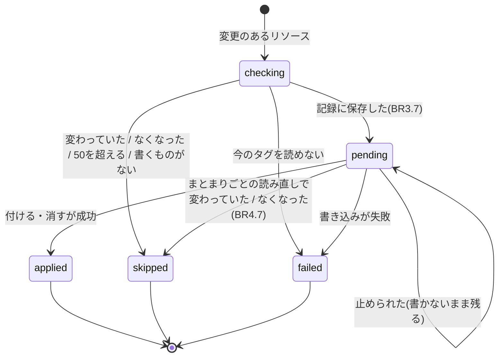
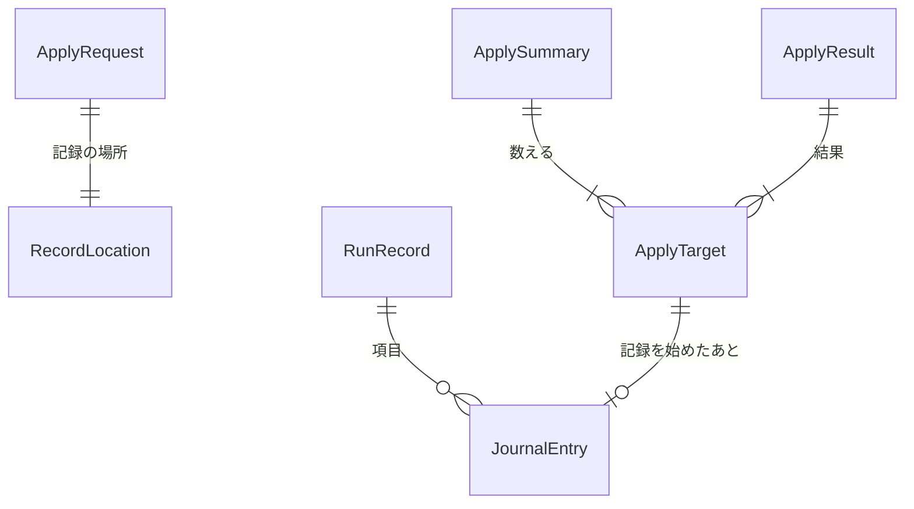

# 機能の仕様: U6 書き換えと記録

U6 は `apply` を作ります。変更案(保存したもの、またはその場で作ったもの)を確認してから、タグを書き換え、書き換えの前後の状態を記録します。本番のタグを書き換える最初の作業単位で、書き込みの権限を使うのは U6 と U7 だけです。この文書は、手順の流れと、リソースごとの状態の移り変わりの正本です。データの形は `entities.md`、判断の規則は `rules.md` が正本です。

出典: ストーリー US4.1・US4.2、要件 FR5.1〜FR5.11・NFR6・NFR7、契約 C2・C4・C5・C10・C12、`functional-design-questions.md` Q1〜Q9、U4 の規則 1.9・4.4。

## U6 の範囲

| U6 で作る | U6 で作らない |
|---|---|
| `apply` のサブコマンドと、確認、`--yes`、`--allow-impact`、`--record-to`、`--force-unlock` | `rollback`(U7)。U6 は U7 が読む記録を書き、取り消しのコマンドを示す |
| 書き込みの口 `TagWriter` の実装(タグを付ける、キーを消す) | IaC への反映(U8) |
| 書き換えの記録(Journal。手元のファイルと S3)と、同時実行を防ぐ印 | 書き込みの呼び出しをまとめる数、同時に書く数、記録を保存する頻度(NFR の設計で決める) |
| 書き換え前の変化の確かめ、`aws:` の保護、タグ数の上限 | |
| `apply` のヘルプ(U4 から引き継いだ AC6.1.1 の `apply` の分) | |

## 契約への変更

| 契約 | 変更 | 理由 |
|---|---|---|
| C5 | `apply` のオプション名を確定する: `--plan`、`--rules`(どちらか1つが必須)、`--yes`、`--allow-impact`、`--record-to`、`--force-unlock`(新しく足す)、`--profile`、`--lang` | Q1、Q6。未決事項「オプション名の確定(apply、rollback)」の apply の分 |
| C4、C10 | 記録の既定の場所を `<ホーム>/.tag-refactor/runs/<accountId>/<runId>.json`、印を同じフォルダーの `.lock` に決める | Q4。未決事項 |
| C10 | S3 に記録するときは、S3 の条件付きの書き込みで `<前置き>/<accountId>/.lock` を印にし、手元の印も取る | Q5。未決事項 |
| C10 | 印の中身(作った時刻、ホスト名、プロセスID、runId、目的、アカウント、ツールの版)を決め、残った印は `--force-unlock` で人が外す。runId は印を取る前に作り、`Lock` に渡す(`Lock(accountId, location, purpose, runId)`。`Begin` はその runId を使う)。手元の印は `--record-to` に関係なく既定の場所に置く | Q6、BR3.1、BR5.4 |
| C6 | `ObjectStore` に `PutIfAbsent(uri, bytes)`(同じ名前がなければ作る。あれば Conflict)と `Delete(uri)` を足す。S3 の条件付きの書き込みの失敗(412 PreconditionFailed、409 ConditionalRequestConflict)は Conflict に、対応しない答え(501 NotImplemented)は StorageFailed にする | Q5、BR3.1、BR5.2 |
| C4 | 注を足す: U7 は status に関係なく、`touchedKeys` が空でない項目を表で判定する(`failed` の一部だけ書いた項目と、結果が分からず `pending` のまま残った項目を含む)。書いていない項目の `touchedKeys` は空 | BR4.2、BR3.7 |

rollback(U7)の `--record-from`、`--force-unlock` の名前は U7 の機能設計で決めますが、印の場所と中身は U6 と同じものを使います。

## 流れ W1: apply

1. **入力を確かめる(BR1.1):** `--plan` と `--rules` のどちらか1つだけがあることを確かめます。`--record-to` の形も確かめます(BR5.2)。
2. **アカウントを確かめる(AwsAccess の Resolve):** 認証情報の誤りなら U1 のとおりに案内して終えます。
3. **変更案を用意する:** `--plan` なら U4 の部品で読み(BR1.2)、アカウントが違えば止めます。`--rules` なら plan と同じ手順でその場で作ります(BR1.3)。
4. **変更があるかを見る(BR1.4):** 変更が1つもなければ「書き換えるものはない」と示し、衝突と値が未指定の必須タグがあればその件数も示して終えます(あれば終了コード 2、なければ 0)。
5. **端末と `--yes` を見る(BR2.3):** 標準入力が端末でなく `--yes` もなければ止めます(終了コード 1)。
6. **`--yes` だけで影響があるかを見る(BR2.5):** `--yes` だけで、影響のある変更(影響分析が不完全な場合を含む)があれば止めます(終了コード 2)。`--yes` なしの `--allow-impact` には案内を出します(BR2.7)。
7. **印を取る(BR3.1、BR3.2):** runId を作り(BR5.4)、手元の既定の場所の印を取り、S3 に記録するときは S3 の印も取ります。印があれば、その中身を示して止めます。`--force-unlock` があれば、その印を外してから取り直します。ここから先は、どの終わり方でも印を消してから終えます(BR3.8)。
8. **確認する(BR2.1、BR2.2):** 要約を示します。`--yes` がなければ `yes` の入力を待ちます。`yes` 以外(入力待ちの Ctrl+C を含む)なら印を消して終えます(終了コード 0。記録は作りません)。
9. **今のタグを読む(BR3.3):** 変更のあるすべてのリソースの今のタグを読み、変わっていたリソース、なくなったリソースを飛ばし、読めなかったリソースを失敗にします。
10. **書き換える内容を決める(BR3.4〜BR3.6):** 書き換え後に期待するタグ、付けるタグ、消すキーを求めます。`aws:` のキーを除き、50を超えるリソースを飛ばします。途中だけ50を超えるリソースは、消すのを先にする印を付けます。
11. **記録を始める(BR3.7):** 手順 7 の runId で記録を作り、書き換えるすべてのリソースを pending として、前後の状態と一緒に保存します(BR5.3)。飛ばしたものと失敗したものも理由つきで入れます(下の「記録の項目の値」)。保存に失敗したら、何も書き換えずに止めます。
12. **書き換える(BR4.7、BR4.1〜BR4.4):** 書き込みのまとまりごとに、書く直前に今のタグを読み直し、手順 9 から変わったリソースを飛ばします。リソースごとに、付けるタグを先に、消すキーを後に書きます(途中だけ50を超えるリソースは逆)。失敗しても次に進みます(認証情報の誤りと、一時的な失敗が10件続いたときは止めます)。書き換えたら読み戻し、結果を途中でも記録に保存します。進み具合は ProgressSink に知らせます(契約 C11)。
13. **終える(BR4.6、BR4.5):** すべて終えたら記録を完了にし、印を消します。止められた場合は、動いている呼び出しを待って結果を保存し、記録を未完了のまま印を消します。
14. **結果を示す(BR6.1〜BR6.3、BR5.5):** 書き換えた件数、飛ばしたものと失敗したものの一覧、ログファイル、取り消しのコマンドを示し、終了コード(BR6.2)で終えます。

印を取るのを確認の前(手順 7)にしているのは、別の apply や rollback が動いているときに、確認の入力をさせてから止めることを避けるためです。今のタグを読むのを確認のあと(手順 9)にしているのは、人が確認している間の変化も確かめられるようにするためです。

## 流れ W2: 今のタグの読み方と比べ方(BR3.3)

1. 変更のあるリソースを、タグの API を呼ぶリージョンごとに分けます(グローバルなリソースは、変更案の `region` のリージョン)。
2. リージョンごとに、リソースの ARN を指定して今のタグを読みます(読み方の API とまとめる数は NFR の設計で決めます)。
3. 答えに含まれないリソースは「なくなった」(`resourceNotFound`)として飛ばします。
4. 答えのタグと変更案の `beforeTags` の両方から `aws:` で始まるキーを除き、キーの集まりと値がすべて同じかを比べます。1つでも違えば `changedSincePlan` として飛ばします。
5. 同じなら、答えのタグ(`aws:` を含む)を `currentTags` にし、以降の計算と記録の `beforeTags` に使います。

## 状態 S1: リソースごとの状態(ApplyTarget.status)



文章での説明: 変更のあるリソースは、まず今のタグを読んで確かめます(checking。記録には現れない、apply の中だけの状態)。飛ばすもの(`skipped`)と読めないもの(`failed`)は、そのまま記録に入ります。書き換えるものは `pending` として記録に保存してから書き換え、成功すれば `applied`、失敗すれば `failed` になります。止められたときにまだ書いていないものは `pending` のまま残り、U7 が契約 C4 の表で判定します。

| 状態 | 記録の status | reason | 終了コードへの影響 |
|---|---|---|---|
| 変わっていた | skipped | changedSincePlan | 2 |
| なくなった | skipped | resourceNotFound | 2 |
| 50を超える | skipped | tagLimitExceeded | 2 |
| 書くものがない | (記録に入れない) | nothingToWrite | なし |
| 今のタグを読めない | failed | readFailed | 1 |
| 書き込みの失敗(何も書いていない) | failed | writeFailed(と誤りの種類) | 1 |
| 書き込みの失敗(付ける・消すの片方だけ書いた) | failed | partialWrite(と誤りの種類) | 1 |
| 書き込みの結果が分からない(時間切れ、接続の切断) | pending | resultUnknown | 1 |
| 書き換えた | applied | (読み戻せなかったときだけ注記) | なし |
| 止められて書いていない | pending | interrupted(結果の表示だけ) | 1 |

## 記録の項目の値(BR3.7、BR4.2。契約 C4 の必須項目)

| 項目の種類 | status | touchedKeys | beforeTags | plannedAfterTags | afterTags |
|---|---|---|---|---|---|
| 書き換える(書く前) | pending | 付ける・消すキー | 手順 9 で読んだ今のタグ | 期待するタグ | なし |
| 書き換えた | applied | 同上 | 同上 | 同上 | 読み戻したタグ(読めた場合) |
| 何も書いていない失敗 | failed | 同上 | 同上 | 同上 | なし |
| 一部だけ書いた失敗 | failed | 同上 | 同上 | 同上 | 読み戻したタグ(読めた場合) |
| 結果が分からない | pending | 同上 | 同上 | 同上 | 読み戻したタグ(読めた場合) |
| 変わっていた、50を超える | skipped | 空 | 手順 9(または読み直し)で読んだ今のタグ | beforeTags と同じ | なし |
| なくなった、読めなかった | skipped / failed | 空 | 変更案の beforeTags | 変更案の beforeTags | なし |

U7 は status に関係なく、`touchedKeys` が空でない項目を契約 C4 の表で判定します。そのため、一部だけ書いた項目や結果が分からない項目も、今のタグと `beforeTags`・`plannedAfterTags` を比べて正しく戻せます。何も書いていない失敗は、今のタグが `beforeTags` と同じなので、U7 では `alreadyRestored` になります。`touchedKeys` が空の項目は、U7 は何もしません。

## 状態 S2: 実行全体の状態

| 段階 | 印 | 記録 | 止まったときに残るもの |
|---|---|---|---|
| 手順 1〜6 | なし | なし | なし |
| 手順 7〜8(確認まで) | あり | なし | なし(どの終わり方でも印を消す。BR3.8。強制終了のときだけ印が残り、BR3.2 で外す) |
| 手順 9〜10 | あり | なし | なし(同上) |
| 手順 11〜12 | あり | completed: false | pending を含む記録(U7 で取り消せる)。強制終了のときは印も |
| 手順 13 のあと | なし | completed: true | 記録 |

## 書き換え後に期待するタグの例(BR3.4、U4 の規則 1.9)

| 今のタグ | 変更(この順) | 期待するタグ | 付けるタグ | 消すキー |
|---|---|---|---|---|
| `env=Prod` | renameKey `env`→`Environment`、changeValue `Environment`: `Prod`→`prod` | `Environment=prod` | `Environment=prod` | `env` |
| `env=Prod`、`Environment=prod` | renameKey `env`→`Environment`(既にあるキーに合わせる) | `Environment=prod` | なし | `env` |
| `Team=a`、`aws:cloudformation:stack-name=x` | addRequired `CostCenter=100` | `Team=a`、`CostCenter=100`、`aws:...=x` | `CostCenter=100` | なし |
| `aws:` を除いて50個(`env=Prod` を含む) | renameKey `env`→`Environment` | 50個(`Environment=Prod`、`env` なし) | `Environment=Prod` | `env`(付けると途中で51個になるため、消すのを先に書く。BR3.6) |

1行目では、途中の値(`Environment=Prod`)を書かずに最終の値を直接書きます。そのため、付けたあと消す前に止まっても、各キーは書き換え前か書き換え後のどちらかの値になり、U7 は契約 C4 の表の2行目として戻せます。

## 確認画面の例(日本語、`--lang ja`)

```text
アカウント 123456789012 · 17 リージョン · 変更案 plan-20261019T120400Z-1a2b(2026-10-19T12:04:00Z に作成)

変更するリソース: 5,341
  キー名の変更   2,950
  値の変更       1,204
  必須タグの追加 1,187
  キーの削除        12

! 影響あり(2)
  ! arn:aws:iam::123456789012:policy/DevAccess  AllowDev  aws:ResourceTag/env  (env → Environment)
  ? arn:aws:s3:::logs-bucket  DenyOthers  aws:ResourceTag/team  判定できない
⚠ IaC で管理されているリソース: 41(IaC の定義とずれます。次のデプロイで元に戻ることがあります)
記録: C:\Users\sato\.tag-refactor\runs\123456789012\

書き換えるには yes と入力してください:
```

## エンティティの関係(entities.md から作った図)



文章での説明: apply の指定(ApplyRequest)は記録の場所(RecordLocation)を1つ持ちます。確認画面の要約(ApplySummary)と結果(ApplyResult)は、リソースごとの作業の状態(ApplyTarget)から数えます。記録(RunRecord)は項目(JournalEntry)を持ち、記録を始めたあとの ApplyTarget は1つの項目になります。

## 規則のまとめ(rules.md から作った表)

| グループ | 規則 | 要点 |
|---|---|---|
| 1. 入力と前の確かめ | BR1.1〜BR1.5 | `--plan` か `--rules` の1つ、アカウントの一致、変更なしなら何もしない、不完全は警告して許す |
| 2. 確認 | BR2.1〜BR2.7 | 要約と影響の表示、`yes` だけで進む、端末でなければ止める、`--yes` と `--allow-impact` の組み合わせ |
| 3. 書き換えの準備 | BR3.1〜BR3.8 | 印、残った印、変化の確かめ、期待するタグ、`aws:` の保護、50の上限(途中の数を含む)、書く前の記録、どの終わり方でも印を消す |
| 4. 書き換え | BR4.1〜BR4.7 | 付けるのが先(例外あり)、失敗の3つの区別、読み戻し、途中の保存、止められたとき、完了、まとまりごとの読み直し |
| 5. 記録 | BR5.1〜BR5.5 | 既定の場所、S3、壊れない保存、runId、ログファイル |
| 6. 結果 | BR6.1〜BR6.4 | 件数と一覧、終了コード、取り消しのコマンド、ヘルプ |

## 業務の場面

| 場面 | 結果 |
|---|---|
| 正常: 保存した変更案で `apply`、`yes` と入力 | 変更案どおりに書き換わり、記録が完了し、取り消しのコマンドが出る。終了コード 0(AC4.1.2、AC4.1.7) |
| 正常: 確認で `no` と入力 | 何も書き換えず、記録も作らない。終了コード 0(AC4.1.1) |
| 正常: 影響のない変更だけで `--yes` | 入力なしで書き換わる(AC4.1.3) |
| 正常: 影響のある変更で `--yes` なし | 確認画面に `!` と `?` が文字つきで出る。`yes` で書き換わる(AC4.1.4) |
| 異常: 影響のある変更で `--yes` だけ | 何も書き換えず、終了コード 2(AC4.1.5) |
| 正常: 影響のある変更で `--yes --allow-impact` | 書き換わる(AC4.1.6) |
| 異常: 変更案の保存後に1つのリソースのタグを手で変えた | そのリソースは飛ばされ、最後の一覧に「変更案の作成後に変わった」と出る。残りは書き換わる。終了コード 2(AC4.2.1) |
| 異常: 書き換える権限のないリソースが混ざる | 残りは書き換わり、成功と失敗の件数と一覧が出て、ログファイルに詳細が残る。終了コード 1(AC4.2.2) |
| 正常: 最初の書き込みの前 | 記録に、書き換えるすべてのリソースが pending と前後の状態つきで保存されている。`--record-to s3://...` なら S3 に(AC4.2.3) |
| 正常: 変更案に `aws:` のキーへの変更が混ざっていた | `aws:` のキーは書き換えず、警告が出る(AC4.2.4) |
| 異常: 書き換えると51個になるリソース | 書き換えずに「タグ数の上限(50)を超える」と一覧に出る。終了コード 2(AC4.2.5) |
| 正常: 50個ちょうどのリソースでキー名を変える(最終も50個) | 消すのを先に書くため、途中で上限を超えずに書き換わる(BR3.6) |
| 異常: 付けるのは成功し、消すのが権限不足で失敗 | 一部だけ書いた失敗として一覧に出て、読み戻したタグが記録に残る。U7 で戻せる。終了コード 1 |
| 異常: 書き込みが時間切れで、AWS が書いたか分からない | 結果が分からないものとして一覧に出て、記録では pending のまま。U7 が今のタグで判定する。終了コード 1 |
| 異常: 書き換えの途中で、ほかの人が別のリソースのタグを変えた | 書く直前の読み直しで変化が分かり、そのリソースは飛ばされる。終了コード 2 |
| 異常: 記録の保存中に強制終了 | 記録のファイルは前の版か新しい版のどちらかで、壊れていない(AC4.2.6) |
| 異常: 同じアカウントで2つの `apply` を同時に実行 | 後から始めた方は印を見て止まり(終了コード 1)、先の方の記録は壊れない(AC4.2.7) |
| 異常: 強制終了で印が残った | 次の `apply` は印の中身を示して止まる。`--force-unlock` で外して進める |
| 異常: 変更案のアカウントと今のアカウントが違う | 何も書き換えず、両方のアカウントを示して終了コード 1 |
| 異常: パイプから実行し `--yes` なし | 確認を求めずに止まり、`--yes` を案内する。終了コード 1 |
| 異常: 書き換えの途中で Ctrl+C | 動いている呼び出しを待って記録を保存し、記録は未完了、取り消しのコマンドが出る。終了コード 1 |
| 異常: 書き換えの途中で認証情報が切れた | 新しい書き込みを止め、Ctrl+C と同じに終え、認証情報の案内を出す。終了コード 1 |
| 異常: 記録を保存できない(ディスクがいっぱいなど) | 書き換えの前なら何も書き換えない。途中なら新しい書き込みを止める。終了コード 1 |

## Assumptions & Open Questions

- `--record-to` に `s3://` で始まらない値を指定したときは、手元のフォルダーとして扱い、記録をそのフォルダーの `<accountId>/` の下に置く(BR5.2)。印とログファイルは既定の場所に置く。[assumption]
- AC4.1.7 の「表示されたコマンドで rollback できる」の後半は、rollback を作る U7 の受け入れ条件のテストで確かめる。U6 では、取り消しのコマンドが示されることと、U7 が読む記録(契約 C4)が書かれていることを確かめる。[assumption]
- 今のタグを全件読む手順 9 と書き込みの間の変化は、書き込みのまとまりごとの読み直し(BR4.7)で見つける。読み直しから書き込みまでのわずかな間(1つのまとまりを書く時間)に変えられたタグは上書きしうる。タグの API には「今の値がこれなら書く」という条件付きの書き込みがないため、この間は防げない。U7 は今のタグと記録を比べて、後から変えられたものを飛ばすので、取り消しで他人の変更を上書きすることはない。[assumption]
- 途中だけ50個を超えるリソースは消すのを先に書く(BR3.6)。消したあと付ける前に止まると、そのリソースは一時的に書き換え前のキーも後のキーもない状態になるが、各キーは `beforeTags` か `plannedAfterTags` のどちらかと同じなので、U7 は戻せる。[assumption]
- 書き換えの直後にタグを読み戻すと、タグの API の反映の遅れで古い値が返ることがある。そのため読み戻しの違いは失敗にせず、「確かめられなかった」として件数を示すだけにする(BR4.3)。[assumption]
- 今のタグを読む API、書き込みの呼び出しをまとめる数(1回の呼び出しで最大20個のリソース)、同時に書く数、記録を保存する頻度、10,000件の apply の時間の目標は、NFR の要件と設計で決める。
- AC6.1.1(5つのサブコマンドのヘルプ)のうち、`apply` のヘルプを U6 で確かめる(U4 の機能設計からの引き継ぎ。BR6.4)。
