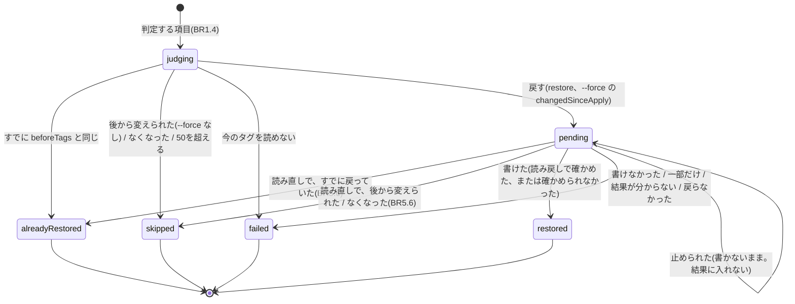
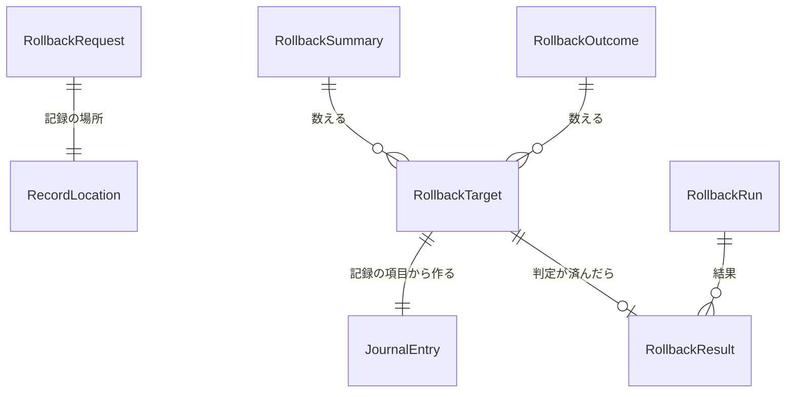

# 機能の仕様: U7 取り消し

U7 は `rollback` を作ります。U6 の `apply` が残した記録をもとに、その実行で書き換えたタグを、書き換える前の状態に戻します。書き込みの権限を使うのは U6 と U7 だけです。この文書は、手順の流れと、項目ごとの状態の移り変わりの正本です。データの形は `entities.md`、判断の規則は `rules.md` が正本です。

出典: ストーリー US5.1、要件 FR6.1〜FR6.5・NFR4、契約 C4・C5・C10・C12、`functional-design-questions.md` Q1〜Q9、U6 の機能設計(記録の項目の値、印、書き込みの順番、止め方)。

## U7 の範囲

| U7 で作る | U7 で作らない |
|---|---|
| `rollback` のサブコマンドと、確認、`--force`、`--yes`、`--record-from`、`--force-unlock` | IaC への反映(U8) |
| 記録の読み込みと、項目ごとの判定(契約 C4 の表) | 書き込みの口、記録の保存、印の仕組み(U6 で作ったものを使う) |
| 書き戻しと読み戻し、結果の記録(`rollbacks`) | 書き込みの呼び出しをまとめる数、同時に書く数、保存の頻度(U6 の NFR の設計のまま使うかを、U7 の NFR の設計で決める) |
| `rollback` のヘルプ(U4 から引き継いだ AC6.1.1 の `rollback` の分) | |

## 契約への変更

| 契約 | 変更 | 理由 |
|---|---|---|
| C5 | `rollback` のオプション名を確定する: `--run`(必須)、`--force`、`--record-from`、`--yes`、`--force-unlock`(新しく足す)、`--profile`、`--lang` | Q1。未決事項「オプション名の確定(apply、rollback)」の rollback の分 |
| C10 | rollback の結果を記録する3つの呼び出しを定める: `BeginRollback(LockHandle, runId, rollbackId, startedAt)`(completed false の RollbackRun を足す)、`RecordRollbackResults(LockHandle, runId, rollbackId, []result)`(ARN を鍵に結果を足すか置き換える)、`CompleteRollback(LockHandle, runId, rollbackId)`(completed を true にする)。どれも、印を取ったあとに読んだ記録を知らない項目ごと持ち、自分の rollbackId の RollbackRun だけを変え、`entries`・`completed`・ほかの RollbackRun・知らない項目を残す(印を持っている間はほかの書き手がいないので、保存のたびには読み直さない)。これまでの `RecordRollback` はこの3つに置き換える | BR5.4、BR6.1、BR6.2、レビュー1回目 |
| C4 | `rollbacks[].results[].reason` の値を決める: skipped は `changedSinceApply`・`resourceNotFound`・`tagLimitExceeded`、failed は `readFailed`・`writeFailed`・`partialWrite`・`resultUnknown`・`notRestored`、restored で読み戻しで確かめられなかったものは `notConfirmed` | BR5.2、BR5.3。reason は自由な文字列の項目なので、`version` は上げない |
| C4 | 注を足す: 判定する項目は `touchedKeys` が空でなく status が `skipped` でないもの。rollback は apply の `entries` と `completed` を変えない。途中で止めた rollback は `completed: false` で残り、もう一度 rollback すると戻した項目は `alreadyRestored` になる | BR1.4、BR5.5、BR6.1 |
| C10 | rollback の印の runId には rollbackId を書く(印の中身の目的は `rollback`)。rollback は記録を読む前に印を取る | BR2.1、BR6.3 |

apply が示す取り消しのコマンド(`--record-to` を指定した場合は `--record-from`、`--profile` を指定した場合は `--profile` を含む)は U6 で実装済みで(U6 の規則 6.3)、U7 では変えません。U7 は、そのコマンドで記録を見つけられることを確かめます(BR7.4)。

## 流れ W1: rollback

1. **入力を確かめる(BR1.1):** `--run` があり、runId の形であることを確かめます。`--record-from` の形も確かめます。
2. **アカウントを確かめる(AwsAccess の Resolve):** 認証情報の誤りなら U1 のとおりに案内して終えます。
3. **印を取る(BR2.1、BR2.2):** rollbackId を作り(BR6.3)、手元の既定の場所の印を取り、記録の場所(`--record-from`)が S3 なら S3 の印も取ります。印があれば、その中身を示して止めます。`--force-unlock` があれば、その印を外してから取り直します。ここから先は、どの終わり方でも印を消してから終えます(BR2.3)。
4. **記録を読む(BR1.2、BR1.3):** `--record-from` の場所(なければ手元の既定の場所)から記録を読み、版を確かめ、記録のアカウントと実行IDが今の指定と同じか、`touchedKeys` に `aws:` のキーがないかを確かめます。記録がない、読めない、違うときは、何も戻さずに止めます。
5. **判定する項目を選ぶ(BR1.4):** `touchedKeys` が空でなく status が `skipped` でない項目を選びます。1つもなければ「取り消すものはない」と示し、記録を変えずに終えます(終了コード 0)。
6. **今のタグを読んで判定する(BR3.1〜BR3.6):** 判定する項目の今のタグを読み、項目ごとに `alreadyRestored`・`restore`・`changedSinceApply`・`gone`・`unknown`(読めない)を決めます。戻す項目について、付けるタグと消すキーを求め、50を超えるかを確かめます。
7. **書き戻すものがあるかを見る(BR4.5):** 戻す項目がなければ(`--force` で上書きする項目もなければ)、確認を求めずに(端末でなくても)結果を記録に足し(completed: true)、結果を示して終えます。
8. **端末と `--yes` を見る(BR4.3):** 確認が要るのに、標準入力が端末でなく `--yes` もなければ、記録を変えずに止めます(終了コード 1)。
9. **確認する(BR4.1、BR4.2、BR4.4):** 要約を示します(すでに取り消し済みの記録なら警告も)。`--yes` がなければ `yes` の入力を待ちます。`yes` 以外なら、何も戻さず記録も変えずに印を消して終えます(終了コード 0)。
10. **結果の記録を始める(BR5.4、BR6.1):** `BeginRollback` で、記録の `rollbacks` に completed: false の RollbackRun を足して保存します。保存に失敗したら、何も戻さずに止めます。
11. **書き戻す(BR5.6、BR5.1〜BR5.4):** 書き込みのまとまりごとに、書く直前に今のタグを読み直して判定し直します。項目ごとに、付けるタグを先に、消すキーを後に書きます(途中だけ50を超える項目は逆)。失敗しても次に進みます(認証情報の誤りと、一時的な失敗で終わった呼び出しが10回続いたときは止めます)。書いたら読み戻し、結果を途中でも `RecordRollbackResults` で保存します。進み具合は ProgressSink に知らせます(契約 C11)。
12. **終える(BR6.2、BR5.5):** すべて終えたら `CompleteRollback` で completed にし、印を消します。止められた場合は、動いている呼び出しを待って(2回目の Ctrl+C なら取り消して)結果を保存し、completed: false のまま印を消します。
13. **結果を示す(BR7.1、BR7.2、BR6.4):** 戻した・飛ばした・失敗した・すでに戻っていた件数、一覧、ログファイル、必要なら上書きのコマンドともう一度 rollback するコマンドを示し、終了コード(BR7.2)で終えます。

印を取るのを記録を読む前(手順 3)にしているのは、印を取るまでの間に動いている apply や別の rollback が記録を変えると、古い記録で判定したり、古い記録に結果を足して保存したりして、他人の変更を上書きしたり記録を壊したりするためです。印を持っている間は、同じアカウントの apply と別の rollback は記録もタグも変えません。そのため、記録がない、アカウントが違うといった誤りも、印を取ってから示します(印はどの終わり方でも消します)。端末の確かめ(手順 8)を判定のあとにしているのは、戻すものがない場合(2回目の rollback など)には、パイプから `--yes` なしで実行しても止めずに結果を残すためです。

### 記録を変える場合と変えない場合

| 場合 | 記録の `rollbacks` | 理由 |
|---|---|---|
| 判定する項目がない(BR1.4) | 変えない | apply が何も書いていない記録で、残す結果がない |
| 判定したが戻すものがない(BR4.5) | completed: true の RollbackRun を足す | 「戻っていた」「後から変えられていた」という判定に意味がある |
| 確認で `yes` 以外、端末でなく `--yes` もない、記録・アカウント・印の誤り | 変えない | 何もしていない |
| 戻した(最後まで) | completed: true の RollbackRun を足す | 結果 |
| 戻す途中で止められた、保存の失敗 | completed: false の RollbackRun が残る | もう一度の rollback で残りを戻せる |

## 判定の例(BR3.2。`touchedKeys` が `env` と `Environment` の項目)

apply で `env=Prod` を `Environment=prod` に変えた項目です(`beforeTags` は `env=Prod`、`plannedAfterTags` は `Environment=prod`)。

| 今のタグ(`touchedKeys` の分) | 判定 | 戻す動き |
|---|---|---|
| `Environment=prod`(`env` なし) | restore | `env=Prod` を付け、`Environment` を消す |
| `env=Prod`、`Environment=prod`(付けたあと消す前に止まった) | restore | `Environment` を消す |
| `env=Prod`(`Environment` なし) | alreadyRestored | 何もしない |
| `Environment=staging` | changedSinceApply | 飛ばす。`--force` なら `env=Prod` を付け、`Environment` を消す |
| どちらもない(消したあと付ける前に止まった、または他人が消した) | restore | `env=Prod` を付ける(どちらのキーも `beforeTags` か `plannedAfterTags` と同じ「ない」状態のため) |

最後の行は、apply が消すのを先にした場合(U6 の規則 3.6)の途中の状態と、他人が両方のキーを消した場合を区別できません。どちらも `touchedKeys` の各キーが `beforeTags` か `plannedAfterTags` のどちらかと同じなので、契約 C4 の表のとおり戻します。

## 状態 S1: 項目ごとの状態(RollbackTarget.status)



文章での説明: 判定する項目は、最初の判定で「すでに戻っている」「飛ばす」「失敗(読めない)」「戻す(pending)」のどれかになります。pending の項目は、書く直前の読み直しで「すでに戻っている」「飛ばす」に変わることがあり、書いたあとは「戻した」か「失敗」になります。止められて書かなかった pending の項目は、結果に入れません(もう一度 rollback すれば判定し直されます)。

| 状態 | 結果の status | reason | 終了コードへの影響 |
|---|---|---|---|
| すでに戻っている | alreadyRestored | なし | なし |
| 後から変えられた(`--force` なし) | skipped | changedSinceApply | 2 |
| なくなった | skipped | resourceNotFound | 2 |
| 戻すと50を超える | skipped | tagLimitExceeded | 2 |
| 今のタグを読めない | failed | readFailed | 1 |
| 書けなかった(何も書いていない) | failed | writeFailed | 1 |
| 一部だけ書いた | failed | partialWrite | 1 |
| 結果が分からない | failed | resultUnknown | 1 |
| 読み戻したら戻っていなかった | failed | notRestored | 1 |
| 戻した(読み戻しで確かめた) | restored | なし | なし |
| 戻した(読み戻せなかった) | restored | notConfirmed | なし(件数を示す) |
| 止められて書いていない | (結果に入れない) | なし | 1(止められたため) |

## 状態 S2: 実行全体の状態

| 段階 | 印 | 記録の rollbacks | 止まったときに残るもの |
|---|---|---|---|
| 手順 1〜2 | なし | 変えない | なし |
| 手順 3〜9(確認まで) | あり | 変えない(手順 7 で戻すものがなければ completed: true の RollbackRun を足して終える) | なし(どの終わり方でも印を消す。BR2.3。強制終了のときだけ印が残り、BR2.2 で外す) |
| 手順 10〜11 | あり | completed: false の RollbackRun | 途中までの結果。同じ `--run` でもう一度 rollback できる。強制終了のときは印も |
| 手順 12 のあと | なし | completed: true の RollbackRun | 結果 |

## 確認画面の例(日本語、`--lang ja`)

```text
アカウント 123456789012 の apply 20261019T211003Z-7f3a を取り消します
記録: /home/sato/.tag-refactor/runs/123456789012/20261019T211003Z-7f3a.json
! 途中で止まった apply の記録です。書き換えた分だけを戻します

  戻す                       118 件
  後から変えられた(飛ばす)     2 件   --force で上書きして戻せます
  すでに戻っている             3 件
  なくなった(飛ばす)           1 件

yes と入力すると戻します:
```

色がなくても、記号(`!`)と文字で意味が分かります。英語(`--lang en`)では同じ項目を英語で示します。

## エンティティの関係(entities.md から作った図)



文章での説明: rollback の指定(RollbackRequest)は記録の場所(RecordLocation)を1つ持ちます。判定する項目(RollbackTarget)は、記録の1つの項目(JournalEntry)から作ります。確認画面の要約(RollbackSummary)と結果(RollbackOutcome)は RollbackTarget から数えます。判定が済んだ RollbackTarget は、記録の rollbacks に足す RollbackRun の1つの結果(RollbackResult)になります。

## 規則のまとめ(rules.md から作った表)

| グループ | 規則 | 要点 |
|---|---|---|
| 1. 入力と記録 | BR1.1〜BR1.4 | `--run` は必須、記録の探し方、アカウントの一致、判定する項目 |
| 2. 印 | BR2.1〜BR2.3 | apply と同じ印、残った印は `--force-unlock`、どの終わり方でも印を消す |
| 3. 判定 | BR3.1〜BR3.6 | 今のタグを読む、`touchedKeys` だけの判定、後から変えられたものと `--force`、付けるタグと消すキー、50の上限、なくなったもの |
| 4. 確認 | BR4.1〜BR4.5 | 要約、`yes` だけで進む、端末でなければ止める、`--yes` と `--force`、戻すものがないとき |
| 5. 書き戻し | BR5.1〜BR5.6 | 付けるのが先、失敗の区別、読み戻し、途中の保存、止められたとき、まとまりごとの読み直し |
| 6. 記録 | BR6.1〜BR6.4 | 結果は `rollbacks` に足す、completed、rollbackId、ログファイル |
| 7. 結果 | BR7.1〜BR7.4 | 件数と一覧、終了コード、ヘルプ、apply の取り消しのコマンド |

## 業務の場面

| 場面 | 結果 |
|---|---|
| 正常: apply のあと別の変更なしで `rollback --run <id>`、`yes` と入力 | 対象のリソースのタグが apply の前と完全に一致する(差分0)。結果が記録に足される。終了コード 0(AC5.1.1、NFR4) |
| 正常: 確認で `no` と入力 | 何も戻さず、記録も変えない。終了コード 0(AC5.1.2) |
| 異常: apply のあと、1つのリソースのタグを手で変えた | そのリソースは飛ばされ、一覧に「apply のあとに変えられた」と出て、`--force` を付けたコマンドが示される。残りは戻る。終了コード 2(AC5.1.3) |
| 正常: 上と同じ状態で `--force` | そのリソースも記録した状態に戻る(`touchedKeys` のキーだけ。ほかのキーは触らない)。終了コード 0(AC5.1.4) |
| 正常: rollback が終わった | 戻した・飛ばした・失敗した件数が示される(AC5.1.5) |
| 正常: 強制終了した apply の記録で `--force-unlock` を付けて rollback | 書き換えた分だけが戻り、まだ書いていなかった項目は `alreadyRestored` になる(AC5.1.6、FR6.5) |
| 異常: 強制終了した apply の印が残ったまま rollback | 印の中身を示して止まり、`--force-unlock` を案内する。終了コード 1 |
| 正常: 同じ `--run` で2回目の rollback | すべて `alreadyRestored` になり、確認なしで結果が記録される。終了コード 0 |
| 正常: キー名の変更の途中で止まった apply(古いキーと新しいキーの両方がある) | 新しいキーを消して戻る |
| 異常: apply で `--record-to s3://...` を使ったのに `--record-from` なしで rollback | 記録が見つからず止まり、`--record-from` を案内する。終了コード 1 |
| 異常: 記録のアカウントと今のアカウントが違う | 何も戻さず、両方のアカウントを示して終了コード 1 |
| 異常: 戻す権限のないリソースが混ざる | 残りは戻り、失敗した件数と一覧が出て、ログファイルに詳細が残る。終了コード 1 |
| 異常: 戻す途中で Ctrl+C | 動いているまとまりを終えて結果を保存し(completed: false)、もう一度 rollback するコマンドが出る。終了コード 1 |
| 異常: 戻す途中で、ほかの人が別のリソースのタグを変えた | 書く直前の読み直しで変化が分かり、そのリソースは飛ばされる。終了コード 2 |
| 異常: apply のあと削除されたリソース | 飛ばされ、一覧に「なくなった」と出る。終了コード 2 |
| 異常: ほかの人がタグを足していて、戻すと51個になる | 戻さずに「タグ数の上限(50)を超える」と一覧に出る。終了コード 2 |
| 異常: パイプから実行し `--yes` なし | 確認を求めずに止まり、`--yes` を案内する。終了コード 1 |
| 正常: `--yes --force` | 確認なしで、後から変えられたリソースも上書きして戻す |

## Assumptions & Open Questions

- 記録の既定の場所は、今のアカウントのフォルダー(`<ホーム>/.tag-refactor/runs/<accountId>/`)なので、プロファイルを間違えると「記録がない」になる。そのときは、記録がないことと、使ったアカウントを示す(BR1.2)。[assumption]
- 判定の表の「どちらもない」の行(判定の例の最後の行)では、apply の途中の状態と、他人が両方のキーを消した場合を区別できない。契約 C4 の表のとおり戻す(他人が消したキーを付け直すことになる)。apply は付けるのを先にするため、このような状態になるのは消すのを先にした項目(途中だけ50を超える項目)と、他人が両方を消した場合に限られる。[assumption]
- 判定から書き込みまでのわずかな間(1つのまとまりを書く時間)に変えられたタグは上書きしうる。U6 と同じく、タグの API に条件付きの書き込みがないため防げない(U6 の機能設計の Assumptions と同じ)。[assumption]
- 書いた直後の読み戻しは、タグの API の反映の遅れで古い値が返ることがある。読み戻せなかったときは「確かめられなかった」として件数を示す。読み戻した値が違ったときは、上限つきで読み直してから `notRestored` として失敗にする(戻したことを確かめるのが rollback の目的のため)。読み直しの回数と間隔は NFR の設計で決める。反映の遅れだけなら、同じ `--run` でもう一度 rollback すれば `alreadyRestored` になる。[assumption]
- タグが1つもないリソースを、タグの API が答えに出すかは確かめていない。apply が最後のタグまで消したリソース(`plannedAfterTags` が `aws:` を除いて空)と、タグが1つもなかったリソースに apply で付けたリソース(`beforeTags` が `aws:` を除いて空。rollback で0個に戻る)の両方について、出さない場合に戻すべき項目を飛ばしたり、すでに戻った項目を「なくなった」にしたりしないよう、そのような項目は答えに出なくても今のタグを空として判定する(BR3.1、BR5.3)。`beforeTags` が空で答えに出ない項目は、本当に削除されていても `alreadyRestored` になる(戻すタグがないので害はない)。本当に削除されていれば、書き込みが NotFound になり `resourceNotFound` で飛ばす(BR5.2)。答えに出るかどうかは、U7 の検証用アカウントでの確かめに入れる。[assumption]
- rollback は、印を取ったあとに読んだ記録をメモリに持って書き戻す(BR6.1)。`--force-unlock` で動いている apply や rollback の印を外して同時に動かすと、どちらかの結果が記録から失われうる。U6 の `--force-unlock` と同じ限界として README に書く。[assumption]
- 判定は今のタグと記録だけで行うため、rollback で戻したあとに同じ変更をもう一度 apply し、そのあと古い記録で rollback をもう一度実行すると、新しい apply の書き換えも戻す(同じ値は区別できない)。仕様として許し、記録にすでに完了した rollback があるときは、確認画面で警告する(BR4.1)。[assumption]
- IAM のロールと一度もタグのないリソースは、U6 のチェックポイントで分かったとおり scan で集まらず、apply の記録に入らないため、rollback の対象にもならない。
- 書き込みをまとめる数、同時に書く数、記録を保存する頻度、10,000件の rollback の時間の目標は、NFR の要件と設計で決める(U6 の部品をそのまま使うかを含む)。
- AC6.1.1(5つのサブコマンドのヘルプ)のうち、`rollback` のヘルプを U7 で確かめる(U4 の機能設計からの引き継ぎ。BR7.3)。AC6.1.2〜AC6.1.5 は、U4 の表示の部品を使うことで満たす。
