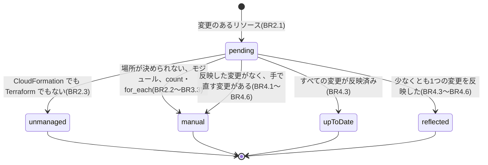
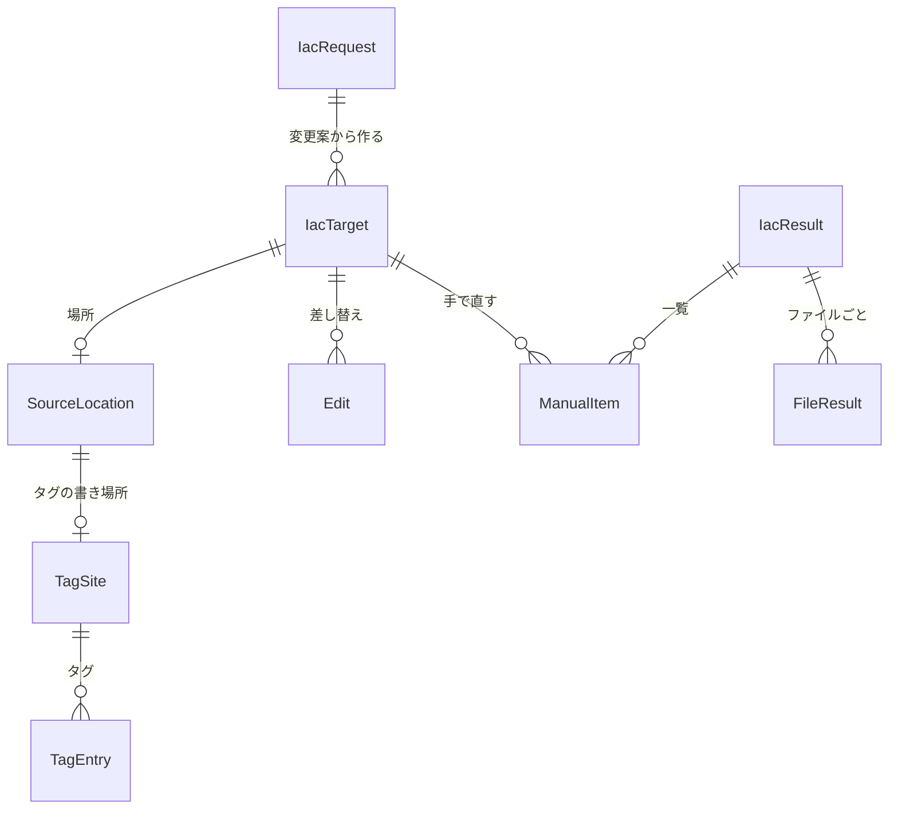

# 機能の仕様: U8 IaC への反映

U8 は `iac` を作ります。変更案(`plan --out` の JSON)の変更を、Terraform の設定と CloudFormation のテンプレートに反映します。apply で AWS のタグを変えても IaC のソースが古いままだと、次に IaC を適用したときにタグが元に戻るため、ソースも同じ変更にそろえます。`iac` は AWS を呼ばず、`terraform` も CloudFormation のスタックの更新も実行しません。この文書は、手順の流れと、リソースごとの状態の移り変わりの正本です。データの形は `entities.md`、判断の規則は `rules.md` が正本です。

出典: ストーリー US7.1(AC7.1.1、AC7.1.2)、要件 FR8.1・FR8.2・AS7・OQ3、契約 C2・C5・C12、`functional-design-questions.md` Q1〜Q9、U4 の機能設計(変更案の形、読み込み、`mergesIntoExisting`)。

## U8 の範囲

| U8 で作る | U8 で作らない |
|---|---|
| `iac` のサブコマンド(`--plan`、`--dir`、`--tf-state`、`--write`) | CDK(TypeScript と Python)への反映(FR8.3、US7.2。後の作業) |
| CloudFormation のテンプレート(YAML と JSON)への反映 | GitHub のプルリクエストの作成(FR8.4、US7.3。後の作業) |
| Terraform の設定(ルートモジュールの `.tf`)への反映 | 式・変数・モジュール・`default_tags`・YAML のアンカーを追いかけた書き換え(手で直す一覧に出す) |
| 差分の表示、`--write` での書き換えと git の確かめ、反映済みの数、手で直す一覧 | `terraform` や CloudFormation のスタックの更新の実行、AWS の呼び出し |
| `iac` のヘルプ | `.tf.json`、Terraform の `tag` ブロック、CDK が作った `cdk.out` のテンプレート、`--format`(JSON・Markdown の出力) |

US7.2(AC7.2.1)と US7.3(AC7.3.1)は Could で、U8 では満たしません(Q1)。README に後の作業として書きます。

## 契約への変更

| 契約 | 変更 | 理由 |
|---|---|---|
| C5 | `iac` のオプションを確定する: `--plan`(必須)、`--dir`(必須)、`--tf-state`、`--write`、`--lang`。`--profile` は受け付けない | Q2、Q6、Q8。`commands.iac` の「第3弾で決める」を置き換える |
| C5 | `iac` の終了コード: 0 は手で直すものがない(反映するものがない場合を含む)、2 は手で直すものがある、1 は誤り | BR6.2、Q9。全体の 0・1・2 の意味(2 は確かめが要る)に合わせる |
| C2 | 未決事項「IaC への反映に追加で必要な項目」を閉じる: 追加の項目は要らない。CloudFormation の論理 ID とスタック名は `beforeTags` の `aws:cloudformation:logical-id`・`aws:cloudformation:stack-name` から、Terraform のアドレスは `--tf-state` から得る | BR2.2、BR2.3。変更案の `version` は上げない |

`iac` は `--format` を持たず、標準出力には差分と一覧の文字だけを出します。契約 C3(scan と plan の JSON)は変えません。

## 流れ W1: iac

1. **入力を確かめる(BR1.1):** `--plan` と `--dir` があり、`--dir` がフォルダーであることを確かめます。
2. **変更案を読む(BR1.2):** U4 の読み込みで版と形を確かめます。
3. **Terraform の state を読む(BR1.3):** `--tf-state` があれば、`terraform show -json` の出力として読み、アドレスと ARN の対応を作ります。
4. **対象を決める(BR2.1〜BR2.4):** 変更のあるリソースごとに、CloudFormation(`aws:cloudformation` のタグ)、Terraform(state の ARN の完全一致)、どちらでもない(管理されていない)を決めます。Terraform のモジュールの中と count・for_each のリソースは、この時点で手で直す一覧に入れます。
5. **ファイルを集める(BR3.1):** CloudFormation は `--dir` の下、Terraform は `--dir` の直下の候補のファイルを読み、解析します。解析できないファイルは候補から外し、数を警告します。
6. **場所を1つに決める(BR3.2、BR3.3):** CloudFormation は論理 ID とリソースの種類、Terraform はアドレスで、定義の場所を1つに決めます。決められなければ手で直す一覧に入れます。
7. **タグの書き場所を読む(BR4.1、BR4.2):** リソースのタグの書き場所の形、1行にまとめた書き方か、各タグが1行の文字列で直接書いてあるかを読みます。
8. **変更を当てる(BR4.3〜BR4.5):** リソースのタグがすでに変更の後の状態なら、反映済みとして数えます。そうでなければ変更を変更案の順にメモリの上で当て、前の状態のものだけを反映し、後の状態のものは反映済み、どちらでもないものは手で直す一覧に入れます。当てたあとの並びを元の並びと比べ、元のテキストの範囲の差し替え(Edit)を作ります。
9. **確かめる(BR4.6):** ファイルごとに差し替えを当てた内容を解析し直し、意図した形になったかを確かめます。違えばそのファイルの変更をやめます。
10. **差分を示す(BR5.1):** ファイルごとの unified diff を示します。`--write` がなければここで手順 12 に進みます。
11. **書き換える(BR5.2、BR5.3):** git の作業ツリーで、書き換えるファイルに未コミットの変更がないことを確かめ、すべてのファイルが読んだときから変わっていないことを確かめてから、1つずつ壊れない方法で書きます。
12. **結果を示す(BR6.1、BR6.2):** 反映した数、反映済みの数、手で直す一覧、管理されていないリソースの数(と、必要なら `--tf-state` の案内)を示し、終了コードで終えます。

`--write` のときも差分を先に示すのは、書き換えた内容を利用者がその場で見られるようにするためです。git の確かめ(手順 11)を書き換えの直前にしているのは、書き換えるファイルがないとき(すべて手で直す場合など)に、git のない場所でも差分と一覧を見られるようにするためです。

## 反映の例

変更案のリソース: SQS のキュー(論理 ID `OrdersQueue`、スタック `orders`、resourceType `sqs:queue`)。変更は `env` を `Environment` に(renameKey、`mergesIntoExisting` は false)、`Environment` の値を `Prod` から `prod` に(changeValue)、`CostCenter: "100"` を足す(addRequired)、`obsolete` を消す(removeKey)。

CloudFormation(`stacks/orders.yaml`。`OrdersQueue` の Type は `AWS::SQS::Queue`)の前:

```yaml
  OrdersQueue:
    Type: AWS::SQS::Queue
    Properties:
      Tags:
        - Key: env          # 環境
          Value: Prod
        - Key: obsolete
          Value: x
        - Key: Owner
          Value: !Ref OwnerParam
```

後:

```yaml
  OrdersQueue:
    Type: AWS::SQS::Queue
    Properties:
      Tags:
        - Key: Environment          # 環境
          Value: prod
        - Key: Owner
          Value: !Ref OwnerParam
        - Key: CostCenter
          Value: "100"
```

- Edit は4つです: `env` のキーの差し替え、`Prod` の値の差し替え、`obsolete` の要素(2行)の削除、最後の元の要素(`Owner`)のあとへの挿入。キーの後ろの空白とコメントは元のまま残るので、コメントの桁は右にずれます(BR4.4)。
- 足す要素は、最後の要素(`- Key: Owner` と `Value: !Ref OwnerParam`)の書き方を写し、キーと値だけを置き換えます。値 `100` は、引用符なしでは数に読めるので `"100"` にします(BR4.4、BR4.5)。
- `Owner` に変更が当たっていれば、値が `!Ref` なので `notLiteral` として手で直す一覧に出ます。

Terraform(`main.tf`。state で `aws_sqs_queue.orders` の `values.arn` が変更案の ARN と同じ)の前と後:

```hcl
resource "aws_sqs_queue" "orders" {
  name = "orders"
  tags = {
    env      = "Prod"
    obsolete = "x"
  }
}
```

```hcl
resource "aws_sqs_queue" "orders" {
  name = "orders"
  tags = {
    Environment      = "prod"
    CostCenter = "100"
  }
}
```

- Terraform も範囲の差し替えだけで書くので、`=` の桁はそろえ直しません(BR4.4)。そろえるには、利用者が `terraform fmt` を実行します。
- 同じ変更案でもう一度 `iac` を実行すると、どちらのファイルもタグがすでに変更の後の状態なので、4つの変更は反映済みとして数えられ、差分は出ず、終了コードは 0 です(BR4.3)。

## 状態 S1: リソースごとの状態(IacTarget.outcome)



文章での説明: 変更のあるリソースは `pending` で始まります。CloudFormation でも Terraform でもなければ `unmanaged`(数だけを示す)、場所を1つに決められなければ `manual` になります。場所が決まったリソースは、すべての変更が反映済みなら `upToDate`、変更を1つでも反映できれば `reflected`(反映できなかった変更は手で直す一覧に出る)、反映した変更がなく手で直す変更があれば `manual` になります。

## 結果の例(日本語、`--lang ja`、`--write` なし)

```text
--- a/stacks/orders.yaml
+++ b/stacks/orders.yaml
@@ -12,10 +12,10 @@
(差分の行)

stacks/orders.yaml: 4件の変更を反映できます
main.tf: 4件の変更を反映できます
反映済みの変更: 3件

ソースにないため反映済みとみなした削除(1件。スタックのタグや default_tags で付けていれば、そちらを直してください):
  arn:aws:sqs:ap-northeast-1:111122223333:audit  obsolete  stacks/audit.yaml

手で直すもの(2件):
  arn:aws:sqs:ap-northeast-1:111122223333:billing  Owner  stacks/billing.yaml:20  値が式(!Ref など)のため書き換えられません
  arn:aws:s3:::logs-bucket  env  (場所なし)  Terraform のモジュールの中のリソースです(module.logs.aws_s3_bucket.this)

IaC で管理されていないリソース: 12件(CloudFormation のタグがなく、--tf-state にもありません)

ファイルは書き換えていません。書き換えるには --write を付けてください。
```

終了コードは 2(手で直すものがあるため)。

## エンティティの関係(entities.md から作った図)



文章での説明: 1回の実行(IacRequest)から、変更のあるリソースごとに IacTarget を作ります。IacTarget は定義の場所(SourceLocation)を0か1つ持ち、場所はタグの書き場所(TagSite)とその中のタグ(TagEntry)を持ちます。IacTarget の変更は、差し替え(Edit)、反映済み、手で直すもの(ManualItem)のどれかになります。結果(IacResult)は、ファイルごとの結果と手で直す一覧を持ちます。

## 規則のまとめ

規則の一覧と「手で直す理由」の表は `rules.md` の「規則のまとめ」にあります。

## 業務の場面

| 場面 | 結果 |
|---|---|
| 正常: CloudFormation のテンプレートに文字列で書いたタグ、`--dir` だけ | テンプレートの差分が出る。ファイルは書き換えない。終了コード 0(AC7.1.2) |
| 正常: 上と同じで `--write`(git の作業ツリー、変更なし) | テンプレートが変更後のタグを表すように書き換わる(AC7.1.2) |
| 正常: Terraform の `tags = { ... }` に文字列で書いたタグ、`--tf-state` あり、`--write` | ルートモジュールの `.tf` が変更後のタグを表すように書き換わる(AC7.1.1) |
| 正常: `--write` のあと、同じ変更案でもう一度 `iac` | 差分なし。変更は反映済みとして数えられる。終了コード 0 |
| 正常: 別名の統合(`env` と `env2` を `Environment` に。2つ目は `mergesIntoExisting`) | 1つ目は名前を変え、2つ目は要素を消す |
| 正常: Terraform のリソースがあるが `--tf-state` なし | Terraform のリソースは「管理されていない」に数えられ、`--tf-state` の案内が標準エラーに出る。終了コード 0 |
| 異常: タグの値が `!Sub` や `var.env`、ブロックスカラー | そのタグの変更は手で直す一覧に出る。ほかの変更は反映する。終了コード 2 |
| 異常: タグが `merge(local.common, {...})` や YAML のアンカーで共有 | そのリソースの変更はすべて手で直す一覧に出る(`tagsNotLiteral`)。終了コード 2 |
| 異常: タグが1行の書き方(`tags = { env = "Prod" }`)で、キーの削除がある | 名前と値の変更は反映し、削除は `unsupportedTagShape` として出す |
| 異常: Auto Scaling グループの Tags(`PropagateAtLaunch` あり)に必須タグを足す | 追加は `unsupportedTagShape` として出す。名前と値の変更、削除は反映する |
| 異常: 同じ論理 ID で同じ種類のテンプレートが `dev/` と `prod/` にある | どちらにも書かず `ambiguous` として候補のファイル名を出す。ファイル名がスタック名と同じものが1つだけならそれに書く |
| 異常: 同じ論理 ID のテンプレートが1つだけあるが、種類が違う(`Queue` が SNS のトピック) | 書かずに `templateNotFound` として出し、種類の違うテンプレートの名前を示す |
| 異常: ソースの値が AWS と違う(`env: Production`、AWS は `Prod`) | 書き換えず `valueDiffers` として出す(どちらが正しいかは人が決める) |
| 異常: 変えるキーがソースにない(スタックのタグや `default_tags`) | `keyNotInSource` として出し、スタックのタグや `default_tags` かもしれないと案内する |
| 注意: 消すキーがソースにない(前に消したのか、スタックのタグや `default_tags` で付いているのか区別できない) | 反映済みとして数え、「ソースにないため反映済みとみなした削除」に別に出して、スタックのタグや `default_tags` を確かめるよう案内する。終了コードは変えない |
| 異常: 必須タグを足すリソースに `Tags` がない | `noTagSite` として出す |
| 異常: `--write` で、書き換えるファイルにコミットしていない変更がある | 何も書き換えずに止める。終了コード 1 |
| 異常: `--write` で、`--dir` が git の作業ツリーでない | 何も書き換えずに止める。差分だけを見るには `--write` を外すよう案内する。終了コード 1 |
| 異常: `--tf-state` に state のファイル(`terraform.tfstate`)そのものを渡した | 形が違うとして止め、`terraform show -json` の出力を渡すよう案内する。終了コード 1 |
| 正常: 変更案のリソースがすべて IaC で管理されていない | 差分なし。管理されていないリソースの数と、反映したものがない警告を示す。終了コード 0 |

## Assumptions & Open Questions

- CloudFormation で作ったリソースには、AWS が `aws:cloudformation:stack-name` と `aws:cloudformation:logical-id` のタグを付ける。タグを付けられない種類や、AWS がこのタグを付けない種類は、テンプレートとつなげられず「管理されていない」に数える。[assumption]
- テンプレートの選び方(BR3.2)は論理 ID と種類で行い、キューの名前のような名前のプロパティは比べない。同じ論理 ID と種類のテンプレートが `--dir` に1つだけあり、それが別のスタックのものだった場合は、書き換えの前提(BR4.3。ソースの値が変更の前の値と同じ)を満たすときだけ書き換える。この残りの危険は、`--write` の前に差分を確かめることで防ぐ(README に書く)。[assumption]
- CloudFormation の Type と変更案の resourceType の対応表は、apply が書き換える種類(U6 の表)の分だけを作る。表の中身は NFR の設計で決め、テストで確かめる。[assumption]
- 入れ子のスタックのリソースは、論理 ID が子のテンプレートのものなので、子のテンプレートが `--dir` にあれば見つかる。スタック名は親の名前を含む別の名前になるため、ファイル名とスタック名で1つに決める規則(BR3.2)は、入れ子のスタックではほとんど当たらない。[assumption]
- CDK や SAM で作ったリソースは、論理 ID が生成された名前(CDK のハッシュつきの ID、SAM が足すロールなど)で、手で書いたテンプレートに無いことが多い。`templateNotFound` として出し、CDK は後の作業であることを案内する。[assumption]
- Terraform の AWS プロバイダーのリソースは、ARN を持つ種類なら `terraform show -json` の `values.arn` に ARN がある(`aws_sqs_queue`、`aws_s3_bucket`、`aws_sns_topic` など)。ARN の属性がない種類は Terraform のリソースと分からず「管理されていない」に数える。ARN の完全一致で比べるので、別のアカウントやリージョンの state を渡しても誤って当たらない。どの種類で `values.arn` があるかは、NFR の設計とテストで確かめる。[assumption]
- `default_tags` のキーは、リソースの `tags` に無く `tags_all` にだけある。U8 では `default_tags` を書き換えないので、`keyNotInSource` として案内する(Q4)。[assumption]
- YAML の位置は github.com/goccy/go-yaml(すでに直接の依存)のトークンの位置から、Terraform の位置は HashiCorp の hclsyntax(新しい依存)の範囲から求める。質問のファイルの「すでに決まっていること」では go.yaml.in/yaml/v3 と書いたが、直接の依存は goccy/go-yaml なのでこちらを使う。新しい依存の追加(hcl/v2)の可否と、位置の正しさの確かめ方は、NFR の要件と設計で扱う。[assumption]
- YAML の引用符なしの値は、書いてあるとおりの文字で比べる(`Value: 1.0` は `"1.0"`)。CloudFormation が引用符なしの数を文字列に直したタグの値が、書いてある文字と違う場合(`1.0` が `1` になるなど)は `valueDiffers` になり、手で直す一覧に出る(誤って書き換えはしない)。[assumption]
- `iac` は変更案を作った時点のタグ(`beforeTags`)とソースを比べる。apply の前後どちらで動かしてもよい。apply で飛ばしたリソースや失敗したリソースの変更もソースには反映するので、apply の結果を見てから `--write` するよう README に書く。[assumption]
- 1つのファイルの大きさや、`--dir` のファイルの数の上限、10,000件の変更案での時間の目標は、NFR の要件と設計で決める。
- `iac` のヘルプは AC6.1.1(5つのサブコマンドのヘルプ)の対象外だが、U1〜U7 と同じ形で作る(BR6.3)。
