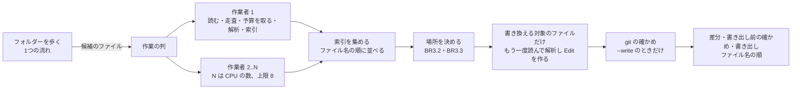

# 論理的な部品: U8 IaC への反映

U8 の部品の分け方、形式ごとの読み取りの口、並行の動き、メモリ、差分の作り方、速さの測り方、障害の範囲、テストの設計を決めます。新しいパッケージは `internal/iac` と、種類の表の小さなパッケージの2つです(Q1 A と、レビュー1回目のあとの人の判断)。

出典: U8 の NFR の要件(`construction/u8-iac/nfr-requirements/`)、`security-design.md`(§0 の人の判断を含む)、U8 の機能設計、`nfr-design-questions.md` Q1〜Q6。

## パッケージごとの変更

| パッケージ | 足すもの・変えるもの | 役割 |
|---|---|---|
| `internal/iac`(新しい) | 公開の口 `Writer`(`Run(ctx, Request) (*Result, error)`)。ファイルで分ける: 変更案の読み取りと対象の決定(機能設計 BR1.2、BR2.1〜BR2.4)、`--tf-state` の流し読み(BR1.3、`security-design.md` §2)、ファイルの集め方と上限と深さの走査(§2)、CloudFormation の YAML の読み取り(yaml/v3)、JSON の読み取り、Terraform の読み取り(hcl/v2)(§3)、変更の当て方と Edit(BR4.3〜BR4.5、§4)、引用符とエスケープ(§5)、差分(下の節)、git(§6)、書き出しの流れ(BR5.1〜BR5.3)、メモリの予算(§3) | `iac` の流れのすべて。AWS の SDK を取り込まない(§1) |
| `internal/restype`(新しい。SDK に依存しない) | resourceType ごとの行の表: resourceType(例: `sqs:queue`、`ec2:security-group`)、サービス(例: `sqs`)、CloudFormation の Type(複数を書ける。例: `AWS::SQS::Queue`)、Terraform のリソースの種類(例: `aws_sqs_queue`)。CloudFormation の Type から resourceType を引く関数 | 機能設計 BR3.2、NFR10.14。行は下の「種類の表の行」の 18 行。表にない resourceType は templateNotFound(種類が分からない) |
| `internal/awsaccess` | 変えない(権限の表はサービスごとの行のまま)。テストで、`internal/restype` のすべての行のサービスが、awsaccess の表にあることを確かめる | 表の食い違いを防ぐ |
| `internal/fileout` | 名前の変更のやり直しの部品 `RetryRename`(待ちの列、やり直す誤りかを返す関数、名前の変更と待ちの関数を引数で受け取る。`security-design.md` §7)と、元のファイルを置き換える書き方 `Replace`(§7)。今の「上書きしない保存」(plan `--out`、rules suggest `--output`)は変えない | 利用者のファイルを書く部品 |
| `internal/journal` | 記録の保存の名前の変更のやり直しを、`fileout.RetryRename` に置き換える。パッケージの変数 `rename`・`renameAttempts`・`renameWait`・`sleep` はそのまま残し、これらから待ちの列(100 ミリ秒 × 4)と関数を作って渡す。古い一時ファイルを消す処理は残す | 依存の向きを journal から fileout への一方向にする。U6・U7 のテストの差し替えと期待は変えない |
| `internal/display` | `iac` の結果(ファイルごとの差分と件数、反映済みの数、反映済みとみなした削除、手で直す一覧、管理されていない数、案内と警告)と、英語・日本語の文言。U4 の言語・色・表の部品を使う | 機能設計 BR6.1、NFR11.10 |
| `internal/cli` | `iac` のサブコマンド(U1 の「まだ使えない」を置き換える): `--plan`、`--dir`、`--tf-state`、`--write`。コマンドの組み立ての口は AwsAccess の接続と書き込みの口を受け取らない型にする。ヘルプ(BR6.3) | 機能設計 BR1.1、BR6.2、BR6.3、NFR3.16 |
| `internal/testutil` | 大きなテストの偽のファイル(テンプレート、`.tf`、`--tf-state`、変更案)を作る部品 | NFR5.25 |

新しい直接の依存は `github.com/hashicorp/hcl/v2` と `go.yaml.in/yaml/v3` の2つ(`security-design.md` §0)。

### 種類の表の行(`internal/restype`。NFR10.14 (a))

apply が書き換えるサービス(`internal/awsaccess` の表の 11 のサービス)のうち、IaC でよく作られる種類を、resourceType ごとに 18 行で置く。resourceType の書き方は `internal/inventory` と同じ(ARN のサービスとリソースの種類)。

| resourceType | CloudFormation の Type | Terraform の種類 |
|---|---|---|
| `s3:bucket` | `AWS::S3::Bucket` | `aws_s3_bucket` |
| `sqs:queue` | `AWS::SQS::Queue` | `aws_sqs_queue` |
| `sns:topic` | `AWS::SNS::Topic` | `aws_sns_topic` |
| `secretsmanager:secret` | `AWS::SecretsManager::Secret` | `aws_secretsmanager_secret` |
| `kms:key` | `AWS::KMS::Key` | `aws_kms_key` |
| `lambda:function` | `AWS::Lambda::Function`、`AWS::Serverless::Function` | `aws_lambda_function` |
| `dynamodb:table` | `AWS::DynamoDB::Table` | `aws_dynamodb_table` |
| `logs:log-group` | `AWS::Logs::LogGroup` | `aws_cloudwatch_log_group` |
| `ec2:security-group` | `AWS::EC2::SecurityGroup` | `aws_security_group` |
| `ec2:vpc` | `AWS::EC2::VPC` | `aws_vpc` |
| `ec2:subnet` | `AWS::EC2::Subnet` | `aws_subnet` |
| `ec2:instance` | `AWS::EC2::Instance` | `aws_instance` |
| `ec2:volume` | `AWS::EC2::Volume` | `aws_ebs_volume` |
| `rds:db` | `AWS::RDS::DBInstance` | `aws_db_instance` |
| `rds:cluster` | `AWS::RDS::DBCluster` | `aws_rds_cluster` |
| `iam:role` | `AWS::IAM::Role` | `aws_iam_role` |
| `iam:user` | `AWS::IAM::User` | `aws_iam_user` |
| `iam:policy` | `AWS::IAM::ManagedPolicy` | `aws_iam_policy` |

- 表の resourceType の書き方が、scan が実際に返す書き方と同じかは、Code Generation で `internal/inventory` の対応(AWS Config の種類の名前から resourceType への表)と比べて確かめ、違えば scan の書き方に合わせる(行の数は変えない)。
- IAM の種類は scan で集まらない(U6 のチェックポイントで分かった制限)ので、今は変更案に入らないが、IAM を集める後の作業のために表に置く。
- NFR10.14 (a) の確かめ: 表の行が 18 行で、すべての行に CloudFormation の Type が1つ以上と Terraform の種類が1つあり、resourceType の重複がなく、各行のサービスが awsaccess の表にあること。

## 形式ごとの読み取りの口(Q1 A)

CloudFormation の YAML、JSON、Terraform の3つの読み取りは、同じ形の口を持つ。

| 口 | 返すもの |
|---|---|
| 解析(ファイルの中身から) | 解析した結果(形式ごとの中身)と、索引(CloudFormation は「論理 ID と Type」の一覧、Terraform は「種類と名前」の一覧)。解析の誤りはファイル名・行・桁・種類だけ |
| タグの書き場所(解析した結果と、論理 ID かアドレスから) | `TagSite`(形、literal、multiline、extraFields、要素の一覧と各要素のキー・値・引用符・範囲、書き場所の値の範囲、要素の範囲の全体、要素の間の区切りのテキスト、写すもとの要素のテキスト)。書き場所がなければ空 |
| 書き換えたあとの確かめ用の取り出し(解析した結果から) | すべてのリソースの「索引の鍵とタグの並び」(`security-design.md` §4 の (a) と (b)) |

変更の当て方(BR4.3)、Edit の作り方と当て方(§4)、差分は、この口の上で形式によらず1つにする。形式に関わるのは、引用符とエスケープ(§5)と、空の書き方、区切りの作り方だけで、これは `TagSite` が持つ範囲とテキストで表す。

## 並行の動きとメモリ(NFR5.25、NFR5.26、NFR3.19、Q5 A)

文章での説明: フォルダーを歩くのは1つの流れで、候補のファイルを作業の列に入れます。CPU の数(上限 8)の作業者が、ファイルを読み、深さを走査し、メモリの予算(同時に解析するファイルの合計 32 MB)を取ってから解析し、索引を作ります。作業者は索引だけを返し、解析した結果と予算を手放します。索引をファイル名の順に並べてから場所を決め、書き換える対象のあるファイルだけを、もう一度読んで解析し、Edit を作ります(このときも予算を取る)。`--write` のときは git の確かめをしてから、書き出しの直前の確かめと書き出しをファイル名の順に1つずつ行います。

- 同時に解析するファイルの合計は 32 MB まで(`security-design.md` §3 のメモリの予算)。索引は小さい(リソースあたり数十バイト)。
- 書き換える対象のあるファイルの2回目の読み取りでは、中身の SHA-256 を最初の読み取りと比べ、違えばそのファイルを手で直す一覧(unreadableFile。読んでいる間に変わった)に回す。
- **ファイルを開く回数(NFR5.26):** 候補のファイルの1回目の読み取り(候補の数)+ 書き換える対象のあるファイルの2回目の読み取り(対象の数)+ `--write` で書くファイルの、書き出しの直前の確かめ(git の確かめのあと)・一時ファイルの作成・一時ファイルの読み直し(書くファイルの数 × 3)。合わせて「候補の数 + 対象の数 + 書くファイルの数 × 3」以下。書き換えたあとの解析の確かめ(§4)はメモリの上の中身で行い、開き直さない。ファイルを開く関数は `internal/iac` の中で差し替えられる変数にし、テストで数える。
- 出力と索引の順はファイル名の順(並行の順によらない)で、実行ごとに同じになる。

## 差分の作り方(Q4 A)

1. ファイルの Edit ごとに、元のファイルの変わる行の範囲を求める。始まりの行は Edit の始まりの位置を含む行。終わりの行は、Edit の範囲が空でなければ「終わりの位置の1つ前のバイトを含む行」、空(挿入だけ)なら始まりの行と同じとする。挿入だけで元の行が変わらない場合は、元の行の数を 0 とする。
2. 新しいファイルの対応する行の範囲は、Edit を当てたあとの位置から同じ規則で求める。
3. 1つの Edit の、元の行と新しい行の並びのうち、先頭と末尾の同じ行は文脈に回す(書き場所の値の範囲を置き換える Edit で、変わらない行が `-` と `+` に出ないように)。
4. 近い範囲(間が 6 行以内)を1つのまとまり(hunk)にまとめ、前後に3行の文脈を付ける。
5. `--- a/<相対パス>`、`+++ b/<相対パス>`、`@@ -元の始まり,行数 +新しい始まり,行数 @@` の形で出す。行の数が 0 の側は、unified diff の決まりどおり、始まりをその前の行の番号にする。行の中身は改行の文字を除いて出し、元の行が CRLF でも表示は改行だけにする。ファイルの終わりに改行がない行には「\ No newline at end of file」を続ける。

## 速さの測り方(NFR5.25)

- Code Generation の最初に、10 MB の YAML(yaml/v3)と 10 MB の `.tf`(hclsyntax)の解析の時間とメモリ(解析のあとに残るもの、割り当ての合計)を、手元で `testing.B` で測り、`code-summary.md` に記録する。YAML は NFR 設計の実測(約 0.5 秒、約 190 MB)と比べる。測った速さから、NFR5.25 の測る条件の解析(YAML 約 50 MB、JSON 約 10 MB、`.tf` 約 40 MB を2回ずつ。書き換える対象のファイルの2回目の解析を含む)にかかる時間の見込みを出し、30 秒を超えるなら人に相談する。hcl/v2 の倍率が 30 倍を超えるなら、メモリの予算を小さくする。
- 大きなテストは、偽のファイルを `t.TempDir` に作ってから、`Writer.Run` の始めから終わりまでを測る。git の呼び出しは差し替える。ヒープの最大は、別の goroutine で 100 ミリ秒ごとに `runtime.ReadMemStats` の `HeapInuse` を見て最大を記録する(NFR3.19)。
- 手元で1回、実際の git を使った `--write` の時間も測って記録する。

## 障害の範囲と隔て方

| 障害 | 範囲 | 扱い |
|---|---|---|
| 1つのファイルが読めない・解析できない・上限を超える・深すぎる | そのファイル | 候補から外して警告に数える。そのファイルにしかないリソースは templateNotFound か blockNotFound(detail に外したファイル) |
| 1つのファイルの位置の確かめや書き換えたあとの確かめの失敗、2回目の読み取りで中身が変わっていた | そのファイル | そのファイルの Edit をすべてやめ、unreadableFile。ほかのファイルは続ける |
| 作業者のパニック | 実行全体 | 作業者の中で止めの誤り(Internal)に変え、ほかの作業者を止めて終了コード 1(U6 のリージョンの役と同じ考え)。スタックの使い切りは回復できないので、事前の走査で防ぐ(§2) |
| git の確かめの失敗・時間切れ | 書き出し全体 | どのファイルも書かずに終了コード 1。差分と一覧は示す |
| 書き出しの直前の確かめの失敗(変わったファイル、読み取り専用) | 書き出し全体 | どのファイルも書かずに終了コード 1 |
| 書き出しの途中の失敗・取り消し | 書き出し全体 | 書いているファイルを終えてから止め、書いたファイルと書いていないファイルを示して終了コード 1 |
| 変更案・`--tf-state` の誤り | 実行全体 | 何もせずに終了コード 1 |

## テストの設計(NFR3.16〜NFR3.21、NFR5.25、NFR5.26、NFR6.5、NFR6.6、NFR8.27、NFR9.11、NFR9.12、NFR10.12〜NFR10.14、NFR11.10)

| 確かめること | テストの作り方 |
|---|---|
| AWS を呼ばない(NFR3.16) | 偽の AWS を立て、`iac` の実行で要求が0件。認証情報の環境変数なしで動く。`go list -f` の直接の取り込みに `internal/awsaccess` と `github.com/aws/aws-sdk-go-v2` のパッケージがない(間接の依存は受け入れる。`security-design.md` §1)。コマンドの組み立てに AwsAccess の接続と書き込みの口が渡らない(組み立ての口の型と、組み立てを差し替えたテスト) |
| 範囲の外が変わらない(NFR3.17) | YAML・JSON・`.tf` × 改行(LF・CRLF・混在)× BOM × コメント × 終わりの改行 × 日本語の組み合わせで、Edit の範囲の外がバイト単位で同じ。UTF-16 の BOM が外れる。YAML では、Tags より前にコメント、ブロックスカラー(`UserData` など)、エスケープ付きの文字列、日本語を置いたテンプレートで、位置が正しく書き換えられる |
| リンクをたどらない(NFR3.18) | Linux と macOS はシンボリックリンク、Windows はジャンクション。`--dir` がリンクの場合 |
| 上限と深さ(NFR3.19) | 20,001 個の候補、20,001 個の候補でないファイル、10 MB を超えるファイル、深さ 33、YAML の爆弾(1秒以内)、10 万重の `[` の JSON・YAML・`.tf`、行の始まりの `- ` を 10 万個並べた YAML、`!` を 10 万個並べた `.tf`、`?` を 10,001 個持つ `.tf`、括弧を多く含む正しいブロックスカラー・ヒアドキュメント・文字列(外れない) |
| git(NFR3.20) | 一時のリポジトリ(テストの中で `git init` と設定)で、fsmonitor の印が作られない、`.gitattributes` の filter の clean のコマンドの印が作られない、`GIT_DIR`(Windows では `Git_Dir` も)を無視する、特殊な名前(空白、`-` で始まる、`[`・`*`・`:` を含む、`:` で始まる、日本語)、未追跡・ignore・変更あり・`git add` 済みでコミットしていない・衝突の途中・まだコミットのないリポジトリで止まる、`core.autocrlf=true` の CRLF のファイルは変更なし、約 1,000 ファイル(引数を分けて呼ぶ)。git を差し替えて、時間切れ、git がない |
| 書き出し(NFR6.5、NFR6.6、NFR9.11) | 途中の停止、一時ファイルの確かめの失敗、権限、一時ファイルが残らない、直前の確かめで1つ変わっていると何も書かない、読み取り専用のファイルがあると何も書かない、2つ目の失敗、書き出しの途中の取り消し、Windows の名前の変更の妨げ(やり直しの回数と待ち、一時的でない誤りはやり直さない)。`RetryRename` の `retryable` ごとのテスト(すべてやり直す関数で5回呼ぶ、Windows の 32・33・5 ではやり直し、ほかの誤りと Windows 以外ではやり直さない)。U4・U6・U7 の保存のテストが変わらず通る |
| 3つの OS で同じ結果(NFR9.11) | 同じ入力から同じ差分と結果が出ることを、期待の出力のファイルと比べるテスト(3つの OS の CI で同じファイル) |
| 出さないもの(NFR8.27) | 差分の外の秘密の値、構文の誤りと秘密の値を持つ YAML・JSON・`.tf`、秘密の値を属性に持つ `--tf-state` で、`--debug` でも値が出ない |
| 機能設計の規則 | BR4.3 の pre・post・反映済み・`mergesIntoExisting`・複数の rename の例、BR4.4 の引用符とエスケープの表(§5 の各行。2進数と日付を含む)、要素ごとの Edit(1つ消して1つ足す JSON、最後の要素を消して足す JSON、すべて消す、すべて消して足す、ファイルの終わりに改行がない、要素の間に行全体のコメント・コメントアウトしたタグ・空行がある Tags の削除と追加でコメントと空行が変わらない、すべて消す書き場所にコメントがあると unsupportedTagShape)、1行の書き方、BR4.5 の写すもとの要素、BR3.2 の種類の確かめ、BR2.3 の ARN の完全一致、BR2.4 のモジュールと添字、BR1.3 の空の state と plan の出力と流し読み |
| 差分 | 挿入だけ(元の行数 0)、削除だけ、組み立て直しで変わらない要素の行が `-` と `+` に出ない、近いまとまりの結合、終わりに改行がないファイル |
| 種類の表と実物の例(NFR10.14) | 上の「種類の表の行」の (a) の確かめ。Terraform の公式の文書の例と、取れれば実物の `terraform show -json` の例(版を記録)で、表の Terraform の種類が `values.arn` を持つ |
| 速さとメモリ(NFR5.25、NFR5.26、NFR3.19) | 大きなテスト(3つの OS で 60 秒以内、ヒープの最大 2 GB 以下、ファイルを開いた回数が上の式以下)。`race` では10分の1 |
| 表示(NFR11.10) | `NO_COLOR` の期待の出力(英語・日本語) |
| ビルドと依存(NFR9.12、NFR10.12、NFR10.13) | CI の既存のジョブ(3つの OS、Go の2つの版、`CGO_ENABLED=0`、coverage、govulncheck)。`go.mod` の `go` の行が hcl/v2 と yaml/v3 を足す前と同じことを、Code Generation で確かめて記録する。`.github/dependabot.yml` の `gomod` の対象を確かめて記録する。`internal/iac` のカバレッジを記録 |
