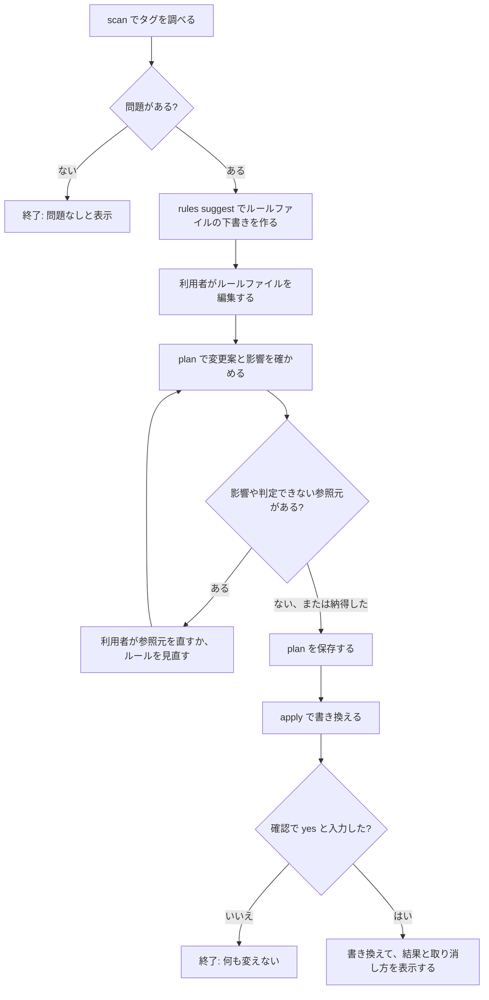
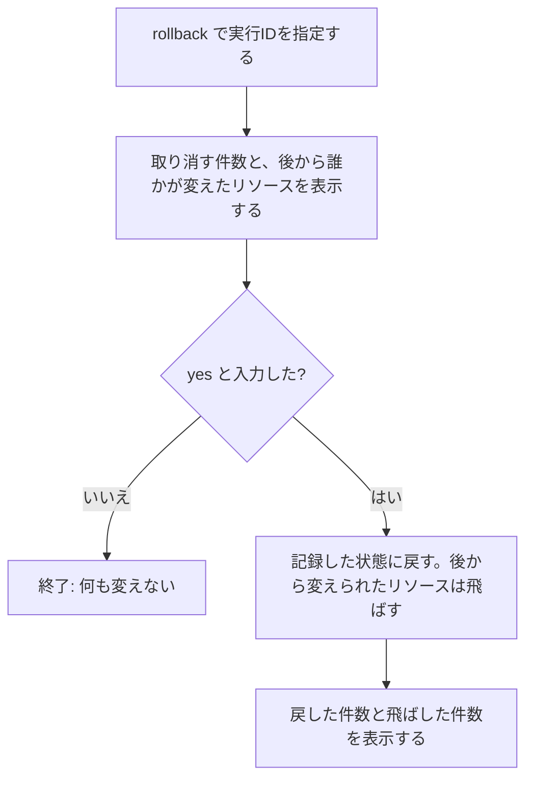

# 操作の流れ: tag-refactor

出典の書き方は wireframes.md と同じです。画面番号は wireframes.md の画面を指します。

## 流れ1: 初めてタグを統一する(主な流れ)

利用者: 社内の担当チーム、またはOSSの利用者(手元の端末で実行。M-Q1)



文章での説明:

1. 画面1・2 → `scan` を実行する → 全リージョンを調べ、表記ゆれと必須タグの欠落を件数つきで示す(IB-01、IB-03)
2. 画面3 → `rules suggest` を実行する → ルールファイルの下書きができる(IB-02、S-Q7)
3. 利用者がルールファイルを編集する(S-Q7)
4. 画面4〜6 → `plan` を実行する → 変更案と、影響を受ける参照元(`!`)、判定できない参照元(`?`)を示す(IB-06)
5. 影響があれば、利用者は参照元(IAMポリシーなど)を直すか、ルールを見直して手順4に戻る
6. 画面4の最後の行 → `plan --out` で plan を保存する
7. 画面7 → `apply --plan` を実行する → 要約を表示し、`yes` の入力を求める(M-Q4)
8. 画面8 → 書き換えた件数、失敗した件数、取り消し方を示す(IB-07)

**成功したときに利用者が見るもの:** 書き換えた件数と、`rollback` で取り消すためのコマンド。

**エラーのとき:**
- 認証情報がない → 何が足りないかと設定方法を表示して終了する
- 一部のリージョンを調べられない → 調べられなかったリージョンを先頭に示し、結果が不完全であることを明記する
- apply の一部が失敗する → 成功と失敗を分けて示し、失敗の詳細はログファイルに残す

## 流れ2: 書き換えを取り消す



文章での説明:

1. 画面9 → `rollback --run <実行ID>` を実行する(IB-08)
2. 取り消す件数と、apply の後に誰かが変えたリソースの件数を示す
3. `yes` を入力すると、記録した状態に戻す。後から変えられたリソースは上書きせずに飛ばす(案)
4. 戻した件数と、飛ばした件数を示す

## 流れ3: IaCに反映する(第3弾)

1. 画面10 → `iac --plan <plan> --dir <IaCのフォルダ>` を実行する(IB-09〜IB-11)
2. Terraform と CloudFormation の設定ファイルを書き換える。CDK は Could have
3. 利用者が `git diff` で確かめる
4. (Could have)プルリクエストを作る(IB-12)

## 情報の構成

```
tag-refactor
├── scan            問題の一覧(第1弾)
├── rules suggest   ルールファイルの下書き(第1弾、仮称)
├── plan            変更案と影響(第1弾)
├── apply           書き換え(第2弾)
├── rollback        取り消し(第2弾)
└── iac / pr        IaCへの書き戻しとプルリクエスト(第3弾、仮称)
```

利用者の作業の順番(調べる → 基準を決める → 確かめる → 書き換える → 取り消す/IaCに反映する)に沿ってサブコマンドを並べています。

## Assumptions & Open Questions

- rollback で「apply の後に誰かが変えたリソース」を飛ばすという動きは案であり、要件定義で決める。[assumption]
- 保存した plan より後にタグが変わっていた場合の apply の動き(知らせて止めるか、続けるか)は、要件定義で決める。[assumption]
