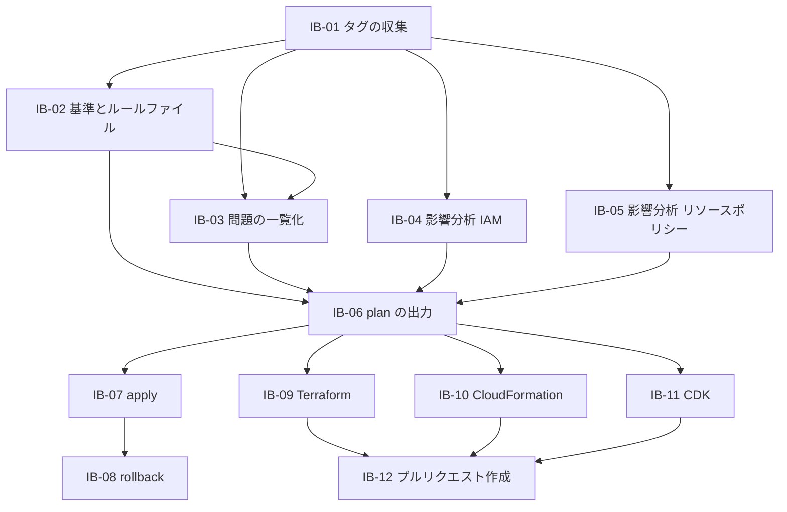

# 作業の一覧(Intent Backlog): tag-refactor

出典の書き方は scope-document.md と同じです。

優先度は MoSCoW(Must have / Should have / Could have / Won't have)で付けています(S-Q2、S-Q3、S-Q8)。同じ優先度の中の順番は、依存関係を優先して決めています(S-Q4)。

## 一覧

| ID | 項目 | 内容 | 優先度 | 段階 | 依存先 | 出典 |
|---|---|---|---|---|---|---|
| IB-01 | タグの収集 | 1アカウント・全リージョンのリソースとタグを集める。一度もタグが付いたことのないリソースも、別の方法で見つける | Must have | 第1弾 | なし | S-Q6、C-T2 |
| IB-02 | 統一後の基準の提案とルールファイル | 既存のタグから正しいキー名・値の候補を提案し、利用者がそれをもとにルールファイルを作って編集できるようにする | Must have | 第1弾 | IB-01 | S-Q7 |
| IB-03 | 問題の一覧化 | 表記ゆれと必須タグの欠落を、件数つきで一覧にする | Must have | 第1弾 | IB-01、IB-02 | 意図 §成功の基準 |
| IB-04 | 影響分析(IAMポリシー) | ユーザー・ロール・グループのIAMポリシーの条件キーから、タグの変更で影響を受ける箇所を見つける | Must have | 第1弾 | IB-01 | C-T3 |
| IB-05 | 影響分析(リソースポリシー) | S3、KMS、SQS、SNS、Secrets Manager などのリソースポリシーの条件キーから、影響を受ける箇所を見つける | Must have | 第1弾 | IB-01 | C-T3 |
| IB-06 | plan の出力 | タグの変更案と、その影響(IB-04、IB-05)をまとめて示す | Must have | 第1弾 | IB-02、IB-03、IB-04、IB-05 | 意図 §成功の基準 |
| IB-07 | apply | plan の変更案に沿って、表記ゆれをそろえる、必須タグを付ける、不要なタグを消す。書き込む前の状態を記録する | Must have | 第2弾 | IB-06 | S-Q5 |
| IB-08 | rollback | apply による変更を、記録した状態に戻す | Must have | 第2弾 | IB-07 | 意図 §最初のバージョンに含めるもの |
| IB-09 | IaCへの書き戻し(Terraform) | タグの変更を Terraform の設定に反映する | Should have | 第3弾 | IB-06 | S-Q8、C-T4 |
| IB-10 | IaCへの書き戻し(CloudFormation) | タグの変更を CloudFormation のテンプレートに反映する | Should have | 第3弾 | IB-06 | S-Q8、C-T4 |
| IB-11 | IaCへの書き戻し(CDK) | タグの変更を CDK(TypeScript と Python)のソースに反映する | Could have | 第3弾 | IB-06 | S-Q8、C-T4 |
| IB-12 | GitHub へのプルリクエスト作成 | IaCの修正をプルリクエストとして出す | Could have | 第3弾 | IB-09、IB-10、IB-11 のいずれか | S-Q3 |

## 今回は作らないもの(Won't have)

| 項目 | 出典 |
|---|---|
| Cost Category と Tag Policy の生成 | 意図 §最初のバージョンに含めないもの |
| 複数アカウント(Organizations)の横断 | 意図 §最初のバージョンに含めないもの |
| 欠けているタグの値の推定 | 意図 §最初のバージョンに含めないもの |
| SCP と RCP の影響分析 | 実現性 §前のステージからの範囲の変化 |
| AWS Backup、DLM、SSM、Resource Groups、Auto Scaling のタグ指定の影響分析 | C-T3 |

## 依存関係

文章での説明: IB-01(タグの収集)がすべての土台です。IB-02〜IB-05 がそれに続き、IB-06(plan の出力)でまとまります。IB-07(apply)と IB-09〜IB-11(IaCへの書き戻し)は IB-06 を使い、IB-08(rollback)は IB-07 に、IB-12(プルリクエスト作成)は IB-09〜IB-11 のいずれかに依存します。

## Assumptions & Open Questions

- IB-11(CDK)は、実現可能性の評価で作る量と不確かさが最も大きいとされた。Could have のため、第3弾の中でも最後に回る想定である。[assumption]
