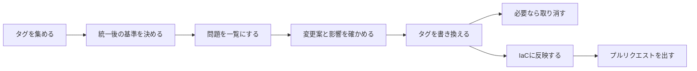

# 範囲の文書: tag-refactor

出典の書き方:
- 「意図 §…」は `ideation/intent-capture/intent-statement.md` の該当箇所
- 「実現性 §…」は `ideation/feasibility/feasibility-assessment.md`、「C-…」は `ideation/feasibility/constraint-register.md` の制約ID
- 「S-Q…」はこのステージの `scope-definition-questions.md` の回答

## 目的

AWSのタグを後から安全に統一できるようにする。表記ゆれや必須タグの欠落を見つけ、タグを変えたときに壊れる参照元を事前に示し、そのうえで書き換えと取り消しができる状態を、最初のバージョンのゴールとする(意図 §問題、意図 §最初のバージョンに含めるもの)。

## 最初のバージョンの出し方

最初のバージョンは3段階で出す(S-Q1)。各段階が終わるごとに、利用者が使える状態にする。

| 段階 | 内容 | 優先度 | 出典 |
|---|---|---|---|
| 第1弾 | scan と plan(影響分析つき)。書き込みはしない | Must have | S-Q1、S-Q2 |
| 第2弾 | apply と rollback | Must have | S-Q1、S-Q2 |
| 第3弾 | IaCへの書き戻し(Terraform、CloudFormation、CDK)と、GitHub へのプルリクエスト作成 | Terraform と CloudFormation は Should have、CDK と プルリクエスト作成は Could have | S-Q1、S-Q3、S-Q8 |

**「最初のバージョンの完成」の定義:** 第1弾と第2弾(Must have)がそろった時点(S-Q2)。第3弾は、そのあとに続けて取り組む。

## 範囲に含めるもの(In scope)

| 項目 | 内容 | 出典 |
|---|---|---|
| 対象 | 1アカウント・全リージョンのリソース | 意図 §成功の基準、C-T2 |
| タグの収集 | 一度もタグが付いたことのないリソースも、別の方法を使って見つける | S-Q6 |
| 統一後の基準 | ツールが既存のタグから候補を提案し、それをもとに利用者がルールファイルを作って編集する | S-Q7 |
| 問題の一覧化 | 表記ゆれや必須タグの欠落を、件数つきで一覧にする | 意図 §成功の基準 |
| 影響分析 | IAMポリシー(ユーザー・ロール・グループ)と、リソースポリシー(S3、KMS、SQS、SNS、Secrets Manager など)の条件キー | C-T3 |
| apply で行う変更 | 表記ゆれをそろえる、必須タグを付ける(値は利用者が指定)、不要なタグを消す | S-Q5 |
| rollback | apply による変更を取り消す | 意図 §最初のバージョンに含めるもの |
| IaCへの書き戻し | Terraform、CloudFormation、CDK(TypeScript と Python) | C-T4、S-Q8 |
| GitHub へのプルリクエスト作成 | IaCの修正をプルリクエストとして出す(Could have) | S-Q3 |

## 範囲に含めないもの(Out of scope)

| 項目 | 理由 | 出典 |
|---|---|---|
| Cost Category と Tag Policy の生成 | 最初のバージョンに含めないと決めた | 意図 §最初のバージョンに含めないもの |
| 複数アカウント(Organizations)の横断 | 同上 | 意図 §最初のバージョンに含めないもの |
| 欠けているタグの値の推定 | 同上 | 意図 §最初のバージョンに含めないもの |
| SCP と RCP の影響分析 | 管理アカウントからしか読めず、複数アカウントの横断をしないため | 実現性 §前のステージからの範囲の変化、C-T2 |
| AWS Backup、DLM、SSM、Resource Groups、Auto Scaling のタグ指定の影響分析 | 影響分析の対象に選ばれなかった | C-T3 |

## 価値の流れ(Value Stream)

利用者がタグを統一するまでの流れと、各段階が受け持つ部分です。

文章での説明:

1. タグを集める → 2. 統一後の基準を決める → 3. 問題を一覧にする → 4. 変更案と影響を確かめる(ここまで第1弾)
5. タグを書き換える → 6. 必要なら取り消す(第2弾)
7. IaCに反映する → 8. プルリクエストを出す(第3弾)

## 成功の基準(前のステージから引き継ぎ)

| 基準 | 測り方 | 関係する段階 | 出典 |
|---|---|---|---|
| 問題の一覧化 | 表記ゆれや必須タグの欠落を、件数つきで一覧にできる | 第1弾 | 意図 §成功の基準 |
| 影響の提示 | テスト用に用意した参照を、検出率100%で示せる | 第1弾 | 意図 §成功の基準 |
| 実行時間 | 1アカウント・全リージョン・10,000リソースで、scan と plan が合わせて10分以内 | 第1弾 | 意図 §成功の基準 |

## 制約(前のステージから引き継ぎ)

- 開発は依頼者1人で、期限は決めない(C-O1、C-O2)。
- 実装言語は Go(C-T1)。
- 検証は個人の検証用アカウントで行う(C-O4)。

## Assumptions & Open Questions

- 第2弾(apply と rollback)と第3弾(IaCへの書き戻し)の成功の基準(たとえば「本番を壊さないこと」をどう判定するか)は、まだ決まっていない。要件定義で決める。[assumption]
- 一度もタグが付いたことのないリソースを見つける「別の方法」の具体的な手段と、その制約(件数の上限など)は、要件定義で決める。[assumption]
