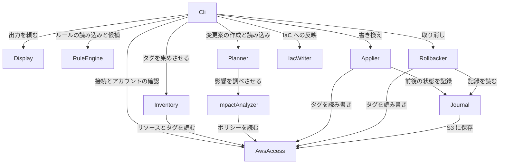

# 部品の一覧(コンポーネント・カタログ): tag-refactor

tag-refactor を、自分たちが書くコードの部品に分けたものです。AWS の API、手元のファイル、GitHub などは部品ではなく、部品が使う外部の依存先として扱います。どの部品をまとめて1つの実行ファイルにするか、使う技術は、後のステージで決めます。

出典: `inception/requirements-analysis/requirements.md`、`inception/user-stories/stories.md`、`domain-design-questions.md`(DD-Q1〜DD-Q6)。設計の判断の理由は `decisions.md` にあります。

## 部品の一覧(機械が読める形)

```yaml
components:
  - name: Cli
    summary: サブコマンドとオプションを受け付け、各部品を順に呼び出し、確認の入力と終了コードを扱う
    behaviour: >
      サブコマンド(scan、rules suggest、plan、apply、rollback、iac)ごとに、必要な部品を決められた順で呼び出し、
      部品の間でデータを受け渡す(部品同士は互いをできるだけ呼ばない)。apply と rollback では、
      標準入力から yes を読み、yes 以外なら何も変えずに終える。確認を省くオプションだけで影響のある変更がある場合は止める。
      各部品の結果から終了コード(0 = 問題なし、1 = エラー・不完全・一部失敗、2 = 問題や影響あり・飛ばしあり)を決める。
      一度もタグが付いていないリソースを探せなかったことだけでは 1 にしない。
    responsibilities:
      - サブコマンドとオプションの解釈
      - 部品の呼び出し順とデータの受け渡し
      - apply と rollback の確認の入力
      - 終了コードの決定
    depends_on:
      - component: Display
        interaction: 結果のデータを渡して、指定の形式と言語で出力させる
        style: sync
      - component: AwsAccess
        interaction: プロファイルを指定して接続し、対象のアカウントとリージョンを確かめる
        style: sync
      - component: Inventory
        interaction: scan、rules suggest、plan のためにリソースとタグを集めさせる
        style: sync
      - component: RuleEngine
        interaction: ルールファイルを読み込ませる。集めたタグを渡して表記ゆれの候補を作らせる
        style: sync
      - component: Planner
        interaction: 集めたタグとルールを渡して変更案を作らせる。保存した変更案を読み込ませる
        style: sync
      - component: Applier
        interaction: 確認の済んだ変更案を渡して書き換えさせる
        style: sync
      - component: Rollbacker
        interaction: 実行IDを渡して元に戻させる
        style: sync
      - component: IacWriter
        interaction: 変更案を渡して IaC に反映させる(第3弾)
        style: sync
    dependents: []
    external_dependencies:
      - name: 標準入力・標準出力・標準エラー
        kind: other
        purpose: 確認の入力と、結果・案内の出力先
    entities: []

  - name: Display
    summary: 結果のデータを、一覧・差分・JSON・Markdown の形式と、英語・日本語で出力する
    behaviour: >
      結果は標準出力に、進み具合・案内・警告・エラーは標準エラーに出す。色は補助で、意味は必ず記号と文字でも表す。
      NO_COLOR があるか、出力先が端末でなければ色を出さない。端末でないときの進み具合は1行ずつ追記する。
      言語は指定がなければ OS の言語設定に合わせ、日本語でも英語でもなければ英語にする。
      同じ結果のデータから4つの形式を作るため、形式によって件数が変わらない。
    responsibilities:
      - 4つの出力形式
      - 英語と日本語の文言
      - 色と記号、NO_COLOR への対応
      - 進み具合の表示(端末と、端末でない場合)
    depends_on: []
    dependents:
      - component: Cli
        interaction: 結果のデータを受け取って出力する
    external_dependencies:
      - name: 端末(標準出力・標準エラー)
        kind: other
        purpose: 出力先と、端末かどうかの判定
    entities: []

  - name: AwsAccess
    summary: AWS への接続、アカウントとリージョンの確認、API 呼び出しの再試行と時間の上限を一か所で受け持つ
    behaviour: >
      認証情報とリージョンは AWS の標準の設定から読み、プロファイルの指定を受け付ける。
      認証情報がなければ、何が足りないかが分かるエラーを返す。すべての API 呼び出しに時間の上限を設け、
      呼び出し回数の上限に当たったら、待ち時間を延ばしながら決まった回数まで再試行する。
      権限が足りないときは、足りない操作(API)の名前が分かる形でエラーを返す。認証情報を記録や出力に含めない。
      他の部品は AWS を直接呼ばず、この部品を通すため、テストではこの部品を差し替える。
    responsibilities:
      - 認証情報とプロファイル
      - 対象のアカウントIDと、有効なリージョンの一覧
      - 時間の上限、再試行、呼び出し回数の上限への対応
      - 権限不足のエラーの整形
    depends_on: []
    dependents:
      - component: Cli
        interaction: 接続とアカウントの確認
      - component: Inventory
        interaction: リソースとタグの読み取り
      - component: ImpactAnalyzer
        interaction: IAM ポリシーとリソースポリシーの読み取り
      - component: Applier
        interaction: 現在のタグの読み取りと、タグの書き換え
      - component: Rollbacker
        interaction: 現在のタグの読み取りと、タグの書き戻し
      - component: Journal
        interaction: S3 への記録の保存と読み込み
    external_dependencies:
      - name: AWS の API(タグ用 API、IAM、S3、KMS、SQS、SNS、Secrets Manager、AWS Config、Resource Explorer、STS)
        kind: third-party-api
        purpose: 読み取りと書き換えのすべて
      - name: AWS の設定(環境変数、プロファイル)
        kind: other
        purpose: 認証情報とリージョン
    entities:
      - name: AccountContext
        identifier: accountId
        attributes: [accountId, callerArn, profile, enabledRegions]

  - name: Inventory
    summary: 1アカウントの全リージョンのリソースとタグを集め、表記ゆれと必須タグの欠落を数えるための元のデータを作る
    behaviour: >
      有効なすべてのリージョンを調べる。一度もタグが付いていないリソースは、AWS Config が有効ならそれを、
      なければ Resource Explorer を使って探し、どちらも使えなければ「探せなかった」ことを結果に記録する。
      読めなかったリージョンとその理由を記録し、結果が不完全であることを示す印を付ける。
      タグを変更できないリソースの種類と件数を記録する。CloudFormation のスタックに属するリソースには、IaC で管理されている印を付ける。
      グローバルなリソースは1回だけ数える。
    responsibilities:
      - リージョンごとのリソースとタグの収集
      - 一度もタグが付いていないリソースの検出
      - 読めなかったリージョンと、タグを変更できない種類の記録
      - IaC(CloudFormation)で管理されている印
    depends_on:
      - component: AwsAccess
        interaction: リージョンごとにリソースとタグを読む
        style: sync
    dependents:
      - component: Cli
        interaction: scan、rules suggest、plan のための収集
    external_dependencies: []
    entities:
      - name: InventorySnapshot
        identifier: snapshotId
        attributes: [snapshotId, accountId, scannedAt, scannedRegions, failedRegions, untaggedDiscovery, unsupportedResourceTypes, resources]
        references:
          - entity: AccountContext
            owned_by: AwsAccess
            relationship: 1つの収集結果は1つのアカウントのもの
      - name: Resource
        identifier: arn
        attributes: [arn, region, resourceType, tags, iacManagedBy, everTagged]

  - name: RuleEngine
    summary: ルールファイル(YAML)を読み込んで検証し、集めたタグから表記ゆれの候補を作る
    behaviour: >
      ルールファイルには、正しいキー名と別名、正しい値と別名、必須タグ(全リソース共通の値と、条件ごとの値)、消すキーを書ける。
      誤りがあれば、行番号とキーと直し方を返す。表記ゆれの候補は、大文字・小文字と区切り文字の違い、
      よく使われる略語の辞書でまとめる。まとめた結果は候補にすぎず、最終的な判断は利用者がルールファイルで行う。
      条件ごとの値が複数当てはまる場合の扱いは、機能設計で決める(案: 上から順に最初に一致したもの)。
    responsibilities:
      - ルールファイルの読み込みと検証
      - 表記ゆれの候補の提案と、ルールファイルの下書き
      - 略語の辞書
    depends_on: []
    dependents:
      - component: Cli
        interaction: ルールファイルの読み込みと、候補の提案
    external_dependencies:
      - name: 手元のファイル(ルールファイル)
        kind: other
        purpose: ルールファイルの読み込み
    entities:
      - name: RuleSet
        identifier: sourcePath
        attributes: [sourcePath, version, keyRules, requiredTagRules, removeKeys]
      - name: KeyRule
        identifier: canonicalKey
        attributes: [canonicalKey, keyAliases, canonicalValues, valueAliases]
      - name: RequiredTagRule
        identifier: key
        attributes: [key, defaultValue, conditionalValues]
      - name: VariantGroup
        identifier: canonicalCandidate
        attributes: [canonicalCandidate, members, counts]
        references:
          - entity: InventorySnapshot
            owned_by: Inventory
            relationship: 候補は1つの収集結果から作る

  - name: Planner
    summary: 集めたタグとルールから変更案を作り、影響分析の結果をまとめ、変更案の保存と読み込みを受け持つ
    behaviour: >
      キー名の変更、値の変更、必須タグの追加、タグの削除の変更案を作る。1つのリソースに変更が重なっても総数では1件と数える。
      必須タグの値が決まらないリソースは「値が未指定」とし、そのリソースの他の変更は残す。
      ルールにないキーは「消す候補」とし、aws: で始まるキーは含めない。aws: で始まるタグを変更の対象にしない。
      影響分析の部品を呼び、影響のある変更と判定できない参照を変更案に付ける。収集や影響分析が不完全なら、変更案にその印を付ける。
      保存する変更案には、作成日時、アカウント、変更前のタグ、変更内容、不完全の印を含める。
    responsibilities:
      - 変更案の作成
      - 値が未指定の必須タグと、消す候補
      - 影響分析の呼び出しと結果のまとめ
      - 変更案の保存と読み込み
    depends_on:
      - component: ImpactAnalyzer
        interaction: 変更の一覧を渡して、影響を受ける参照を調べさせる
        style: sync
    dependents:
      - component: Cli
        interaction: 変更案の作成、保存、読み込み
    external_dependencies:
      - name: 手元のファイル(保存した変更案)
        kind: other
        purpose: 変更案の保存と読み込み
    entities:
      - name: Plan
        identifier: planId
        attributes: [planId, accountId, createdAt, regions, changes, unsetRequiredTags, removeCandidates, impactFindings, inventoryComplete, impactAnalysisComplete]
        references:
          - entity: InventorySnapshot
            owned_by: Inventory
            relationship: 1つの変更案は1つの収集結果から作る
          - entity: RuleSet
            owned_by: RuleEngine
            relationship: 1つの変更案は1つのルールファイルから作る
      - name: Change
        identifier: changeId
        attributes: [changeId, resourceArn, kind, fromKey, toKey, fromValue, toValue, iacManaged]
        references:
          - entity: Resource
            owned_by: Inventory
            relationship: 1つの変更は1つのリソースのタグに対するもの

  - name: ImpactAnalyzer
    summary: IAM ポリシーとリソースポリシーを読み、変更の影響を受ける条件を見つける
    behaviour: >
      IAM のユーザー、ロール、グループのポリシー(利用者が作った管理ポリシーとインラインポリシー)と、
      S3、KMS、SQS、SNS、Secrets Manager のリソースポリシーを読む。タグに関する条件キー
      (リソースのタグ、リクエストのタグ、タグキーの一覧、呼び出し元のタグ、サービス固有のリソースタグ)を対象に、
      キー名の変更、値の変更、タグの削除で条件が成り立たなくなるかを調べる。ワイルドカードやポリシー変数を含む条件は
      「判定できない」とし、影響なしとはしない。読めなかったポリシーの種類と理由を記録し、分析が不完全であることを示す。
      テスト用に用意した参照を100%検出することを目標にする。
    responsibilities:
      - ポリシーの読み込み
      - タグに関する条件キーの照合
      - 影響あり・判定できない・不完全の判断
    depends_on:
      - component: AwsAccess
        interaction: IAM ポリシーとリソースポリシーを読む
        style: sync
    dependents:
      - component: Planner
        interaction: 変更の一覧に対する影響を返す
    external_dependencies: []
    entities:
      - name: PolicySource
        identifier: policyRef
        attributes: [policyRef, sourceKind, statements]
      - name: ImpactFinding
        identifier: findingId
        attributes: [findingId, verdict, statementId, conditionKey, conditionValue]
        references:
          - entity: PolicySource
            owned_by: ImpactAnalyzer
            relationship: 1つの指摘は1つのポリシーの1つの条件について
          - entity: Change
            owned_by: Planner
            relationship: 1つの指摘は、原因になった1つ以上の変更を指す

  - name: Applier
    summary: 変更案に沿ってタグを書き換え、書き換える前に状態を記録させる
    behaviour: >
      変更案のアカウントと今のアカウントが違えば、何も書き換えずに止める。書き換えを始める前に、記録の部品に変更前の状態を保存させ、
      保存できなければ何も書き換えずに止める。変更案の作成後にタグが変わっていたリソースは飛ばす。
      一部のリソースの書き換えに失敗しても残りを続け、成功・飛ばし・失敗の件数と一覧を返す。
      aws: で始まるタグは変えない。タグの上限数を超えるリソースは書き換えない。書き換えた結果を記録に残す。
    responsibilities:
      - アカウントの一致の確認
      - 変更案の作成後の変化の確認と飛ばし
      - タグの書き換えと、成功・飛ばし・失敗の集計
    depends_on:
      - component: AwsAccess
        interaction: 現在のタグを読み、タグを書き換える
        style: sync
      - component: Journal
        interaction: 書き換える前後の状態を記録させる
        style: sync
    dependents:
      - component: Cli
        interaction: 変更案の書き換え
    external_dependencies: []
    entities:
      - name: ApplyResult
        identifier: runId
        attributes: [runId, changed, skipped, failed]
        references:
          - entity: Plan
            owned_by: Planner
            relationship: 1回の書き換えは1つの変更案に対するもの
          - entity: RunRecord
            owned_by: Journal
            relationship: 1回の書き換えには1つの記録がある

  - name: Rollbacker
    summary: apply の記録をもとに、タグを書き換える前の状態に戻す
    behaviour: >
      実行IDの記録が見つからなければ、そのことを返す。記録のアカウントと今のアカウントが違えば、何も戻さずに止める。
      apply の後に別の変更が入ったリソースは、既定では飛ばし、上書きの指定があれば戻す。
      途中で止まった apply でも、記録が残っている範囲で戻す。戻した・飛ばした・失敗した件数を返す。
    responsibilities:
      - 記録の読み込みとアカウントの確認
      - 後から変えられたリソースの判定
      - タグの書き戻しと集計
    depends_on:
      - component: AwsAccess
        interaction: 現在のタグを読み、タグを書き戻す
        style: sync
      - component: Journal
        interaction: 実行IDの記録を読む
        style: sync
    dependents:
      - component: Cli
        interaction: 実行IDの取り消し
    external_dependencies: []
    entities:
      - name: RollbackResult
        identifier: rollbackId
        attributes: [rollbackId, restored, skipped, failed]
        references:
          - entity: RunRecord
            owned_by: Journal
            relationship: 1回の取り消しは1つの記録に対するもの

  - name: Journal
    summary: 書き換える前後のタグの状態を、壊れない方法で記録し、同じアカウントでの同時実行を防ぐ
    behaviour: >
      記録は既定で手元のファイルに、指定があれば S3 バケットに保存する。書き換えより先に、途中で壊れない方法
      (書き込んでから名前を変えるなど)で保存する。書き換えた後の状態も残し、rollback で「後から変えられたか」を判定できるようにする。
      同じアカウントで apply や rollback が同時に動いたときに、記録が壊れないようにする。
    responsibilities:
      - 記録の保存と読み込み(手元のファイルと S3)
      - 壊れない保存
      - 同時実行の防止
    depends_on:
      - component: AwsAccess
        interaction: S3 に記録を保存し、読み込む
        style: sync
    dependents:
      - component: Applier
        interaction: 書き換える前後の状態の記録
      - component: Rollbacker
        interaction: 記録の読み込み
    external_dependencies:
      - name: 手元のファイル(記録)
        kind: other
        purpose: 記録の既定の保存先と、同時実行を防ぐ印
    entities:
      - name: RunRecord
        identifier: runId
        attributes: [runId, accountId, planId, startedAt, completed, entries]
      - name: JournalEntry
        identifier: entryId
        attributes: [entryId, resourceArn, beforeTags, afterTags, status]
        references:
          - entity: RunRecord
            owned_by: Journal
            relationship: 1つの記録は多くの項目を持つ
          - entity: Resource
            owned_by: Inventory
            relationship: 1つの項目は1つのリソースのもの

  - name: IacWriter
    summary: 変更案の内容を Terraform、CloudFormation、CDK に反映し、プルリクエストを作る(第3弾)
    behaviour: >
      第3弾で作る。受け持つことだけを決めておき、詳しい振る舞いは第3弾に取りかかる前に設計する(要件 OQ3)。
      Terraform と CloudFormation は重要、CDK(TypeScript と Python)とプルリクエストの作成はあればよい。
    responsibilities:
      - IaC の設定ファイルへの反映
      - GitHub へのプルリクエストの作成
    depends_on: []
    dependents:
      - component: Cli
        interaction: 変更案の IaC への反映
    external_dependencies:
      - name: 手元のファイル(IaC のファイル)
        kind: other
        purpose: Terraform、CloudFormation、CDK のファイルの書き換え
      - name: GitHub の API
        kind: third-party-api
        purpose: プルリクエストの作成
    entities:
      - name: IacPatch
        identifier: patchId
        attributes: [patchId, toolKind, filePath, edits]
        references:
          - entity: Plan
            owned_by: Planner
            relationship: 1つの反映は1つの変更案から作る
```

## 部品の図



文章での説明: Cli がすべての部品を呼び出し、部品の間でデータを受け渡します。AWS を呼ぶ部品(Inventory、ImpactAnalyzer、Applier、Rollbacker、Journal)は、すべて AwsAccess を通します。Planner は ImpactAnalyzer を呼び、Applier と Rollbacker は Journal を呼びます。部品どうしの呼び出しに循環はありません。

## 部品の概要

| Component | Purpose | Depends On | Dependents | Entities Owned |
|---|---|---|---|---|
| Cli | サブコマンドの受け付け、部品の呼び出し、確認の入力、終了コード | Display、AwsAccess、Inventory、RuleEngine、Planner、Applier、Rollbacker、IacWriter | なし | なし |
| Display | 4つの形式と2つの言語での出力、色、進み具合 | なし | Cli | なし |
| AwsAccess | 接続、アカウントとリージョン、再試行と時間の上限 | なし | Cli、Inventory、ImpactAnalyzer、Applier、Rollbacker、Journal | AccountContext |
| Inventory | リソースとタグの収集 | AwsAccess | Cli | InventorySnapshot、Resource |
| RuleEngine | ルールファイルの読み込みと検証、表記ゆれの候補 | なし | Cli | RuleSet、KeyRule、RequiredTagRule、VariantGroup |
| Planner | 変更案の作成・保存・読み込み | ImpactAnalyzer | Cli | Plan、Change |
| ImpactAnalyzer | ポリシーの条件の照合 | AwsAccess | Planner | PolicySource、ImpactFinding |
| Applier | タグの書き換え | AwsAccess、Journal | Cli | ApplyResult |
| Rollbacker | タグの書き戻し | AwsAccess、Journal | Cli | RollbackResult |
| Journal | 書き換え前後の記録、同時実行の防止 | AwsAccess | Applier、Rollbacker | RunRecord、JournalEntry |
| IacWriter | IaC への反映、プルリクエスト(第3弾) | なし | Cli | IacPatch |

## データの持ち主

| Entity | Owning Component | Identifier | Attributes | References |
|---|---|---|---|---|
| AccountContext | AwsAccess | accountId | accountId、callerArn、profile、enabledRegions | なし |
| InventorySnapshot | Inventory | snapshotId | snapshotId、accountId、scannedAt、scannedRegions、failedRegions、untaggedDiscovery、unsupportedResourceTypes、resources | AccountContext |
| Resource | Inventory | arn | arn、region、resourceType、tags、iacManagedBy、everTagged | なし |
| RuleSet | RuleEngine | sourcePath | sourcePath、version、keyRules、requiredTagRules、removeKeys | なし |
| KeyRule | RuleEngine | canonicalKey | canonicalKey、keyAliases、canonicalValues、valueAliases | なし |
| RequiredTagRule | RuleEngine | key | key、defaultValue、conditionalValues | なし |
| VariantGroup | RuleEngine | canonicalCandidate | canonicalCandidate、members、counts | InventorySnapshot |
| Plan | Planner | planId | planId、accountId、createdAt、regions、changes、unsetRequiredTags、removeCandidates、impactFindings、inventoryComplete、impactAnalysisComplete | InventorySnapshot、RuleSet |
| Change | Planner | changeId | changeId、resourceArn、kind、fromKey、toKey、fromValue、toValue、iacManaged | Resource |
| PolicySource | ImpactAnalyzer | policyRef | policyRef、sourceKind、statements | なし |
| ImpactFinding | ImpactAnalyzer | findingId | findingId、verdict、statementId、conditionKey、conditionValue | PolicySource、Change |
| ApplyResult | Applier | runId | runId、changed、skipped、failed | Plan、RunRecord |
| RollbackResult | Rollbacker | rollbackId | rollbackId、restored、skipped、failed | RunRecord |
| RunRecord | Journal | runId | runId、accountId、planId、startedAt、completed、entries | なし |
| JournalEntry | Journal | entryId | entryId、resourceArn、beforeTags、afterTags、status | RunRecord、Resource |
| IacPatch | IacWriter | patchId | patchId、toolKind、filePath、edits | Plan |

## 外部の依存先

| Component | Dependency | Kind | Purpose |
|---|---|---|---|
| Cli | 標準入力・標準出力・標準エラー | other | 確認の入力と、出力先 |
| Display | 端末(標準出力・標準エラー) | other | 出力先と、端末かどうかの判定 |
| AwsAccess | AWS の API(タグ用 API、IAM、S3、KMS、SQS、SNS、Secrets Manager、AWS Config、Resource Explorer、STS) | third-party-api | 読み取りと書き換えのすべて |
| AwsAccess | AWS の設定(環境変数、プロファイル) | other | 認証情報とリージョン |
| RuleEngine | 手元のファイル(ルールファイル) | other | ルールファイルの読み込み |
| Planner | 手元のファイル(保存した変更案) | other | 変更案の保存と読み込み |
| Journal | 手元のファイル(記録) | other | 記録の既定の保存先と、同時実行を防ぐ印 |
| IacWriter | 手元のファイル(IaC のファイル) | other | IaC のファイルの書き換え |
| IacWriter | GitHub の API | third-party-api | プルリクエストの作成 |

## 分けた理由

| Component | 分けた理由 |
|---|---|
| Cli | 部品の呼び出し順と、確認の入力・終了コードという「利用者とのやり取りの決まり」を一か所に集めるため(ADR-006) |
| Display | 4つの形式と2つの言語を同じデータから作り、形式による件数の違いを防ぐため(ADR-005) |
| AwsAccess | 再試行、時間の上限、権限不足のエラーを一か所で扱い、テストで AWS を差し替えるため(ADR-004) |
| Inventory | AWS からの読み取りの量と失敗の扱いが最も多く、変わる理由(AWS 側の変化)が他と違うため |
| RuleEngine | 利用者が編集するファイルの書式と検証、表記ゆれのまとめ方は、AWS と無関係に変わるため |
| Planner | 「何を変えるか」の判断を、AWS への書き込みから切り離して、読み取りだけで試せるようにするため |
| ImpactAnalyzer | ポリシーの条件の照合は最も複雑で、検出率100%を単独のテストで確かめるため(ADR-003) |
| Applier | 本番を書き換える処理の安全確認を、取り消しと分けて明確にするため(ADR-002) |
| Rollbacker | 取り消しは「後から変えられたか」の判定など独自の判断があり、apply と別に確かめるため(ADR-002) |
| Journal | 記録の壊れにくさと同時実行の防止は、apply と rollback の両方の土台で、保存先も2種類あるため(ADR-002) |
| IacWriter | 第3弾で中身が大きく変わる可能性があり、他の部品に影響させないため(ADR-007) |

**採らなかった案:** 4つ程度の粗い部品に分ける案(CLI と表示、収集、分析、書き換え)は、部品の中が大きくなり、影響分析や取り消しを単独でテストしにくいため採りませんでした(ADR-001)。

## Assumptions & Open Questions

- 条件ごとの値が複数当てはまる場合の扱い(案: 上から順に最初に一致したもの)は、機能設計で決める。[assumption]
- グローバルなリソースをどのリージョンで1回だけ数えるかは、機能設計で決める。[assumption]
- IacWriter の中身は、第3弾に取りかかる前に設計する(要件 OQ3)。[assumption]
