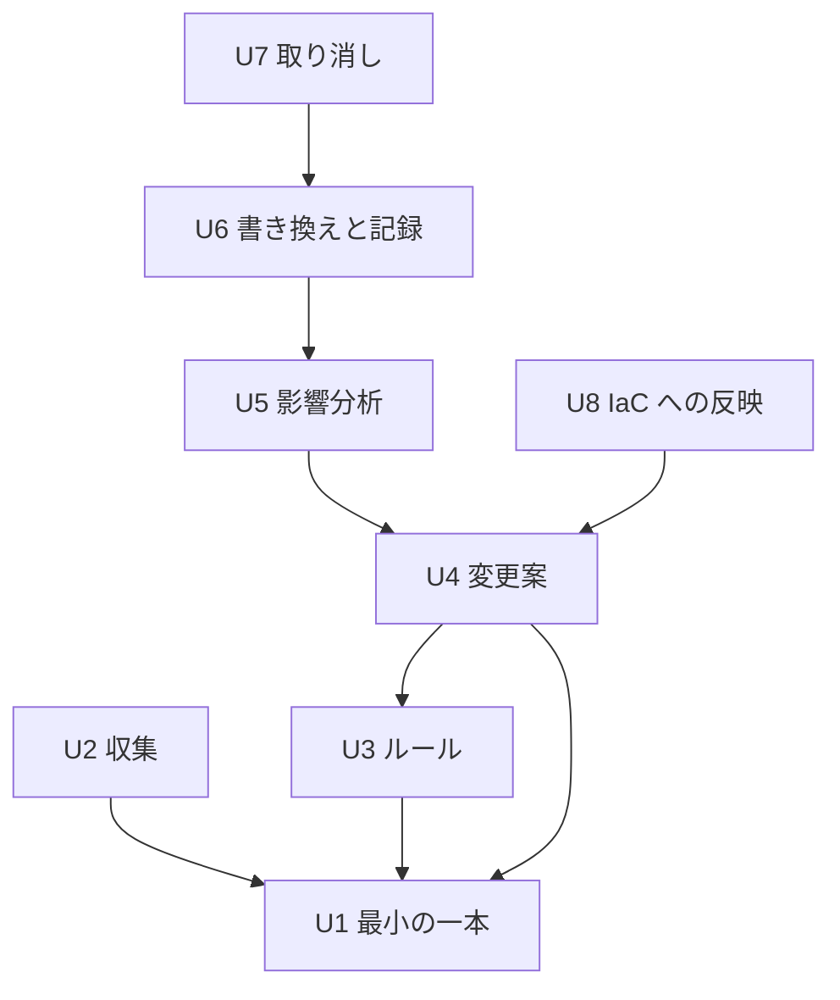

# 作業単位の依存関係: tag-refactor

作業単位の間の「何が何に依存するか」だけを示します。作る順番や最も時間のかかる経路は、次の「作業計画」のステージで決めます。

## 依存関係(機械が読める形)

```yaml
units:
  - name: u1-walking-skeleton
    kind: service
    depends_on: []
  - name: u2-scan
    kind: library
    depends_on: [u1-walking-skeleton]
  - name: u3-rules
    kind: library
    depends_on: [u1-walking-skeleton]
  - name: u4-plan
    kind: library
    depends_on: [u1-walking-skeleton, u3-rules]
  - name: u5-impact
    kind: library
    depends_on: [u4-plan]
  - name: u6-apply
    kind: library
    depends_on: [u5-impact]
  - name: u7-rollback
    kind: library
    depends_on: [u6-apply]
  - name: u8-iac
    kind: library
    depends_on: [u4-plan]
```

## 図



矢印は「左が右に依存する」ことを表します。文章での説明: U1 にはどの作業単位も依存せず、U2、U3、U4 が U1 に依存します。U4 は U3 にも依存します。U5 は U4 に、U6 は U5 に、U7 は U6 に依存します。U8 は U4 に依存します。循環はありません。

## 依存の理由

| 依存 | 理由 |
|---|---|
| U2 → U1 | U1 で作った収集の骨組みと AwsAccess を完成させるため |
| U3 → U1 | U1 で作ったルールファイルの読み込みを完成させるため |
| U4 → U1 | U1 で作った変更案と表示の骨組みを完成させるため |
| U4 → U3 | 変更案は、必須タグの値や消すキーなど、完成したルールを使うため |
| U5 → U4 | 影響分析を、完成した変更案(4種類の変更)に組み込むため |
| U6 → U5 | apply の確認画面で、影響のある変更を示すため。保存した変更案を読むため |
| U7 → U6 | rollback は、apply が残した記録を使うため |
| U8 → U4 | IaC への反映は、保存した変更案を使うため |

## 作業単位の間の受け渡し

すべての作業単位は1つの実行ファイルの中にあるため、受け渡しはプログラムの中での呼び出しです。ネットワーク越しの呼び出しはありません。

| 受け渡し | 内容 | 使う作業単位 |
|---|---|---|
| 収集の結果(InventorySnapshot、Resource) | リソースとタグ、読めなかったリージョン、IaC の印 | U2 が作り、U3(候補の提案)と U4 が使う |
| ルール(RuleSet) | 正しいキー名・値、別名、必須タグ、消すキー | U3 が作り、U4 が使う |
| 変更案(Plan、Change) | 変更の一覧、影響、不完全の印 | U4 が作り、U5 が影響を加え、U6 と U8 が使う |
| 保存した変更案のファイル | apply と IaC への反映の入力 | U4 が書き、U6 と U8 が読む |
| 記録(RunRecord、JournalEntry) | 書き換え前後の状態 | U6 が書き、U7 が読む |

## 並行して進められる作業単位

Q2 で「依存関係さえ守れば並行してよい」と決めました。依存関係から、次の組は互いに依存しないため、並行して進められます。

- U2 と U3(どちらも U1 だけに依存)
- U2 と U4(U4 は U2 に依存しない)
- U5 と U8(どちらも U4 に依存し、互いには依存しない)
- U6・U7 と U8

## 最小の一本について

チームの進め方で、最初の作業単位を最小の一本にすると決めています(§Walking Skeleton)。依存関係の上でも、U1 はどの作業単位にも依存しないため、最初に作れます。U1 だけで `scan` と `plan` が端から端まで動き、個人の検証用 AWS アカウントで確かめられます。
