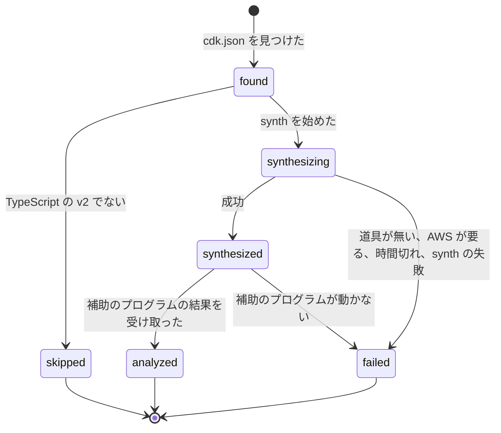
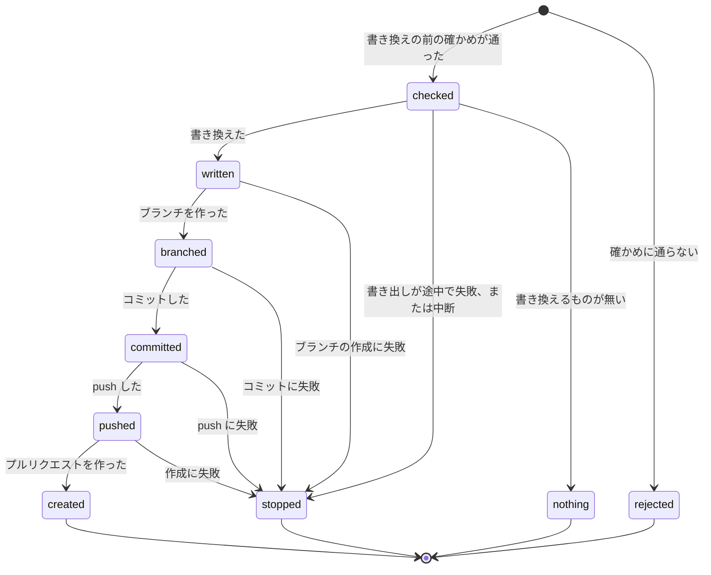
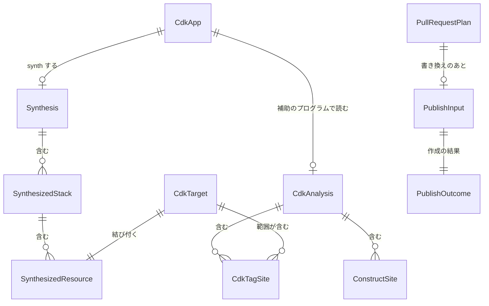

# 機能の仕様: U1 最小の一本

U1 の流れと状態の変わり方です。この文書が、流れの順番と状態の移り方の元になります。データの形は `entities.md`、判断の決まりは `rules.md` にあり、ここの図と表はそれらから写したものです。単位の定義は `inception/units-generation/unit-of-work.md`、部品は `inception/domain-design/components.md`、契約は `inception/contract-design/contract-summary.md`、要件は `inception/requirements-analysis/requirements.md` です。

## 1. U1 で動くもの

TypeScript の CDK v2 のアプリ1つに `Tags.of(x).add('キー', '値')` で付けたタグについて、変更案のキーの名前の変更をソースに反映します。`--pr` を付けると、書き換えたファイルだけをコミットしたプルリクエストを作ります。

U1 で扱わないものは次のとおりです。

| 扱わないもの | 扱う単位 |
|---|---|
| 書き換えの前の確かめの残り、`--pr-branch` などのオプション、途中の失敗の続きの命令、手で直す一覧の本文 | U2 |
| 複数のアプリ、`--cdk-app`、`--synth-timeout`、作成の記録による補い、端末でないときの進み具合の表示、`needsAWS` の文の一覧の残り | U3 |
| ほかの書き方と、値の変更、追加、削除 | U4 |
| Python | U5 |
| 手で直す一覧の CDK の理由の文 | U6 |

U1 の受け入れ条件のうち、ストーリーの一部だけを満たすものは次のとおりです。残りは後の単位で満たします。

| 受け入れ条件 | U1 で満たす部分 |
|---|---|
| AC1.1.1 | 書き換え、ブランチ、コミット、push、作成、URL の表示(既定の名前とタイトル) |
| AC2.1.2 | アプリ1つの synth と、標準エラーの状態の行(待ち、実行中、済み、失敗と経過時間) |
| AC2.1.3 | 認証情報を外した環境と、needsAWS の最小の判定(既知の文4つ)と対処の文 |
| AC2.1.6 | U1 で扱う形(BR2.2)のリソースの、ソースのファイルと行 |
| AC3.1.1 | 書き方 (1)(文字列そのまま)のキーの名前の変更と、synth し直しての確かめ |

## 2. 今の iac への取り込み方(FD-Q1)

CDK は、今の `internal/iac` のファイルごとの流れ(`run.go` の reflect → placeTargets → processAll → finish → write)に、次の4か所で入ります。差分、書き出し、反映済みの数え方、手で直す一覧のまとめ方は、今のものをそのまま使います。

| 場所 | 今の動き | CDK で足すこと |
|---|---|---|
| 対象の決定(`buildTargets`、`decideTool`) | stack-name と logical-id のタグで CloudFormation と決める | その前に CDK の照合(BR2.1)をする。結び付いた対象は Tool を ToolCDK にし、アプリ、コンストラクトのパス、リージョン、Global を持たせる。結び付かなかった対象は今までどおり CloudFormation に進む |
| 候補のファイル(`walkRoot` の candidate) | CloudFormation と Terraform のファイルを `--dir` の下から集める | 補助のプログラムの結果に出てくる TypeScript のファイルを、CDK の候補として足す(形式は CDK)。`walkRoot` は .ts を集めない。CDK の候補は補助のプログラムが名指したファイルだけ |
| 場所と読み取り(`placeTargets`、`parseContent`) | ファイルの形式ごとの読み取りで、論理 ID かアドレスからタグ一式(tagSite)を引く | CDK 用の読み取りを足す。補助のプログラムの結果から、対象のコンストラクトのパスに効くタグの箇所(BR2.2 の前方一致)を集め、1つのタグ一式(tagSite)として返す。各箇所はタグ一式の1つの要素(tagEntry)になり、キーと値の範囲は Edit の位置。読み取りの前に、各範囲のバイトが引用符つきの文字列と一致することを確かめ、一致しなければ今の unreadableFile にする。対象の場所(place)は、変更前のキーの箇所のあるファイルと行 |
| 書き換えの確かめ(`editFile` の `checkEdits`) | 同じ形式で読み直し、タグ一式が期待どおりか確かめる | CDK のファイルは `editFile` の中では確かめず、`processAll` と `finish` の間で、書き換えを作ったアプリごとに Recheck を1回呼んで確かめる(BR3.4)。`--write` の有無によらず行う。合わないファイルの書き換えは捨て、その変更を手で直す一覧に出す |

書き換えの作り方(`buildEdits`)は、CDK ではキーか値の範囲の置き換えだけを作ります。要素を足す、消すことは U1 ではしません(U4)。

## 3. 流れ W1: `iac`(`--pr` なし)

1. 入力を読む(今の `iac` と同じ。`--plan`、`--dir`、`--tf-state`、`--write`)。
2. 変更案のリソースごとに、IaC の種類を決める(今の `iac` と同じ)。`aws:cloudformation:stack-name` のタグのリソースが1つも無ければ、手順 3〜6 を飛ばす(BR1.1)。
3. `--dir` の下で `cdk.json` を探し、アプリを見つける(BR1.1)。アプリの言語と版を決める(BR1.2)。TypeScript の v2 でなければ、そのアプリは synth せずに外す。synth するアプリの一覧を「待ち」として示す(BR1.7)。
4. アプリを synth する(BR1.3、BR1.4)。
   1. 認証情報を外した環境を作る。
   2. 一時的なフォルダーを出力先にして `cdk synth` を動かす(上限 10 分)。
   3. 出力の manifest とテンプレートから、スタック(名前、アカウント、リージョン)とリソース(論理 ID、種類、コンストラクトのパス、タグ)を読む。
   4. 一時的なフォルダーを消す。
   5. 失敗したら、理由を種類に分ける(BR1.5)。
   6. 状態の行(実行中、済み、失敗と経過時間)を標準エラーに出す(BR1.7)。
5. 変更案のリソースを synth のリソースに結び付ける(BR2.1)。結び付いたものが CDK の対象になる。結び付かなかったものは、手順 6 のあとで今までどおり CloudFormation のテンプレートを探す。
6. CDK の対象のあるアプリごとに、補助のプログラムを1回動かす(契約 C4 の analyze)。
   1. 埋め込んだ JavaScript を一時的なフォルダーに書き出す。
   2. `node` で動かす。環境は手順 4 と同じ規則で作る。
   3. 要求として、対象のコンストラクトのパスを渡す。
   4. 結果として、タグの箇所と作成の箇所を受け取る。
   5. 結果の版を確かめる。違えば止める(終了コード 1)。
   6. 補助のプログラムが失敗したら、BR1.6 のとおりアプリを failed にするか、そのファイルだけを外す。
7. CDK の対象ごとに、作成の箇所とタグの箇所を探す(BR2.2)。範囲がそのリソースを含むタグの箇所を集め、2節のとおり今の `iac` のファイルごとの流れに入れる(FD-Q1)。結び付かず CloudFormation のテンプレートでも見つからないリソースは、synth できなかったアプリがあればその理由で手で直す一覧に出す(BR2.3)。
8. ファイルごとに書き換えを作る(BR3.1、BR3.2、BR3.3)。キーの名前の変更は、キーの範囲だけを書き換える。
9. `--write` の有無によらず、書き換えを作ったアプリごとに、書き換えたあとの内容をまとめて補助のプログラムで読み直す(BR3.4、契約 C4 の recheck)。確かめに合わないファイルは差分にも書き出しにも入れない。
10. 差分を示し、`--write` があれば今の `iac` と同じ方法でファイルを置き換える。
11. 結果を示す。終了コードは、書き出しの失敗で 1、手で直すものか synth できなかったアプリがあれば 2、それ以外は 0(契約 X1、C7 の exit_code_rule)。

## 4. 流れ W2: `iac --pr`

`--pr` は `--write` を含みます。W1 の手順に、確かめと作成を足します。

1. 入力を読む。
2. 書き換えの前に確かめる(BR4.1、契約 C1 の Check)。
   1. ネットワークを使わない確かめを先にする。リポジトリの根と Git の管理フォルダーを決め、HEAD がブランチを指すこと、merge や rebase の途中でないこと、リモートを決め GitHub であることを確かめる。
   2. 次に `gh` があってログイン済みであることを確かめる。
   3. 満たされない項目があれば、どのファイルも変えずに理由を示して終了コード 1。
3. W1 の手順 2〜10 を `--write` ありで行う。
4. 書き出しが途中で失敗したか中断されたら、作成に進まず、書けたファイルと書けなかったファイルを示して終了コード 1(BR4.2)。書き出したファイルが無ければ、何も作らず、W1 と同じ結果を示す(BR4.2)。
5. 本文を組み立てる(BR4.4)。タイトルは既定の文にし、変更案のファイル名の ARN の形や 12 桁の数字は伏せ字にする(BR4.3)。
6. 作成する(BR4.2、契約 C1 の Publish)。
   1. 既定の名前でブランチを作る(`git switch -c`)。
   2. 書き出したファイルだけを `git add -- <files>` と `git commit --only -m <タイトル> -- <files>` でコミットする。フックと署名は利用者の設定のままで、標準入力と標準エラーは端末につなぐ(BR4.5)。
   3. リモートに push する。
   4. 本文を Git の管理フォルダーの下のファイルに書き、`gh pr create --base <実行したときのブランチ> --head <ブランチ> --title <タイトル> --body-file <ファイル>` で作る。
   5. URL を1行で出す。
7. どこかの段階で失敗したら、そこで止め、済んだ段階と失敗した段階を示して終了コード 1。済んだことは元に戻さない。成功しても失敗しても、手元は新しいブランチに切り替わったままにする。

## 5. 状態の移り方

### CDK のアプリ

文の代わり: 見つけたアプリは、TypeScript の v2 でなければ外し(skipped)、そうでなければ synth します。synth に成功すると補助のプログラムで読み(analyzed)、synth か補助のプログラムが失敗すると failed になります。failed と skipped のアプリのリソースは、手で直す一覧に出ます。

### プルリクエストの作成

文の代わり: 確かめに通らなければ何も変えずに止まります(rejected)。通ったら書き換え、書き換えるものが無ければ何も作りません(nothing)。書き出しが途中で失敗したときも、作成に進まず止まります(stopped)。書き換えたら、ブランチ、コミット、push、作成の順に進み、途中で失敗するとそこで止まります(stopped)。止まっても、済んだことは元に戻しません。

## 6. エンティティの関係(entities.md から写したもの)

文の代わり: アプリは synth の結果と補助のプログラムの結果を1つずつ持ちます。変更案の対象は synth のリソース1つに結び付き、範囲がそのリソースを含むタグの箇所を持ちます。プルリクエストの作成は、確かめの結果、書き換えのあとの入力、作成の結果の順につながります。

## 7. 決まりのまとめ(rules.md から写したもの)

| 流れの手順 | 決まり |
|---|---|
| W1-2、W1-3 | BR1.1、BR1.2、BR1.7 |
| W1-4 | BR1.3、BR1.4、BR1.5、BR1.7 |
| W1-6 | BR1.6 |
| W1-5、W1-7 | BR2.1、BR2.2、BR2.3 |
| W1-8 | BR3.1、BR3.2、BR3.3 |
| W1-9 | BR3.4 |
| W2-2 | BR4.1 |
| W2-5、W2-6 | BR4.2、BR4.3、BR4.4、BR4.5 |
| テストと CI | BR3.5、BR5.1、BR5.2 |

## 8. 端の場合

| 場合 | 振る舞い | 決まり |
|---|---|---|
| 変更案に CloudFormation のリソースが無い | cdk.json があっても synth しない。出力は今までと同じ | BR1.1 |
| アプリが Python か v1、または版が分からない | synth せずに外す。結び付けられないリソースは、テンプレートを探したあとで、そのアプリの理由で手で直す一覧に出す | BR1.2、BR2.3 |
| アプリに node_modules/typescript が無い | アプリを failed にし、結び付けられないリソースを cdkAppFailed で一覧に出す | BR1.6、BR2.3 |
| AWS の認証情報の環境変数がある端末 | synth には渡さない。AWS の値を引くアプリは needsAWS で失敗する | BR1.3、BR1.5 |
| synth が 10 分を超える | 子のプロセスを止め、timeout の失敗にする | BR1.4 |
| `Tags.of(stack)` のように、範囲の下にほかのリソースも同じキーを持つ | 書き換えず、cdkScopeTag で手で直す一覧に出す | BR3.2 |
| キーか値が式(文字列のつなぎ合わせ、関数の呼び出しなど) | 書き換えず、cdkExpression で手で直す一覧に出す | BR3.1 |
| キーか値が定数、辞書、別のファイルの引数 | U1 では書き換えず、cdkUnsupportedShape で手で直す一覧に出す(U4 で扱う) | BR3.1 |
| 変更前のキーの箇所が2つ以上ある | 書き換えず、cdkAmbiguous で手で直す一覧に出す | BR3.1 |
| 同じスタックのクラスを2回使い、片方のリソースだけが変わる | 書き換えず、cdkSharedValue で手で直す一覧に出す | BR3.2 |
| 書き出しが2つ目のファイルで失敗する(--pr) | 作成に進まず、書けたファイルと書けなかったファイルを示し、終了コード 1 | BR4.2 |
| すでに新しいキーになっている | 反映済みに数える | BR3.3 |
| 読み直しで意図した形にならない | そのファイルは書かない | BR3.4 |
| `gh` がログインしていない | どのファイルも変えずに止まり、終了コード 1 | BR4.1 |
| push のあとで作成に失敗 | そこで止まり、済んだ段階を示し、終了コード 1。手元は新しいブランチのまま | BR4.2 |
| 書き換えるものが無い | ブランチもプルリクエストも作らない | BR4.2 |

## 9. 検証の筋書き(最小の一本のデモ)

1. テスト専用のリポジトリの `main` に、TypeScript の最小の CDK アプリを置く。中身は S3 のバケット1つと `Tags.of(bucket).add('Env', 'dev')`(FD-Q5)。
2. そのアプリを、検証用のアカウントにスタック `tag-refactor-cdk-skeleton` として置く。変更を見せて、人の明示の許可を得てから行う。
3. `Env` を `Environment` に変えるタグの規則で `scan` と `plan` を行い、変更案を作る。
4. テスト専用のリポジトリを手元に clone し、アプリのフォルダーで `npm ci` を実行してから、`iac --plan <変更案> --dir <clone> --pr` を動かす。
5. テスト専用のリポジトリにプルリクエストができ、その差分がキーの1か所だけであることを確かめる。

この筋書きを動かすコマンドは U1 の Code Generation で作り、U1 の検証の前に人の承認を得ます。
