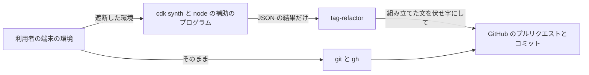

# セキュリティの設計: U1 最小の一本

要件は `construction/u1-walking-skeleton/nfr-requirements/security-requirements.md`(NFR1.x、NFR2.x)、流れは `construction/u1-walking-skeleton/functional-design/functional-spec.md`、契約は `inception/contract-design/contract-summary.md` の C1、C5、X2 です。出典の ND-Q… は、このステージの `nfr-design-questions.md` の回答です。

## 1. 守るものと境目

文の代わり: 利用者の環境は、git と gh にはそのまま渡し、synth と補助のプログラムには認証情報を外して渡します。公開の場(プルリクエストとコミット)に出す文は tag-refactor が組み立て、伏せ字を通します。

## 2. 認証情報の遮断(NFR2.1、NFR2.2)

1. `internal/cdk` の環境を作る関数が、親の環境を1つずつ見て、名前を大文字に直したものが `AWS_` で始まるもの、または GitHub のトークンの4つの名前のものを外す。
2. `os.CreateTemp` で空のファイルを2つ作り、`AWS_SHARED_CREDENTIALS_FILE` と `AWS_CONFIG_FILE` に入れる。`AWS_EC2_METADATA_DISABLED=true`、`CDK_DISABLE_VERSION_CHECK=1`、`CDK_DISABLE_CLI_TELEMETRY=true` を足す。
3. 一時ファイルは、呼び出しの関数が `defer` で消す。中断(Ctrl+C)のときも、文脈の取り消しのあとに同じ `defer` が走る。
4. テストは、この関数を直接呼び、外した変数が無く足した値があることを確かめる。Windows のテストでは、小文字の `aws_profile` も外れることを確かめる。

## 3. 外のプログラムの出力の扱い(NFR1.2、NFR1.4、ND-Q1)

| 呼び出し | 標準入力 | 標準出力 | 標準エラー |
|---|---|---|---|
| `cdk synth` | 空 | 読み捨て | 取り込む。失敗の分類に使い、`--debug` のときだけ伏せ字を通して出す |
| 補助のプログラム(node) | 要求の JSON | 結果の JSON | 取り込む。`--debug` のときだけ伏せ字を通して出す |
| `git commit`、`git push` | 端末 | 読み捨て | 端末に直接つなぐ(フックと署名の対話のため。起動の仕方は reliability-design.md の1節の「対話」)。利用者の端末にだけ出て、プルリクエストにも記録にも入らない |
| ほかの `git`、`gh` | 空 | 取り込む(必要なものだけ使う) | 取り込む。失敗したときだけ、伏せ字を通して表示と `--debug` に出す |

外のプログラムの出力は、タイトル、本文、コミットのメッセージには入れません。理由の文は、表示の文の一覧(カタログ)の固定の文と、道具の名前だけです。

git の環境は、今の `internal/iac` の `gitEnv` と同じ決まりにします(`GIT_` で始まる変数を外し、`GIT_OPTIONAL_LOCKS=0`、`GIT_LITERAL_PATHSPECS=1`、`GIT_TERMINAL_PROMPT=0` を足す)。ただし対話の `git commit` と `git push` では、資格情報やパスフレーズの入力ができるよう `GIT_TERMINAL_PROMPT=0` を足しません。gh には利用者の環境をそのまま渡します。

## 4. 伏せ字の規則(NFR1.2、NFR1.3、NFR1.4)

伏せ字は1つの関数(`internal/redact`)にまとめ、表示、`--debug`、タイトル、本文、コミットのメッセージのすべてで使います。伏せる形は次の閉じた一覧で、それ以外は伏せません。一覧を増やすときは、この文書とテストを一緒に直します。置き換えは、契約 X2 のとおり、どの形も `<redacted>` にします。

| 形 | 決まり |
|---|---|
| ARN | `arn:aws` に英字かハイフンが続き、`:` のあと、空白、引用符(`"`、`'`、バッククォート)、`,`、`;`、閉じ括弧(`)`、`]`、`}`)、`<`、`>` のどれかの手前までを1つの ARN とする |
| 12 桁の数字の並び | 前後が数字でない、ちょうど 12 桁の数字 |
| AWS のアクセスキーの ID | `AKIA` か `ASIA` で始まり、英大文字と数字が 16 文字続くもの |
| GitHub のトークン | `ghp_`、`gho_`、`ghu_`、`ghs_`、`ghr_`、`github_pat_` で始まり、英数字と `_` が続くもの |
| URL の userinfo | `://` と `@` の間(`/` を含まない部分) |

`--pr-body-file` の中身は利用者が書いたものなので、伏せ字を通しません(契約 X2)。U1 にはこのオプションが無いので、U2 で足すときにこの決まりを守ります。

synth と補助のプログラムの標準エラーは、残す行を決める方式(許す行の一覧)にします。ソースの中身が出る行の形を数え上げて落とす方式にはしません。残すのは次の形の行だけで、ほかの行はすべて落とし、落とした行の数だけを示します。

- `<ファイル>(<行>,<桁>): error TS<番号>: <メッセージ>` と `<ファイル>:<行>:<桁> - error TS<番号>: <メッセージ>`(TypeScript の診断の1行目)
- `Error:`、`TypeError:`、`SyntaxError:`、`TSError:` などで始まる1行(例外の名前とメッセージ)
- `at ` で始まるスタックの行(関数の名前とファイルと行と桁だけで、ソースの中身を含まない)
- 補助のプログラムが自分で出す `tag-refactor-helper:` で始まる行

残した行も、上の伏せ字を通します。

## 5. 補助のプログラムの書き出し(NFR2.3)

1. 埋め込んだ補助のプログラムの SHA-256 を、プログラムの開始のあと最初に使うときに、埋め込んだバイトから計算して覚える(`sync.Once`)。ビルドの手順は増やさない。
2. `os.MkdirTemp` で一時的なフォルダーを作る。Unix では権限を 0700 にする。Windows では、作ったフォルダーに、本人だけが読み書きでき、上から受け継がない ACL を付ける(`golang.org/x/sys/windows` の `SetNamedSecurityInfo` で、本人の SID だけを許す)。`TMP` がどこを指していても、このフォルダーは本人だけのものになる。
3. ファイルを 0600 で作り、埋め込んだ中身を書いて閉じる。
4. 書いたファイルを読み直し、SHA-256 が1の値と同じことを確かめる。違えば、そのアプリを failed(helper)にする。
5. すぐに `node <ファイル>` で起動し、終わったらフォルダーごと消す。

テストのために、書いてから確かめるまでの間に呼ぶ差し込み口(テストのときだけ値を入れる関数の変数)を置き、ファイルを書き換えたときに起動しないことを確かめます。確かめてから起動するまでの短い隙は残りますが、フォルダーが本人だけのものなので、受け入れる残るリスクです。

## 6. CI のトークン(NFR2.4、ND-Q2)

### トークンと secret

- fine-grained トークンは、テスト専用のリポジトリだけに、Contents と Pull requests の読み書きだけを許し、期限を 90 日にする。期限の前に人が作り直す(external-dependency-map.md の E1)。
- secret `TAG_REFACTOR_TEST_REPO_TOKEN` とリポジトリの変数 `TAG_REFACTOR_TEST_REPO` は、`ci.yml` の新しい仕事 `github-pr` の、結合テストの手順の `env` にだけ書く。その手順は `go test -run '^TestGitHubPullRequest$' ./internal/cli/` だけを動かし、ほかのテストにはトークンが見えない。

### テストの中での渡し方

検証の対象は `tag-refactor iac --pr` で、git と gh はその子として環境を受け取ります(契約 C5)。そのため、テストは tag-refactor をビルドして別のプロセスとして動かし、その環境をテストが作ります。

1. テストは `TAG_REFACTOR_TEST_REPO_TOKEN` を読み、すぐに自分のプロセスの環境から消す(`os.Unsetenv`)。
2. テスト専用のリポジトリの clone は、`GH_TOKEN` だけを入れた環境で `gh repo clone` を動かして作る。
3. clone のリポジトリの設定(そのリポジトリだけの設定ファイル)に `credential.https://github.com.helper=!gh auth git-credential` を書く。git push は、この設定で gh から資格情報を受け取る。トークンの値は設定に書かない。
4. `npm ci` は、`GH_TOKEN` も `TAG_REFACTOR_TEST_REPO_TOKEN` も無い環境で動かす。
5. tag-refactor は、`GH_TOKEN` を入れ、`TAG_REFACTOR_TEST_REPO_TOKEN` を外した環境で動かす。tag-refactor の中では、synth と補助のプログラムの環境から `GH_TOKEN` が外れる(2節)。git と gh には `GH_TOKEN` がそのまま渡る。
6. 後片付け(プルリクエストを閉じてブランチを消す)も、`GH_TOKEN` だけを入れた環境の gh で行う。

### 自動テストで確かめること

- 差し替えた実行の口で、`npm ci` の子の環境に `GH_TOKEN` と `TAG_REFACTOR_TEST_REPO_TOKEN` が無いこと。
- synth と補助のプログラムの環境を作る関数に `GH_TOKEN` と `TAG_REFACTOR_TEST_REPO_TOKEN` の入った環境を渡すと、どちらも外れること(`TAG_REFACTOR_TEST_REPO_TOKEN` も、外す名前の一覧に入れる)。
- ワークフローのファイルを読み、`TAG_REFACTOR_TEST_REPO_TOKEN` を参照する箇所が `github-pr` の仕事の1つの手順の `env` だけであること。

## 7. 信頼できないリポジトリと行き先(ND-Q5)

- README の `iac` の節と `iac --help` に、「CDK のアプリがあるときの iac は、そのリポジトリのコードを `cdk synth` で動かす。信頼できるリポジトリでだけ使う」と書く(README は U2 で直すときに含め、`--help` は U1 で足す)。
- `--pr` では、作成の前に、リモート(URL は userinfo を除く)、行き先のブランチ、作るブランチを標準エラーに1行で示す。確認の問いは出さない(FR1.9)。

## 8. 合否の基準を機械で確かめる方法(NFR1.1、NFR2.4)

- NFR1.1: `internal/pullrequest` と `internal/cdk` のコードに、`GH_TOKEN`、`GITHUB_TOKEN` を読む `os.Getenv` が無いことを、ソースを読むテストで確かめる(外すための名前の一覧は、比べるためだけに使う)。
- NFR2.4: 6節のとおり、ワークフローのファイルを読むテストと、子のプロセスの環境を見るテストで確かめる。
