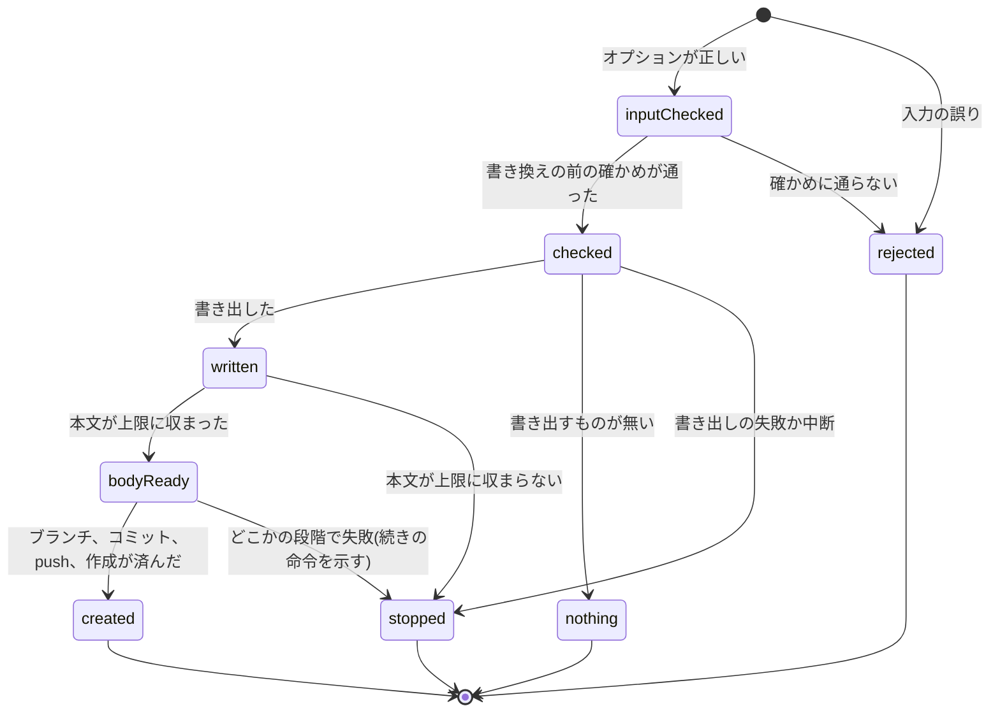
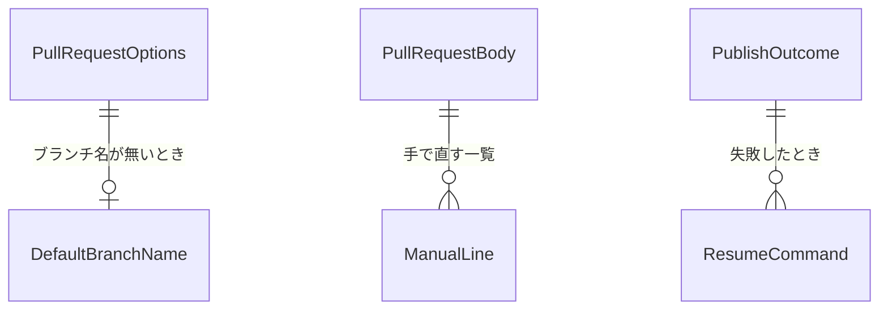

# 機能の仕様: U2 プルリクエストの作成(残り)

U2 の流れです。この文書が、流れの順番と状態の移り方の元になります。データの形は `entities.md`、判断の決まりは `rules.md` にあり、ここの図と表はそれらから写したものです。単位の定義は `inception/units-generation/unit-of-work.md`、部品は `inception/domain-design/components.md`、契約は `inception/contract-design/contract-summary.md`、要件は `inception/requirements-analysis/requirements.md` です。

## 1. U1 から変わるところ

U1 で、`iac --pr` の流れ(確かめ、書き換え、ブランチ、コミット、push、作成)と、そのほとんどの確かめはできています。U2 で足し、仕上げるのは次のとおりです。

| 足すもの | 場所 | 決まり |
|---|---|---|
| `--pr-branch`、`--pr-title`、`--pr-body-file` と、その入力の誤り | `internal/cli`、`internal/pullrequest` の Check | BR1.1、BR1.3 |
| 既定のブランチ名を UTC にする | `internal/pullrequest` の DefaultBranch | BR1.2 |
| 同じ名前のブランチがリモートにあるかの確かめ | `internal/pullrequest` の Check | BR2.1 |
| 本文に、変更したファイルの種類と手で直す一覧を載せる。上限を超えたときの扱い | `internal/display` の本文の組み立て | BR3.1〜BR3.3 |
| 書き換えるものが無いときの表示と終了コード | `internal/cli` | BR4.1、BR4.2 |
| 途中で失敗したときの続きの命令 | `internal/pullrequest` の Publish、`internal/display` | BR4.3 |
| README の `iac` の節(オプションと終了コード) | `README.md` | 契約の決まり |

U1 から変えないもの:

- リモートの決め方
- 行き先のブランチがリモートにあることの確かめ
- merge などの途中でないことの確かめ
- `git commit --only` のコミット
- 段階ごとの上限
- 伏せ字

## 2. 流れ W1: `iac --pr`(U2 の形)

1. オプションを読む。`--pr` が無いのに `--pr-*` があれば、入力の誤りで終了コード 1(BR1.1)。
2. `--pr-body-file` を、コマンドを動かしたフォルダーから読み、UTF-8 で 1 MiB まで、60,000 文字までであることを確かめる。`--pr-title` を伏せ字に通し、空でなく 256 文字までであることを確かめる(BR1.1)。
3. 書き換えの前に確かめる(U1 の BR4.1 と、BR2.1〜BR2.3)。どれかに当たれば、どのファイルも変えずに理由と対処を示して終了コード 1。
   1. ネットワークを使わない確かめ: リポジトリの根、HEAD がブランチ、merge などの途中でない、リモートの決定と GitHub、ブランチ名が正しい、手元に同じ名前のブランチが無い、タイトルが正しい。
   2. ネットワークの確かめ: gh のログイン、行き先のブランチがリモートにある、作るブランチがリモートに無い。
4. iac の流れ(U1)で書き換えを作り、--write と同じ確かめ(gitCheck)のあとで書き出す。
5. 書き出しが途中で失敗したか中断されたら、作成に進まず終了コード 1(U1 の BR4.2)。
6. 書き出したファイルが無ければ、何も作らない。手で直す項目も synth できなかったアプリも無ければ「反映するものはありません」で 0、あれば一覧とアプリの状態を示して 2(BR4.1)。
7. 本文を組み立てる(BR3.1〜BR3.3)。tag-refactor の作る部分にだけ伏せ字を通してから、利用者の本文とつなぐ。上限を超えて省いても収まらなければ、作成に進まず終了コード 1。
8. 作成する。Publish の始めに本文のファイルを書き、ブランチ、コミット(書き出したファイルだけ、フックと署名はそのまま、BR2.4)、push、作成の順に進む。タイトルとコミットのメッセージは `--pr-title` か既定の文(BR1.3)。
9. 成功したら URL を1行で示す。終了コードは、手で直す項目か synth できなかったアプリがあれば 2、無ければ 0(BR4.2)。
10. 途中で失敗したら、済んだ段階、失敗した段階と原因、続きの命令、本文のファイルの場所を標準エラーに示して終了コード 1(BR4.3)。

## 3. 本文の形

`--pr-body-file` が無いとき(英語の例):

```text
Opened by tag-refactor iac --pr. ...

## Changed files (2)
- `lib/stack.ts` (CDK, TypeScript)
- `infra/app.yaml` (CloudFormation)

## To fix by hand (1)
- `infra/app.yaml:12` Bucket, Env: the value differs from the plan
```

`--pr-body-file` があるときは、紹介の行の代わりにファイルの中身を最初に置き、そのあとに同じ2つの節を置きます。手で直す一覧が上限で省かれるときは、最後の行を「- ほか N 件(全部はこのコマンドの表示を見てください)」にします。

## 4. 状態の移り方



文の代わり: オプションや書き換えの前の確かめに通らなければ、何も変えずに止まります(rejected)。書き出すものが無ければ何も作りません(nothing)。書き出したあと、本文が上限に収まれば作成に進み、収まらないか、作成のどこかで失敗すると止まります(stopped)。止まったときは、済んだ段階と続きの命令を示し、済んだことは元に戻しません。

## 5. エンティティの関係(entities.md から写したもの)



文の代わり: オプションにブランチ名が無いときは、既定の名前を作ります。本文は手で直す一覧の行を持ち、作成の結果は、失敗したときに続きの命令を持ちます。

## 6. 決まりのまとめ(rules.md から写したもの)

| 流れの手順 | 決まり |
|---|---|
| W1-1、W1-2 | BR1.1 |
| W1-3 | BR1.2、BR2.1、BR2.2、BR2.3 |
| W1-6 | BR4.1 |
| W1-7 | BR3.1、BR3.2、BR3.3 |
| W1-8 | BR1.3、BR2.4、BR5.1 |
| W1-9 | BR4.2 |
| W1-10 | BR4.3、BR4.4 |

## 7. 端の場合

| 場合 | 振る舞い | 決まり |
|---|---|---|
| `--pr-title` を `--pr` なしで付けた | 入力の誤りで終了コード 1。ファイルは変わらない | BR1.1 |
| `--pr-body-file` が 1 MiB か 60,000 文字を超える、UTF-8 でない | 入力の誤りで終了コード 1。ファイルは変わらない | BR1.1 |
| `--pr-title` が伏せ字で変わる | 伏せ字のあとの文で確かめ、変わったことを1行で示す | BR1.1 |
| 作業ツリーとステージにほかのファイルの変更があり、コミットのフックがある | コミットには書き出したファイルだけが入り、フックが動き、ほかのステージは残る | BR2.4 |
| 書き出すものは無いが、synth に失敗した CDK のアプリがある | 何も作らず、アプリの状態を示して終了コード 2 | BR4.1 |
| コミットのフックが失敗する | コミットの段階の失敗として止まり、続きの命令を示す | BR2.4、BR4.3 |
| gh は成功したが URL を読み取れない | 成功として扱い、`gh pr list --head <ブランチ>` で確かめるよう示す | BR4.3 |
| 作るブランチと同じ名前のブランチがリモートにある | どのファイルも変えずに止まり、`--pr-branch` で別の名前を付けるよう示す | BR2.1 |
| 追跡先が `upstream` | `upstream` に push し、そこにプルリクエストを作る | BR2.2 |
| 書き換えるファイルに未コミットの変更がある | どのファイルも変えずに止まる | BR2.3 |
| 手で直す項目が多く、本文が上限を超える | 一覧の後ろを省いて「ほか N 件」 | BR3.3 |
| すでに反映済み | 「反映するものはありません」で終了コード 0 | BR4.1 |
| 手で直すものだけが残る | 一覧を示して終了コード 2 | BR4.1 |
| push のあとで作成に失敗 | push したブランチと、`gh pr create --body-file ...` の続きの命令を示し、終了コード 1 | BR4.3 |
| 応答しない gh | 2 分で止まり、トークンは出ない | BR4.4 |
| Terraform の書き換えだけ | 同じ流れでプルリクエストを作る | BR5.1 |
