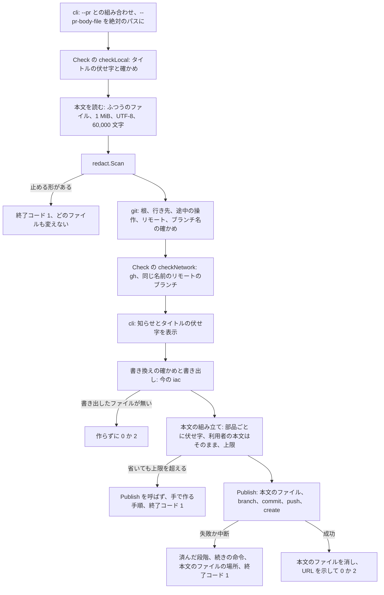

# 論理の部品: U2 プルリクエストの作成(残り)

U1 の論理の部品(`construction/u1-walking-skeleton/nfr-design/logical-components.md`)はそのままで、U2 では新しい部品を作らず、今の部品に足します。部品の一覧は `inception/domain-design/components.md`、契約は `inception/contract-design/contract-summary.md` です。セキュリティの設計は同じフォルダーの `security-design.md` にあります。すべての部品は1つのバイナリの中にあり、配置の単位は1つです。

| 部品(パッケージ) | U2 で足すこと | 効く非機能の設計 | 失敗の広がり |
|---|---|---|---|
| `internal/redact` | `Scan` と `Finding`(利用者の本文の形の確かめ) | security-design.md の2節 | なし(純粋な関数) |
| `internal/pullrequest` の Publisher(`Check`) | タイトルの伏せ字と確かめ、本文の読み取りと `Scan`、ブランチ名の確かめ(先頭の `-`、`check-ref-format` と出力の比べ)、既定のブランチ名を UTC と `Z` に | 2節、3節、6節 | 入力の誤りは書き換えの前に実行全体を止める(終了コード 1) |
| `internal/pullrequest` の Publisher(`Publish`) | 本文のファイルを始めに作る、伏せ字をやめる | 3節、5節 | 失敗した段階で止まる。済んだ段階は残る |
| `internal/pullrequest` の `resume.go`(新しいファイル) | 続きの命令、シェルの選び方、引用の関数 | 4節 | なし(純粋な関数) |
| `internal/display` | `PullRequestBody` を部品ごとの伏せ字と利用者の本文の受け取りに変える。手で直す一覧と上限での省略(BR3.3)。`PullRequestStopped(out, lines)`。新しい表示の文(英語と日本語) | 3節、4節、5節 | なし |
| `internal/cli` の `iac` | `--pr-*` と `--pr` の組み合わせの確かめ、`--pr-body-file` を絶対のパスに直す、知らせとタイトルの伏せ字の表示、失敗と中断のときの表示の順番、終了コード(BR4.1、BR4.2) | 2節、5節 | 実行全体 |
| `internal/testutil` | 偽の gh を、名前を選べる「引数を書き出す偽物」に広げる(`git` の代わりにも使える) | 4節の確かめ | テストだけ |
| CI(`.github/workflows/ci.yml`) | 変えない。windows-latest の test の仕事が、`powershell.exe` と `pwsh` の両方でシェルのテストを動かす。`github-pr` の仕事は `-run '^TestGitHubPullRequest$'` のままで、足したサブテストも動く | 4節、7節 | その仕事。`ci-gate` が待つ |

共有するものは、U1 と同じく利用者の端末の一時フォルダーと `--dir` の下のファイルに、`<GitDir>/tag-refactor/` の本文のファイルが加わります。本文のファイルは実行ごとに重ならない名前で作り、ほかの実行のファイルには触りません。

## 型と呼ぶ場所の変更

| もの | 今 | U2 |
|---|---|---|
| `CheckRequest.BodyFile` | U1 では空 | cli が絶対のパスにして入れる。`checkLocal` が読む(契約 C1 のまま) |
| `Plan.UserBody` | U1 では空 | `checkLocal` が読んだ本文を入れる(契約 C1 のまま)。cli が `PullRequestBody` に渡す |
| `Plan.Title` | 受け取ったタイトル | 伏せ字を通したタイトル |
| `Plan.TitleRedacted`(新しい欄) | なし | タイトルが伏せ字で変わったら true |
| `Plan.BodyNotices`(新しい欄) | なし | 知らせの `[]redact.Finding` |
| `PublishOutcome.ResumeCommands` | `[]string`(未使用) | 消す。続きの命令は cli が `pullrequest.ResumeCommands` で作る |
| `display.PullRequestBody` | `(lang, res, prefix) string`、全体に伏せ字 | `(lang, res, prefix, userBody) (string, bool)`、部品ごとに伏せ字。省いても上限を超えたら false |
| `display.PullRequestStopped` | `(out)` | `(out, lines []pullrequest.ResumeLine)` |
| `pullrequest.writeBody` | 作成の段階の中、固定の名前 | Publish の始め、`os.CreateTemp` |

`Plan` に足す2つの欄は、契約 C1 の `Plan` に足すものです。U2 の Code Generation で、契約の「Construction での直し」の表に1行足します。

## 処理の順番(U2 で決まるもの)

文の流れ: cli がオプションを確かめ、Check がタイトル、本文、git、gh の順に確かめます(止める形があれば終了コード 1)。そのあと知らせを表示し、書き換え、本文の組み立て、Publish の順です。Publish が失敗か中断で止まったら続きの命令を示して終了コード 1、成功したら本文のファイルを消して 0 か 2 です。

## 契約との関係

- 契約 X1 と X2 は、U2 の非機能の要件で直したもの(契約の「Construction での直し」)に従います。
- 契約 C1 の段階の名前(branch、commit、push、create)は変えません。本文のファイルが作れないときは、新しい段階を足さず、branch の段階の失敗として返します(security-design.md の5節)。
- 契約 C1 の `Plan` に `TitleRedacted` と `BodyNotices` を足します(上の表)。
- U1 の `notInU1`(アプリを1つだけ扱う一時的な扱い)は、U2 では変えません(U3 で消す)。
