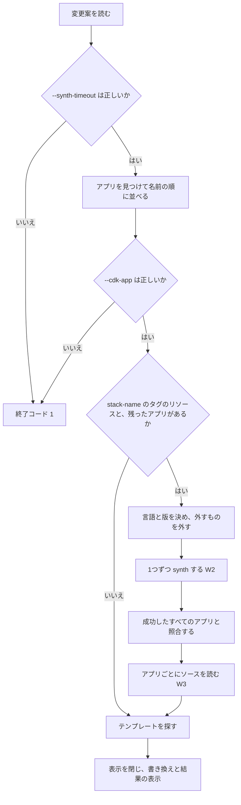
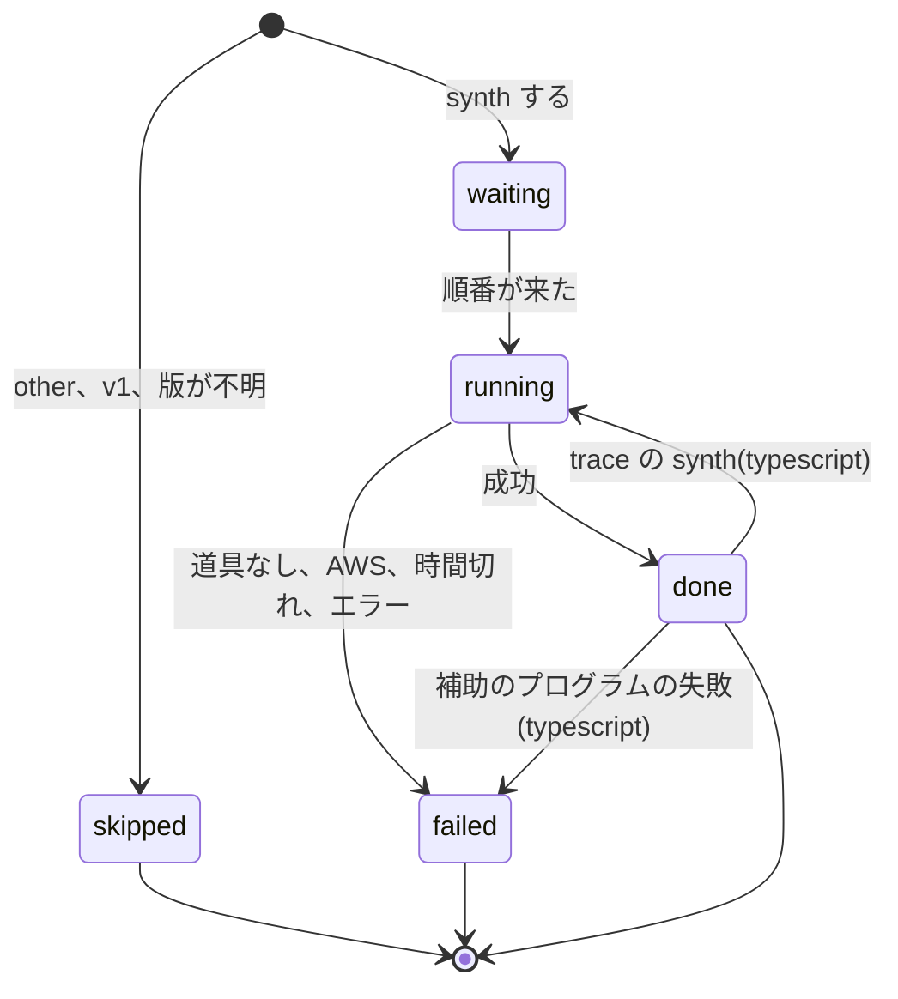
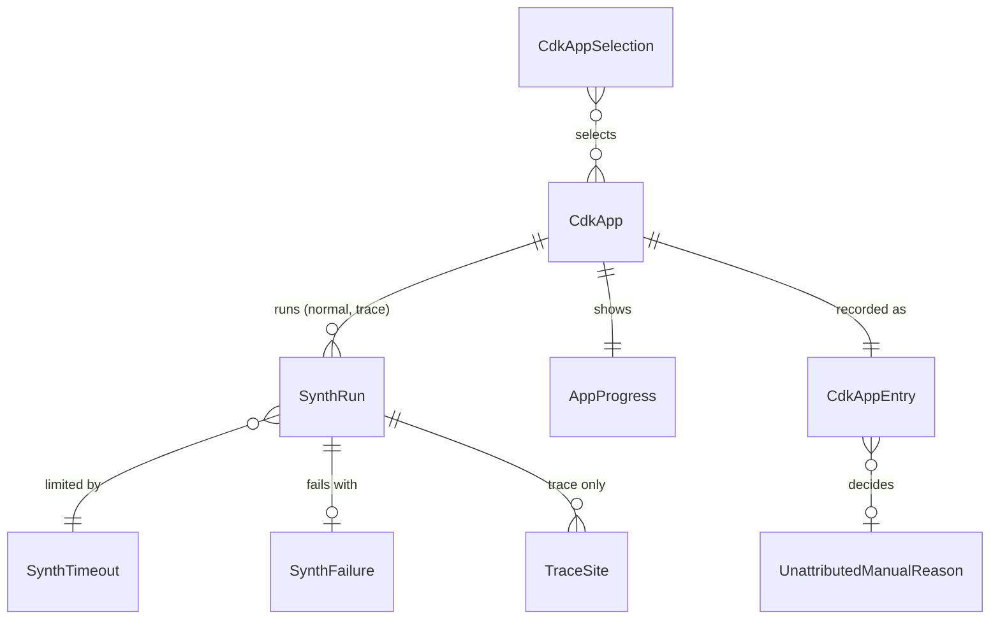

# 機能の仕様: U3 CDK の synth と対応づけ(残り)

U3 の振る舞いです。手順の流れと状態の移り変わりは、この文書が元です。データの形は `entities.md`、判断の決まりは `rules.md` が元で、この文書の図と表はそこから写したものです。

## 1. 範囲

U1 は、`--dir` の下の1つ目のアプリ(TypeScript の CDK v2)だけを synth し、ほかのアプリを「U1 では扱わない」として外していました。U3 はこれを次のように仕上げます。

| 仕上げること | ルール | 受け入れ条件 |
|---|---|---|
| 複数のアプリの発見と、名前の順の synth | BR1.1、BR1.4 | AC2.1.1、AC2.1.2 |
| `--cdk-app` での絞り込みと入力の確かめ | BR1.2 | AC2.1.1 |
| Python のアプリの版の判定と synth(`.venv` の Python) | BR1.3、BR2.1、BR2.2 | AC2.1.2、AC4.1.3、AC4.1.4 |
| `--synth-timeout` と、中断のときの後片付け | BR2.4、BR2.5 | AC2.1.4、AC2.1.5 |
| AWS が要るアプリの見分けと、認証情報の経路の遮断 | BR2.3、BR2.6 | AC2.1.3 |
| 一部のアプリの失敗のときに、ほかを続けること | BR2.7、BR3.3 | AC4.1.3 |
| 複数のアプリとの照合と、どのアプリか分からないリソースの理由 | BR3.1、BR3.2 | AC2.1.6、AC4.1.3、AC4.1.4 |
| 作成の記録での補い(ADR-004。TypeScript のアプリだけ) | BR4.1〜BR4.4 | AC2.1.6、AC4.1.4 |
| 進み具合の表示(端末と、端末でないとき) | BR5.1〜BR5.4 | AC2.1.2 |

含めないもの: TypeScript のほかの書き方と変更の種類(U4)、Python のソースの読み取りと Python のアプリでの作成の記録の使い方(U5。U3 では Python のアプリに結び付いた変更を手で直す一覧に出す、BR3.3)、手で直す一覧の理由の文の整え(U6)。

## 2. 流れ

### W1. iac の CDK の部分の全体

1. 変更案を読んだあと、`--synth-timeout` を確かめる(SynthTimeout、BR2.4)。誤りがあれば、どのファイルも変えずに終了コード 1。
2. `--dir` の下のアプリを見つけ、名前の順に並べる(BR1.1)。.git、node_modules、cdk.out、.venv、venv、リンクの下には入らない。変更案に `aws:cloudformation:stack-name` のタグのリソースが無く、`--cdk-app` も無いときは探さない。
3. `--cdk-app` があれば、2 で見つけたアプリと照らして確かめ、選んだアプリだけを残す(BR1.2)。誤りがあれば、どのファイルも変えずに終了コード 1。
4. 変更案に stack-name のタグのリソースが無いか、残ったアプリが無ければ、CDK の処理をせずに 10 に進む(BR1.1、NFR5)。
5. 各アプリの言語と版を決める(BR1.3)。外すアプリに「外した」を知らせ、CdkAppEntry を skipped にする。synth するアプリの一覧で「待ち」を知らせる(BR1.4)。
6. synth するアプリを名前の順に1つずつ W2 で synth する(BR1.4)。失敗したアプリは CdkAppEntry を failed にして次へ進む(BR2.7)。
7. 変更案のリソースを、成功したすべてのアプリのスタックと照合する(BR3.1)。
8. 結び付いたリソースがあるアプリごとに、名前の順に W3 を行う。typescript のアプリは補助のプログラムでソースを読み、補助のプログラムが失敗したアプリは failed にして、そのリソースを cdkAppFailed にして次へ進む(BR3.3)。python のアプリは U5 までは読まず、結び付いた変更を cdkUnsupportedShape にする(BR3.3)。
9. 実行中のアプリが無くなった時点で、進み具合の時計は止まっている(BR5.4)。表示は、次にほかの出力を書くときに閉じる。
10. 候補が0のリソースについて、CloudFormation のテンプレートを探す。見つからなければ、synth できなかったアプリ(synth に失敗したものと外したもの)があれば BR3.2 の理由で、無ければ今までどおり templateNotFound で手で直す一覧に出す。
11. CDK の書き換え(U1 と U4 の仕組み)、Terraform と CloudFormation の書き換えを今までどおり行う。結果を表示する前に、進み具合の表示を閉じる(BR5.4)。終了コードは、ほかに 1 が無く、手で直す項目か failed か skipped のアプリがあれば 2(BR2.7)。

<!-- Text fallback: 変更案を読み、--synth-timeout を確かめる(誤りなら終了コード 1)。アプリを見つけて並べ(stack-name のタグのリソースも --cdk-app も無ければ探さない)、--cdk-app を確かめて選んだものを残す(誤りなら終了コード 1)。stack-name のタグのリソースか残ったアプリが無ければテンプレートを探す。あれば、言語と版で外すものを外し、1つずつ synth し、成功したすべてのアプリと照合し、アプリごとにソースを読み、それからテンプレートを探し、進み具合の表示を閉じて書き換えと表示に進む。 -->

### W2. 1つのアプリの synth

1. 「実行中」を知らせる(AppStarted)。
2. 要る道具を確かめる: node、cdk、python のアプリでは BR2.2 で選ぶ Python(BR2.1)。`.venv` の Python があれば、python は見つかったとする。無ければ synth せず toolMissing で失敗を知らせ(running から failed)、W2 を終える。
3. 一時的な出力先を作り、BR2.3 の環境を作る。Python のアプリで `.venv` があれば、その実行ファイルのフォルダーを PATH の先頭に置き、VIRTUAL_ENV を入れる。さらに app の命令の最初の語が python、python3、py なら、それを `.venv` の Python の絶対パス(二重引用符で囲む)に置き換えた命令を、`cdk synth` の `--app` で渡す(BR2.2)。
4. `cdk synth --quiet --no-notices --output <出力先>`(3 で置き換えたときは `--app <命令>` も)を、アプリのフォルダーを作業のフォルダーにして、`--synth-timeout` の上限で動かす(BR2.4)。
5. 終わり方で分ける。
   - 0 で終わった: 出力先のクラウドアセンブリからスタックとリソースを読む(U1 と同じ)。読めなければ synthError。
   - 0 以外で終わった: BR2.6 の文で needsAWS か synthError。
   - 上限を超えた: 子まで止めて timeout。
   - 中断された: 子まで止めて、W5。
6. 出力先を消す(どの場合でも、BR2.5)。
7. 「済み」(経過時間つき)か「失敗」(経過時間と理由の種類つき)を知らせる。

### W3. 1つのアプリのソースの読み取りと、作成の記録での補い

1. python のアプリでは、Analyze を呼ばず、結び付いた変更を cdkUnsupportedShape にして W3 を終える(作成の記録での補いもしない。U5 で決める、BR3.3)。アプリの状態は done のまま。
2. typescript のアプリでは、結び付いたリソースのコンストラクトのパスを渡して、補助のプログラムで読む(Analyze、U1 と同じ)。失敗したら、アプリを failed にし、そのリソースを cdkAppFailed にして W3 を終える(BR3.3)。
3. コンストラクトのパスに合う作成の箇所が見つからないリソースを集める(BR4.1)。無ければ W3 を終える。
4. そのアプリを `cdk synth --debug` で、もう1回だけ synth する(W2 と同じ環境、上限、後片付け。BR4.1)。IacWriter は、失敗の知らせを済みに読み替える包みの通知口を渡す(BR5.4)。表示は「実行中」に戻り、終わると「済み」になる。
5. 失敗した(時間切れを含む)なら、集めたリソースを cdkNoSource にし、理由を `--debug` に出して W3 を終える(BR4.3)。中断なら W5。
6. スタックとリソース(論理 ID とコンストラクトのパス)が1回目と同じかを確かめる。違えば、集めたリソースを cdkNoSource にして終える(BR4.4)。
7. 集めたパスについて、作成の記録から利用者のソースの最初の行を読み、TraceSite を作る(BR4.2)。
8. TraceSite を渡して、もう1回 Analyze する。補助のプログラムは、ソースで見つかった作成の箇所を先に使い、見つからないパスだけ TraceSite の行の new の式を使う(BR4.4)。
9. それでも作成の箇所が見つからないリソースを cdkNoSource にする。

### W4. 進み具合の表示

display.Printer が、契約 C6 の5つの知らせを受けて描き、時間で動く更新の時計も持ちます(BR5.4)。ProgressSink にメソッドは足しません。

1. 「待ち」の知らせで、表示を始める。端末で、カーソルを動かす書き方が使えれば書き直しの表(BR5.1)、そうでなければ1行ずつ足す形(BR5.2)。
2. 知らせのたびに、書き直しの表では表を書き直し(0.2 秒に1回まで)、1行ずつ足す形では1行を足す。
3. 実行中のアプリができたら(AppStarted)時計を動かし、実行中のアプリが無くなったら(最後の running が AppDone か AppFailed になったら)時計を止める。済みのアプリに AppStarted が来たら(trace の synth)、実行中に戻して経過時間を新しく数える。
4. 時計は1秒ごとに動き、書き直しの表では経過時間を書き直す。1行ずつ足す形では、実行中のアプリの最後の行から1分たったら「実行中(経過時間)」の1行を足す。時計が描くときも、知らせと同じ Printer のロックを取る。
5. Analyze と Recheck のあいだは、アプリを「済み」のまま見せる。
6. ほかの出力(結果の表、メッセージ)を書く前に、進み具合の表示を閉じ(endProgress)、時計を止める。CDK の処理の終わりの知らせは足さない。

### W5. 中断(Ctrl+C など)

1. 動いている外のプログラム(normal か trace の synth の cdk と、それが動かした node や python、または Analyze と Recheck の補助のプログラム)を、子まで止める。
2. 一時的な出力先と、環境と補助のプログラムのための一時ファイルを消す。
3. 進み具合の表示を閉じ、時計を止める。
4. どのファイルも書き換えずに、今の iac の中断と同じ表示をして、終了コード 1 で終える(BR2.5)。

## 3. 状態の移り変わり

### アプリの状態(AppProgress.state と CdkAppEntry.status)

| 今の状態 | きっかけ | 次の状態 | ルール |
|---|---|---|---|
| (見つかった) | 言語が other、版が 1 か 0 | skipped | BR1.3 |
| (見つかった) | synth するアプリの一覧に入った | waiting | BR1.4 |
| waiting | 自分の順番が来た(AppStarted) | running | BR1.4、BR2.1 |
| running | 道具が無い、AWS が要る、時間切れ、synth のエラー | failed | BR2.1、BR2.4、BR2.6 |
| running | synth が成功した | done | W2 |
| done | typescript のアプリで補助のプログラムが失敗した | failed | BR3.3 |
| done | python のアプリ(U5 まで Analyze をしない) | done のまま | BR3.3 |
| done | typescript のアプリで作成の箇所が見つからないリソースがあり、trace の synth を始めた | running | BR4.1、BR5.4 |
| running(trace) | trace の synth が終わった(成功でも失敗でも) | done | BR4.3、BR5.4 |
| どれでも | 中断された | (全体が終わる) | BR2.5 |

<!-- Text fallback: 見つかったアプリは、other、v1、版が不明なら skipped、それ以外は waiting。waiting は順番が来ると running(道具が無いときも、いったん running になってから failed)。running は成功で done、道具なし、AWS、時間切れ、エラーで failed。typescript のアプリの done は、補助のプログラムの失敗で failed、作成の箇所が見つからなければ trace の synth で running に戻り、終われば done。python のアプリは done のまま。 -->

trace の synth の失敗では failed にしません(1回目の結果を使うため、BR4.3。包みの通知口が失敗を済みに読み替える、BR5.4)。CdkAppEntry の elapsed は、1回目と2回目の合計です。

## 4. エンティティの関係(entities.md から写したもの)

<!-- Text fallback: CdkAppSelection は CdkApp を選ぶ。CdkApp は SynthRun を 0〜2 回(normal と trace)持つ。SynthRun は SynthTimeout の上限を持ち、SynthFailure を 0 か 1 持ち、trace のときは TraceSite を持つ。CdkApp は AppProgress と CdkAppEntry を1つずつ持つ。synth できなかった CdkAppEntry の全体から UnattributedManualReason を1つ決める。 -->

## 5. ルールのまとめ(rules.md から写したもの)

| グループ | ルール | 要点 |
|---|---|---|
| 発見と選び方 | BR1.1〜BR1.4 | すべてのアプリを名前の順に(.venv と venv の下は見ない)。`--cdk-app` は発見のあと、書き換えの前に確かめる。Python の版は3つの依存の宣言のファイルから。1つずつ synth |
| synth の実行 | BR2.1〜BR2.7 | 「実行中」のあとに道具の確かめ(node、cdk、python)。`.venv` の Python と `--app` での置き換え。認証情報の経路の遮断。synth ごとの上限と子まで止めること。中断でも補助のプログラムまで止めて後片付け。needsAWS の文を増やす。失敗してもほかを続ける |
| 対象の決定 | BR3.1〜BR3.3 | 成功したすべてのアプリと照合。どのアプリか分からないリソースの理由は、synth できなかったアプリから優先で1つ。補助のプログラムの失敗はそのアプリだけ。Python のアプリは U5 まで手で直す一覧へ |
| 作成の記録 | BR4.1〜BR4.4 | TypeScript のアプリで見つからないときだけ `--debug` で synth し直す。利用者のソースの最初の行。2回目の失敗は1回目を使う。スタックが同じときだけ使う |
| 表示 | BR5.1〜BR5.4 | 端末では書き直しの表、端末でないときは変化ごとと1分ごと。外のプログラムの出力は `--debug` だけ。時計は display.Printer が持ち、通知口は変えない |
| テスト | BR6.1 | Python と失敗の形のテスト用のアプリ。CI で `.venv` を作る |

## 6. 例

### 例 1: 2つのアプリのうち1つで Python が無い(AC4.1.3)

- `--dir` の下に `infra/py`(Python、v2、`.venv` なし)と `infra/ts`(TypeScript、v2)がある。端末に Python が無い。
- 表示(端末でないとき): `infra/py: 待ち`、`infra/ts: 待ち` → `infra/py: 実行中` → `infra/py: 失敗 0s(道具が無い: python。Python 3 を入れてください)` → `infra/ts: 実行中` → (1分後)`infra/ts: 実行中 1m00s` → `infra/ts: 済み 1m12s`。
- `infra/ts` のリソースの変更は反映される。どのアプリにも結び付かず、テンプレートにも無いリソースは、cdkAppFailed(道具 python)で手で直す一覧に出る。終了コードは 2。

### 例 2: `--cdk-app` で絞り込む(AC2.1.1)

- `--cdk-app infra/ts` を付けると、`infra/py` は synth されず、アプリの状態の一覧にも出ない。
- `--cdk-app infra/none` や `--cdk-app ../other` は、どのファイルも変えずに入力の誤り(終了コード 1)。変更案に stack-name のタグのリソースが無くても、同じく確かめる。

### 例 3: 作成の箇所がソースで見つからない(AC4.1.4)

- TypeScript のアプリで、コンストラクトの ID を変数で作っているため、補助のプログラムがパス `Stack/Bucket` の作成の箇所を見つけられない。
- そのアプリだけを `cdk synth --debug` で synth し直し、作成の記録の最初の利用者のソースの行(例 `lib/stack.ts` の 12 行目)を TraceSite にして、もう1回読む。見つかればそのリソースの変更を反映し、見つからなければ cdkNoSource で手で直す一覧に出す。
