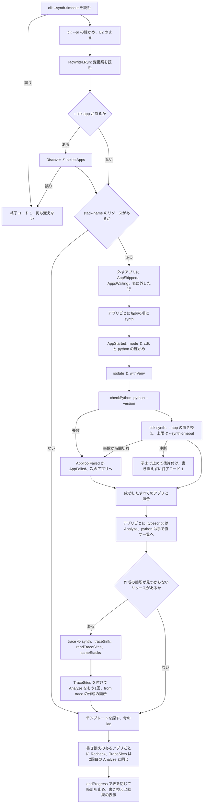

# 論理の部品: U3 CDK の synth と対応づけ(残り)

U1 と U2 の論理の部品(`construction/u1-walking-skeleton/nfr-design/logical-components.md`、`construction/u2-pull-request/nfr-design/logical-components.md`)はそのままで、U3 では新しいパッケージを作らず、今の部品に足します。部品の一覧は `inception/domain-design/components.md`、契約は `inception/contract-design/contract-summary.md` です。セキュリティと、ほかの区分の非機能の設計は、同じフォルダーの `security-design.md` にあります(節の番号はその文書のもの)。すべての部品は1つのバイナリの中にあり、配置の単位は1つです。新しく作る型、関数、ファイルには「(足す)」と付けます。

| 部品(パッケージ) | U3 で足すこと、変えること | 効く非機能の設計 | 失敗の広がり | ほかの部品との境目 |
|---|---|---|---|---|
| `internal/cdk` の Synthesizer(`CdkSynthesizer`) | 発見で `.venv` と `venv` に入らない(`skippedFolders`)、`readDir` の変数(足す)。`python.go`(足す): `interpreter`、`venvPython`、`firstWord`、`isPythonWord`、`pythonFor`、`withVenv`、`appCommand`、`windowsQuotedApp`、`checkPython`、`MinPythonVersion`。`ReasonToolTooOld`(足す)。`Options.WithTrace` と `Synthesis.TraceSites`(足す)。`trace.go`(足す): `readTraceSites`、`traceFrame`、`userFile`。`toolName`、`homeForms`、`shortHome`(足す)。`Config.TempDir`、`Config.Home`、`Synthesizer.VersionTimeout`(足す)。任意の口 `ToolFailureSink`(足す) | 2節〜5節、8節、10節 | そのアプリだけ(failed)。ほかのアプリ、CloudFormation、Terraform の処理は続く。中断だけは実行全体を止める | `IacWriter` だけが呼ぶ。外のプログラム(`cdk`、`python`)は `procexec.Runner` を通して起動する。進み具合は `ProgressSink`(と、実装されていれば `ToolFailureSink`)で知らせる |
| `internal/cdk` の Analyzer(`CdkSourceAnalyzer`) | `Recheck` に `traces []TraceSite` を足し、要求の `traceSites` に入れる(今は空の配列で固定)。`keptLines` に `homes` を渡して `shortHome` を通す。`privateDir(base)` と `isolate(parent, tempDir)` に `Config.TempDir` を渡す。起動の回数、上限 2 分、呼び出しごとの `node --version` は変えない | 5節、8節 | そのアプリだけ(failed、cdkAppFailed) | `IacWriter` だけが呼ぶ |
| 補助のプログラム(`internal/cdk/helper/ts-helper.js`、変える) | 要求の `traceSites` を読む `traceSites` と `traceNew`(足す)。ソースのたどり方のあとに、ソースで見つからないパスだけ、記録の行の `new` の式を `from: "trace"` の作成の箇所として返す。recheck のときだけ、行がずれた式を2つ目の引数の文字列で探し直す。タグの箇所と足す場所の読み方、JSON の形、`HelperVersion` は変えない | 5節 | そのアプリだけ。式が見つからないパスは作成の箇所を出さない(analyze では cdkNoSource、recheck では食い違いで編集を捨てる) | Analyzer が1回の起動ごとに標準入出力の JSON(契約 C4)で使う |
| `internal/procexec` | 変えない。版の確かめも、python を含む synth も、今の上限つきの起動と木ごとの停止を使う | 8節 | 呼び出した1つの起動だけ | `internal/cdk` と `internal/pullrequest` が使う |
| `internal/iac` の IacWriter | `Request.CDKApps` と `Request.SynthTimeout`(足す)。`selectApps`(足す)を `Run` の始めで呼ぶ。`runner.apps`、`runner.discovered`(足す)。`prepareCDK` を複数のアプリの処理に書き直し、`synthesizeFirst` と `ReasonNotInU1` を消す。`traceSink`(足す)。trace の synth のスタックを比べる関数 `sameStacks(a, b []cdk.Stack) (bool, string)`(足す)。`cdkRun.traces`(足す)を Recheck に渡す。`compareAnalyses` の作成の箇所の比べ方を `sameConstructSites`(足す)にし、trace 由来のものはパスとファイルだけを比べる。`Writer` が synthesizer を持たないときは `selectApps` を呼ばない。BR3.2 の理由を、synth に失敗したアプリと外したアプリから決める | 6節、7節、8節、9節、11節 | `--cdk-app` の誤りは書き換えの前に実行全体を止める(終了コード 1)。アプリの失敗はそのアプリのリソースだけ(手で直す一覧)。中断は書き換えずに実行全体を止める | `CdkSynthesizer` と `CdkSourceAnalyzer` を、今の `cdkSynthesizer` と `cdkAnalyzer` のインタフェースを通して呼ぶ |
| `internal/display` の IacDisplay(`display.Printer`) | アプリの進み具合の表(`progress.apps`、`progress.byApp`、`appRow`)、外したアプリの通知を表ができるまで溜める `pendingSkipped` と `skippedApp`、表に無いアプリの通知を無視して `--debug` に1行出す扱い、時計(`Ticker`、`SetTicker`、`appClock`、`startClock`、`stopClock`、`tick`、`clockWG`)、`AppToolFailed` の実装、`cdkElapsed`、`iaccdk.go` と `iacCDKCatalog`(すべて足す)。`endProgress` で時計を止め、`Close` で時計のゴルーチンを待つ。`iac.cdkWhyNotInU1` を消す | 6節、9節、10節、11節 | なし(表示だけ)。時計の不具合があっても結果と終了コードは変わらない | `cdk.ProgressSink` と `cdk.ToolFailureSink` を実装する。`iac.Result` を読む |
| `internal/cli` の `iac` | `--cdk-app`(`StringArrayVar`)、`--synth-timeout`(`StringVar`、既定 `10m`)、`parseSynthTimeout`(足す)。`iac.Request` に2つの値を入れる。`iacLong` の CDK の段落を直す | 7節、8節、11節 | 実行全体(入力の誤りは書き換えの前に終了コード 1) | `IacWriter` に `iac.Request` で渡す |
| `internal/testutil` | `RequirePythonTools`、`RequirePythonToolsWith`、`ProcessAlive`(足す)。`CopyCDKApp` が `.venv` と `venv` を写さず、`.venv` をリンクでつなぐ | 8節、10節 | テストだけ | テストだけが使う |
| テスト用のアプリ(`internal/cdk/testdata/apps/`) | `py-minimal`、`ts-lookup`、`ts-profile`、`ts-v1`、`py-v1`、`unknown-version`、`other-lang`、`ts-trace`(足す) | 5節、10節 | テストだけ | テストだけが使う。`py-minimal` だけが依存を入れる |
| CI(`.github/workflows/ci.yml`、`release.yml`) | Go のテストのすべてを動かす仕事(`ci.yml` の `test`、`race`、`coverage`、`release.yml` の `build`)に `setup-python` と `py-minimal` の準備。`release.yml` の `env` にも `PY_TEST_APP` と `PYTHON_VERSION` を足す。`-run` で絞る `github-pr` には足さない。`ci-gate` の `needs` は変えない | 10節 | その仕事。`ci-gate` が待つ | AWS の認証情報と新しい secret は渡さない |
| Dependabot(`.github/dependabot.yml`) | `py-minimal` の pip と npm | 10節 | なし | なし |
| 文書と設定(`README.md`、`.gitignore`) | README の `iac` の節(全体の時間の見積もり、Python のアプリ、`--cdk-app`、`--synth-timeout`、残るリスクの回避の書き方)と「開発」の節(`py-minimal` の `.venv` の3行)。`.gitignore` に `internal/cdk/testdata/apps/*/.venv/` | 8節、10節、11節、13節 | なし | なし |

共有するものは、U1 と U2 と同じく、利用者の端末の一時フォルダー(`Config.TempDir`、既定は `os.TempDir()`)と `--dir` の下のファイルです。U3 で加わる一時的なものは、trace の synth の出力先だけで、normal と同じく呼び出しごとに新しく作って消します。アプリの `.venv` と `cdk.out` は読むだけで、書きません。

## 型と呼ぶ場所の変更

| もの | 今 | U3 |
|---|---|---|
| `cdk.FailureReason` | 7つ | `toolTooOld` を足す |
| `cdk.Failure.Tool` | `cdk` か `node` | `python` と、python のアプリの app の命令の最初の語が python 系でないときのその語の `toolName` を足す |
| `cdk.Options` | `{Timeout}` | `{Timeout, WithTrace}`。`WithTrace` のときは `cdk synth` に `--debug` を足す |
| `cdk.Synthesis` | `{App, Stacks, Elapsed, Failure, Debug}` | `TraceSites []TraceSite` を足す(`WithTrace` のときだけ。今の `cdk.TraceSite` の型を使う) |
| `cdk.Config` | `{Runner, Environ, Now}` | `TempDir string`、`Home func() (string, error)` を足す |
| `cdk.Synthesizer` | `cfg` だけ | `VersionTimeout time.Duration` を足す(0 なら 30 秒) |
| `cdk.skippedFolders` | `.git`、`node_modules`、`cdk.out` | `.venv`、`venv` を足す |
| `cdk.isolate` | `isolate(parent)` | `isolate(parent, tempDir)`。`.venv` の分は `withVenv` で別に足す |
| `cdk.keptLines` | `keptLines(stderr, debug, prefix)` | `keptLines(stderr, debug, prefix, homes)`(`homes` は `homeForms` の結果) |
| `cdk.Analyzer.Recheck` | `Recheck(ctx, app, edited)`。`TraceSites` は空で固定 | `Recheck(ctx, app, edited, traces []TraceSite)`。`internal/iac` の analyzer のインタフェースと、テストの差し替えもすべて同じ変更で直す |
| 補助のプログラムの作成の箇所 | `from: "source"` だけ。要求の `traceSites` は読まない | ソースで見つからないパスに `from: "trace"` を足す(analyze は記録の行、recheck は行がずれたら文字列の ID で探し直す) |
| `iac.cdkRun` | `{app, syn, analysis}` | `traces []cdk.TraceSite` を足す(2回目の Analyze の結果を使ったときだけ) |
| `iac.compareAnalyses` | `ConstructSites` を `slices.Equal` で比べる | `sameConstructSites` で比べる。`source` は今のまま、`trace` はパスとファイルだけ |
| `cdk.privateDir` | `privateDir()` | `privateDir(base)` |
| `cdk.ToolFailureSink`(新しい任意の口) | なし | `AppToolFailed(app, elapsed, reason, tool)` |
| `cdk.App.Synthesizable` と `skipReason` | TypeScript で v2 だけ | Python で v2 も synth する(BR1.3。Python の版の判定は機能の設計のとおり `newApp` に足す) |
| `iac.Request` | `{PlanPath, Dir, TFStatePath, Write, Progress}` | `CDKApps []string`、`SynthTimeout time.Duration` を足す |
| `iac.ReasonNotInU1`、`runner.synthesizeFirst` | U1 の一時的な扱い | 消す。`Result.ExitCode` の `ReasonNotInU1` の条件も消す |
| `iac.CDKApp` | `{Dir, Language, Status, Elapsed, FailureReason, Tool}` | 欄は変えない。`Elapsed` は normal と trace の合計。`Detail` は足さない(NFR1.13) |
| `display.Printer` | 1行ずつのアプリの表示 | アプリの表と時計、`AppToolFailed`、`SetTicker`、`pendingSkipped` を足す。外したアプリは表の `[外した]` の行。表に無いアプリの通知は無視して `--debug` に1行 |
| `display.cdkWhy` | 8つの理由 | `toolTooOld` を足し、`notInU1` を消す |
| `cli.iacArgs` | `plan`、`dir` など | `cdkApps []string`、`synthTimeout string` を足す |

## 処理の順番(U3 で決まるもの)

文の流れ: cli が `--synth-timeout` を読み(誤りなら終了コード 1)、U2 の `--pr` の確かめをします。IacWriter は変更案を読み、`--cdk-app` があれば発見して `selectApps` で確かめます(誤りなら終了コード 1。変更案に stack-name のリソースが無くても行う)。stack-name のリソースが無ければ、今の iac のとおりテンプレートを探します。あれば、外すアプリを知らせ、synth するアプリを名前の順に1つずつ synth します。1つのアプリでは、`AppStarted` のあとに node、cdk、python の順に道具を確かめ、遮断した環境に `.venv` の分を足し、Python の版を確かめてから、`--synth-timeout` の上限で `cdk synth` を動かします。失敗や時間切れはそのアプリだけを失敗にして次へ進み、中断は子まで止めて後片付けをし、書き換えずに終了コード 1 で終えます。そのあと、成功したすべてのアプリと照合し、typescript のアプリは補助のプログラムで読み、作成の箇所が見つからないリソースがあれば trace の synth をして、スタックが同じときだけ TraceSite を付けてもう1回読みます(補助のプログラムは、ソースで見つからないパスだけ記録の行の `new` の式を `from: "trace"` で返す)。python のアプリは手で直す一覧に出します。外したアプリは、進み具合の表に `[外した]` の行として出ます。テンプレートと Terraform の処理のあと、書き換えのあるアプリごとに、2回目の Analyze と同じ TraceSite を渡して Recheck し、trace 由来の作成の箇所はパスとファイルだけを比べます。最後に、進み具合の表を閉じて時計を止め、書き換えと結果の表示に進みます。

## 契約との関係

- 契約 X1 の `--cdk-app` と `--synth-timeout` は、ここで初めて実装します。`--cdk-app` の誤りの書き方を直すことは、`security-design.md` の12節の表にあります。
- 契約 C2 の `Options.WithTrace` と `Synthesis.TraceSites` は、契約にあって今のコードに無いものを足します。`Failure.Reason` に `toolTooOld` を足し、`Failure.Tool` に app の命令の最初の語の `toolName` を足します。
- 契約 C3 の `AnalyzeRequest.TraceSites` と補助のプログラムの JSON の `traceSites`(C4)の型と JSON の形は今のまま(相対のパス)ですが、扱いを変えます。補助のプログラムが `traceSites` を読んで `from: "trace"` の作成の箇所を返すこと(`construct_rules` の実装)、`Recheck` に `traces` を足して2回目の Analyze と同じ `TraceSites` を渡すこと、書き換えのあとの比べ方で trace 由来の作成の箇所の行を比べないこと、C4 の `traceSites` を recheck でも送ることを、`security-design.md` の12節の表に入れます。
- 契約 X2 の `resource_name` を、BR3.2 に合わせて直します(どのアプリのものか分からないリソースにアプリのフォルダーを書かない。12節)。
- 契約 C5 の環境は変えず、Python のアプリだけ `.venv` の PATH の先頭と VIRTUAL_ENV を足します。上限の表の `cdk synth` は `--synth-timeout` になり、Python の版の確かめ(30 秒)を足します。
- 契約 C6 の `cdk.ProgressSink` のメソッドは変えません。任意の口 `cdk.ToolFailureSink` を足します(`security-design.md` の10節)。
- 契約 C7 の `failure_to_manual` に `toolTooOld` を足します。`exit_code_rule` は、U1 の `notInU1` の例外を消して契約のとおりにします。
