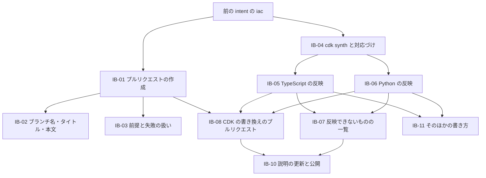

# 作業の一覧(Intent Backlog): iac への CDK の反映とプルリクエストの作成

出典の書き方は `scope-document.md` と同じです。意図の文書は `ideation/intent-capture/intent-statement.md`、実現性の評価は `ideation/feasibility/feasibility-assessment.md`、制約は `ideation/feasibility/constraint-register.md` です。

優先度は MoSCoW で付けています。`v0.2.0` に入るものは Must、できれば入れるものは Could です。同じ優先度の中の順番は、S-Q5(プルリクエストを先に)と依存関係で決めています。

## 一覧

| ID | 項目 | 内容 | 優先度 | 順番 | 依存先 | 出典 |
|---|---|---|---|---|---|---|
| IB-01 | プルリクエストの作成 | `iac` の書き換えのあと、新しいブランチへのコミット、push、`gh` でのプルリクエストの作成までを1回の実行で行う。Terraform と CloudFormation の書き換えに使える | Must | 1 | 前の intent の `iac` | S-Q3、S-Q4、S-Q5 |
| IB-02 | ブランチ名、タイトル、本文 | 既定の値を tag-refactor が決め、オプションで変えられる | Must | 1 | IB-01 | S-Q3 |
| IB-03 | プルリクエストの前提と失敗の扱い | `gh` や `git` が無い、ログインしていない、push に失敗した、などのときに、何が足りないかと対処を示して止まる。認証情報は表示しない | Must | 1 | IB-01 | C-T5、C-T6、R6 |
| IB-04 | CDK の `cdk synth` と対応づけ | tag-refactor が `cdk synth` を実行し、リソースとソースの中の場所を対応づける。AWS の認証情報は渡さない。足りないものや synth できない理由を示して止まる | Must | 2 | 前の intent の `iac` | C-T3、C-T4、R2、R3、R4、R5 |
| IB-05 | CDK の TypeScript の反映 | 必ず自動にする4つの書き方について、4種類の変更を TypeScript のソースに反映する | Must | 3 | IB-04 | S-Q2、S-Q6、S-Q7 |
| IB-06 | CDK の Python の反映 | 必ず自動にする4つの書き方について、4種類の変更を Python のソースに反映する | Must | 3 | IB-04 | S-Q2、S-Q6、S-Q7 |
| IB-07 | 反映できないものの一覧 | 自動で書き換えられない CDK のタグを、理由つきで「手で直す一覧」に出す | Must | 3 | IB-05、IB-06 | S-Q1、S-Q7、R1 |
| IB-08 | CDK の書き換えのプルリクエスト | CDK の書き換えも、IB-01 と同じようにプルリクエストにできる | Must | 4 | IB-01、IB-05、IB-06 | S-Q4 |
| IB-09 | CI での確かめ | 3つの OS で `cdk synth` を動かすテストと、テスト専用のリポジトリに実際のプルリクエストを作るテストを CI で動かす | Must | 1〜4 で順に足す | IB-01、IB-04 | C-Q2、C-Q3 |
| IB-10 | 説明の更新と公開 | README の `iac` の節を更新し、2つの機能がそろったら `v0.2.0` として公開する(タグは人が付ける) | Must | 5 | IB-01〜IB-09 | C-O2 |
| IB-11 | そのほかの書き方の自動化 | 必ず自動にする4つ以外の書き方も、できるだけ自動で書き換える | Could | 3 以降 | IB-05、IB-06 | S-Q1 |

## 依存関係

<!-- Text fallback: 前の intent の iac から、IB-01(プルリクエストの作成)と IB-04(cdk synth と対応づけ)が始まる。IB-01 のあとに IB-02 と IB-03。IB-04 のあとに IB-05(TypeScript)と IB-06(Python)。その2つのあとに IB-07(反映できないものの一覧)と IB-11(そのほかの書き方)。IB-01、IB-05、IB-06 のあとに IB-08(CDK の書き換えのプルリクエスト)。IB-07 と IB-08 のあとに IB-10(説明の更新と公開)。IB-09(CI)は各項目とあわせて足していく。 -->

## 価値の流れ

| 段階 | 利用者がすること | このツールがすること | 得られるもの | 出典 |
|---|---|---|---|---|
| 1 | `plan --out` で変更案を保存し、`apply` で AWS のタグを変える | (前の intent のとおり) | AWS のタグがそろう | 意図 §Problem Statement |
| 2 | IaC のフォルダーと変更案を渡して `iac` を動かす | Terraform、CloudFormation、CDK のソースを同じ変更にそろえる。CDK は `cdk synth` で対応を得る | 次の `terraform apply` や `cdk deploy` でタグが元に戻らない | IB-04〜IB-07 |
| 3 | プルリクエストを作るオプションを付ける | ブランチ、コミット、push、`gh` でのプルリクエストの作成を行う | 手作業なしで、チームのレビューに IaC の修正を出せる | IB-01〜IB-03、IB-08 |

## Assumptions & Open Questions

- IB-09(CI)のテスト専用のリポジトリとトークンは、人が用意する。[assumption]
