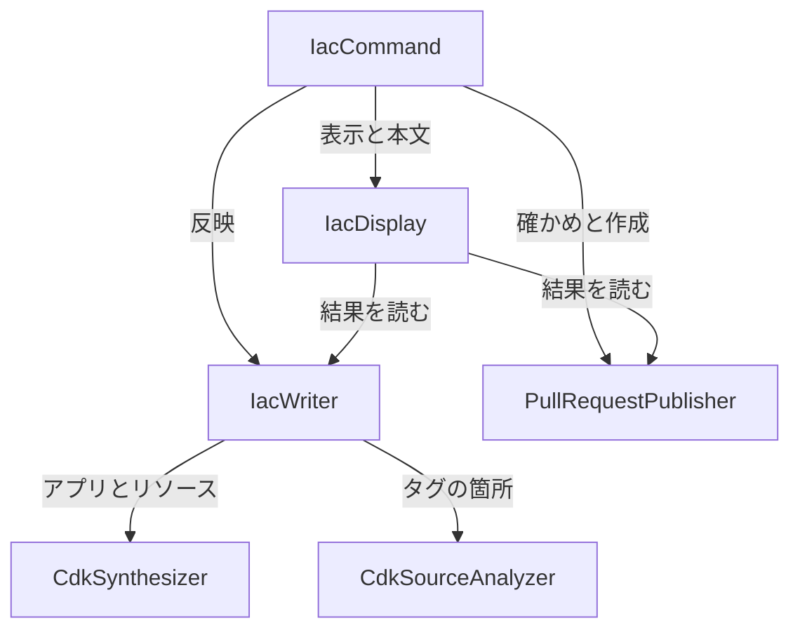

# 部品の一覧: iac への CDK の反映とプルリクエストの作成

要件(`requirements.md`)とストーリー(`stories.md`)を実現する部品です。今の構成(コードの記録 `architecture.md`、`component-inventory.md`)に、新しい部品を3つ足し、今の部品を3つ広げます。チームの進め方(`team-practices.md`)のとおり、外のプログラムの呼び出しは差し替えてテストできる形にします。出典の DD-Q… はこのステージの `domain-design-questions.md` の回答です。

## Part A: 部品の一覧(機械で読む形)

```yaml
components:
  - name: IacCommand
    summary: iac のコマンドの入口。オプションを受け、書き換えとプルリクエストの作成をつなぐ(internal/cli、今の部品を広げる)
    behaviour: >
      --plan と --dir の必須の確かめに加え、--pr、--cdk-app、--synth-timeout、--pr-branch、--pr-title、
      --pr-body-file を受ける。--pr-* は --pr なしでは入力の誤り(終了コード 1)。
      --pr のときは、PullRequestPublisher の確かめ(ネットワークを使わない確かめ → gh とリモートの確かめ)を
      書き換えの前に行い、通ったときだけ IacWriter を --write 相当で動かし、書き換えたファイルの一覧を
      PullRequestPublisher に渡してブランチ、コミット、push、作成を行う。
      書き換えるものが無いときはプルリクエストを作らない(手で直すものが無ければ 0、あれば 2)。
      終了コードは IacWriter の結果と PullRequestPublisher の結果から決める(1 が最優先、次に 2、最後に 0)。
    responsibilities:
      - iac のオプションの定義と確かめ
      - 書き換えの前の確かめ、書き換え、プルリクエストの作成の順番の管理
      - 終了コードの決定
    depends_on:
      - component: IacWriter
        interaction: 変更案の IaC への反映(差分、書き換え、手で直す一覧)
        style: sync
      - component: PullRequestPublisher
        interaction: 書き換えの前の確かめと、ブランチ、コミット、push、作成
        style: sync
      - component: IacDisplay
        interaction: 進み具合、差分、手で直す一覧、プルリクエストの段階の表示と、本文の文章の組み立て
        style: sync
    dependents: []
    external_dependencies: []
    entities: []

  - name: IacWriter
    summary: 変更案を IaC のソースに反映する(internal/iac、今の部品を広げる)。CDK を CloudFormation と Terraform に並ぶ3つ目の IaC として扱う
    behaviour: >
      変更案の各リソースの対象を決める。aws:cloudformation:stack-name と logical-id のタグがあり、
      CdkSynthesizer の結果のスタックと論理 ID に一致するものは CDK、そうでなければ今までどおり
      CloudFormation か Terraform か IaC の外。CDK のリソースは CdkSourceAnalyzer が返すタグの箇所に
      今の反映の決まり(変更の前の値と同じときだけ書き換える、反映済みに数える、aws: のキーは触らない、
      キーと値の範囲だけを変える、書き換えたあとに読み直して確かめる)を当てる。
      スコープ(スタックやコンストラクト)に付けたタグは、変更案がそのスコープでタグを受けるすべての
      リソースを同じように変えるときだけ書き換え、そうでなければ手で直す一覧に出す。
      同じ定数や引数をほかのリソースも使う場合も一覧に出す。CDK のアプリが1つも無いときの振る舞いは今と同じ。
      git は今までどおり読み取りだけを使う。
    responsibilities:
      - 対象(CDK、CloudFormation、Terraform、IaC の外)の決定
      - CDK のタグの箇所への反映の決まりの適用と、範囲の書き換え
      - 差分と手で直す一覧と結果(IacResult)の組み立て
      - --write のときの git の読み取りの確かめと、ファイルの置き換え
    depends_on:
      - component: CdkSynthesizer
        interaction: CDK のアプリの発見と synth、リソースとコンストラクトのパスの一覧
        style: sync
      - component: CdkSourceAnalyzer
        interaction: CDK のソースのタグの箇所とコンストラクトの作成の箇所の読み取り
        style: sync
    dependents:
      - component: IacCommand
        interaction: 変更案の IaC への反映
      - component: IacDisplay
        interaction: 結果の型(IacResult)を読んで表示する
    external_dependencies:
      - name: git
        kind: other
        purpose: --write の前の確かめ(rev-parse、ls-files、ls-tree の読み取りだけ)
      - name: ファイルシステム
        kind: other
        purpose: IaC のソースの読み取りと、一時ファイルを使った置き換え
    entities:
      - name: IacResult
        identifier: 1回の実行につき1つ
        attributes: [files, manualItems, reflected, alreadyReflected, unmanaged, cdkApps, written]
        references:
          - entity: CdkApp
            owned_by: CdkSynthesizer
            relationship: 1回の実行の結果は、対象にした CDK のアプリとその状態を含む
      - name: ManualItem
        identifier: 変更の ID とキーの組
        attributes: [changeId, key, file, line, resource, reason, detail]
        references:
          - entity: TagSite
            owned_by: CdkSourceAnalyzer
            relationship: CDK の手で直すものは、書き換えられなかったタグの箇所を指すことがある

  - name: CdkSynthesizer
    summary: CDK のアプリを見つけて cdk synth を実行し、リソースとコンストラクトのパスの一覧を作る(internal/cdk、新しい部品)
    behaviour: >
      --dir の下で cdk.json を探す(.git、node_modules、cdk.out、シンボリックリンク、ジャンクションは見ない)。
      --cdk-app で絞り込む。存在しない、または cdk.json の無いフォルダーの指定は入力の誤り。
      cdk.json の app の命令から言語を決め、CDK v1 のアプリは理由つきで外す。
      各アプリについて、利用者の CDK の CLI で cdk synth を実行する。出力先は一時的なフォルダーで、
      終わったら(失敗、中断のときも)消す。AWS の認証情報の環境変数とプロファイルの指定、
      GitHub のトークンの環境変数は渡さない。アプリごとに時間の上限(既定 10 分)を置く。
      AWS を呼ばないと synth できない、道具が無い、時間切れ、synth の誤りは、そのアプリの失敗として
      理由と対処を返し、ほかのアプリは続ける。synth の出力のテンプレートから、リソースごとに
      スタック名、論理 ID、種類、コンストラクトのパス(aws:cdk:path)を読む。
      作成の箇所が決まらないリソースのために、求められたときだけ作成の記録を出す設定で synth し直せる。
    responsibilities:
      - CDK のアプリの発見と絞り込み
      - cdk synth の実行(環境、時間の上限、一時的な出力先)
      - synth の出力からのリソースとコンストラクトのパスの一覧
      - アプリごとの状態と失敗の理由
    depends_on: []
    dependents:
      - component: IacWriter
        interaction: CDK のアプリとリソースの一覧を受け取る
    external_dependencies:
      - name: CDK の CLI(cdk)
        kind: other
        purpose: cdk synth の実行
      - name: Node.js、Python
        kind: other
        purpose: 利用者の CDK のアプリの実行(cdk synth の中で動く)
    entities:
      - name: CdkApp
        identifier: --dir からの相対のフォルダー
        attributes: [dir, language, status, elapsed, failureReason]
      - name: SynthesizedResource
        identifier: スタック名と論理 ID の組
        attributes: [stackName, logicalId, resourceType, constructPath, app]
        references:
          - entity: CdkApp
            owned_by: CdkSynthesizer
            relationship: 各リソースは1つのアプリの synth から作られる

  - name: CdkSourceAnalyzer
    summary: CDK の TypeScript と Python のソースを読み、タグの箇所とコンストラクトの作成の箇所を返す(internal/cdk、新しい部品)
    behaviour: >
      埋め込んだ小さな補助のプログラム(TypeScript 用と Python 用)を、利用者の Node.js と Python で動かす。
      TypeScript はアプリの node_modules の TypeScript のコンパイラーで、Python は標準の ast で読む。
      補助のプログラムは読むだけで、ファイルを書かない。結果は JSON で、各タグの箇所について
      ファイル、キーと値の範囲、書き方の種類(必ず自動にする4つ、その他、式)、効く範囲
      (どのコンストラクトのパスに付くか)を返す。必ず自動にする形は Tags.of(x).add / remove と
      スタックの tags のプロパティで、同じファイルの定数、同じファイルの辞書を回すもの、
      別のファイルからスタックの引数で渡した文字列を、元の文字列の箇所までたどる。
      コンストラクトのパスをたどって、new X(scope, 'Id') のような作成の箇所を探す。
      補助のプログラムの呼び出しにも時間の上限を置き、失敗はそのアプリの手で直すものとして返す。
    responsibilities:
      - 補助のプログラムの起動と結果の受け取り
      - タグの箇所(範囲、書き方、効く範囲)の一覧
      - コンストラクトの作成の箇所の一覧
    depends_on: []
    dependents:
      - component: IacWriter
        interaction: タグの箇所と作成の箇所を受け取る
    external_dependencies:
      - name: Node.js とアプリの TypeScript
        kind: other
        purpose: TypeScript のソースの構文の読み取り
      - name: Python(標準の ast)
        kind: other
        purpose: Python のソースの構文の読み取り
    entities:
      - name: TagSite
        identifier: ファイルとキーの範囲の始まりの位置
        attributes: [file, line, keyRange, valueRange, shape, scopeConstructPath, origin]
        references:
          - entity: SynthesizedResource
            owned_by: CdkSynthesizer
            relationship: 1つのタグの箇所は、効く範囲の下の1つ以上のリソースにタグを付ける
      - name: ConstructSite
        identifier: コンストラクトのパス
        attributes: [constructPath, file, line, constructId]
        references:
          - entity: SynthesizedResource
            owned_by: CdkSynthesizer
            relationship: 各リソースのコンストラクトのパスは、ソースの1つの作成の箇所に対応する

  - name: PullRequestPublisher
    summary: 書き換えの前の確かめと、ブランチ、コミット、push、プルリクエストの作成を行う(internal/pullrequest、新しい部品)
    behaviour: >
      確かめ(書き換えの前、ネットワークを使わないものから): HEAD がブランチを指す、push するリモート
      (追跡先、無ければ origin)が決まる、そのリモートが GitHub、gh があり、そのホストにログイン済み、
      行き先のブランチがリモートにある、作るブランチの名前が手元にもリモートにも無い、
      --pr-branch が git のブランチ名として使える、--pr-body-file が読める、タイトルが空でない。
      作成: 今の HEAD から新しいブランチを作って切り替え、書き換えたファイルだけをステージしてコミット
      (フックと署名は利用者の git の設定のまま)、push、gh pr create(行き先は実行したときのブランチ)。
      各段階の成否を記録し、途中で失敗したら、そこまで済んだことと続きの命令を返す。済んだことは戻さない。
      git と gh の呼び出しには時間の上限を置き、GitHub のトークンを読まず、出力にも出さない。
    responsibilities:
      - 書き換えの前の確かめ
      - ブランチの作成、コミット、push、プルリクエストの作成
      - 段階ごとの成否と、続きの命令の組み立て
    depends_on: []
    dependents:
      - component: IacCommand
        interaction: 確かめと作成
      - component: IacDisplay
        interaction: 結果の型(PublishOutcome)を読んで表示する
    external_dependencies:
      - name: git
        kind: other
        purpose: ブランチ、コミット、push、リモートとブランチの確かめ
      - name: gh(GitHub CLI)
        kind: other
        purpose: ログインの確かめと、プルリクエストの作成
      - name: GitHub
        kind: third-party-api
        purpose: プルリクエストの作成先(gh と git を通して使う)
    entities:
      - name: PublishOutcome
        identifier: 作ったブランチの名前
        attributes: [remote, base, branch, committedFiles, completedSteps, failedStep, url, resumeCommand]

  - name: IacDisplay
    summary: iac の表示とプルリクエストの本文の文章を組み立てる(internal/display、今の部品を広げる)
    behaviour: >
      今の iac の表示(差分、手で直す一覧、反映済みの件数、完了と終了コードの行)に、synth の進み具合
      (端末なら行の書き換え、端末でなければ追記)、書き換えの前の確かめの1行、プルリクエストの段階の行、
      URL の行、途中の失敗の「Done so far」と続きの命令、CDK の手で直す理由を足す。
      プルリクエストのタイトルと本文(変更したファイル、手で直す一覧。ARN とアカウント ID は載せない)を
      --lang の言語で組み立てる。新しい文はすべて英語と日本語を並べる。色は補助のみ。
    responsibilities:
      - 端末への表示
      - プルリクエストのタイトルと本文の文章
    depends_on:
      - component: IacWriter
        interaction: IacResult を読む
        style: sync
      - component: PullRequestPublisher
        interaction: PublishOutcome を読む
        style: sync
    dependents:
      - component: IacCommand
        interaction: 表示と本文の組み立て
    external_dependencies: []
    entities: []
```

## Part B: 人が読む形

### 部品の図



<!-- Text fallback: IacCommand は IacWriter、PullRequestPublisher、IacDisplay を呼ぶ。IacWriter は CdkSynthesizer と CdkSourceAnalyzer を呼ぶ。IacDisplay は IacWriter と PullRequestPublisher の結果の型を読む。循環はない。 -->

### 部品のまとめ

| 部品 | 目的 | 依存先 | 依存元 | 持つもの |
|---|---|---|---|---|
| IacCommand | iac の入口と順番の管理 | IacWriter、PullRequestPublisher、IacDisplay | なし | なし |
| IacWriter | 変更案の IaC への反映(CDK を足す) | CdkSynthesizer、CdkSourceAnalyzer | IacCommand、IacDisplay | IacResult、ManualItem |
| CdkSynthesizer | アプリの発見と synth、リソースの一覧 | なし | IacWriter | CdkApp、SynthesizedResource |
| CdkSourceAnalyzer | ソースのタグの箇所と作成の箇所 | なし | IacWriter | TagSite、ConstructSite |
| PullRequestPublisher | 確かめとプルリクエストの作成 | なし | IacCommand、IacDisplay | PublishOutcome |
| IacDisplay | 表示と本文の文章 | IacWriter、PullRequestPublisher | IacCommand | なし |

### 持つものの一覧

| もの | 持つ部品 | 識別 | 項目 | 参照 |
|---|---|---|---|---|
| IacResult | IacWriter | 1回の実行につき1つ | files、manualItems、reflected、alreadyReflected、unmanaged、cdkApps、written | CdkApp |
| ManualItem | IacWriter | 変更の ID とキーの組 | changeId、key、file、line、resource、reason、detail | TagSite |
| CdkApp | CdkSynthesizer | --dir からの相対のフォルダー | dir、language、status、elapsed、failureReason | なし |
| SynthesizedResource | CdkSynthesizer | スタック名と論理 ID の組 | stackName、logicalId、resourceType、constructPath、app | CdkApp |
| TagSite | CdkSourceAnalyzer | ファイルとキーの範囲の始まりの位置 | file、line、keyRange、valueRange、shape、scopeConstructPath、origin | SynthesizedResource |
| ConstructSite | CdkSourceAnalyzer | コンストラクトのパス | constructPath、file、line、constructId | SynthesizedResource |
| PublishOutcome | PullRequestPublisher | 作ったブランチの名前 | remote、base、branch、committedFiles、completedSteps、failedStep、url、resumeCommand | なし |

### 外のもの

| 部品 | 依存するもの | 種類 | 目的 |
|---|---|---|---|
| IacWriter | git | other | --write の前の読み取りの確かめ |
| IacWriter | ファイルシステム | other | ソースの読み取りと置き換え |
| CdkSynthesizer | CDK の CLI | other | cdk synth |
| CdkSynthesizer | Node.js、Python | other | 利用者のアプリの実行 |
| CdkSourceAnalyzer | Node.js とアプリの TypeScript | other | TypeScript の構文の読み取り |
| CdkSourceAnalyzer | Python(標準の ast) | other | Python の構文の読み取り |
| PullRequestPublisher | git | other | ブランチ、コミット、push |
| PullRequestPublisher | gh | other | ログインの確かめとプルリクエストの作成 |
| PullRequestPublisher | GitHub | third-party-api | プルリクエストの作成先 |

### 理由

| 部品 | 分けた理由 |
|---|---|
| IacCommand | 今の部品。書き換えとプルリクエストの順番を持つ場所として、`internal/iac` の git の読み取りだけの境界を守るために、ここでつなぐ(DD-Q2、ADR-002) |
| IacWriter | 今の部品。反映の決まり(変更の前の値と同じときだけ、範囲だけ、読み直し)は IaC の種類によらず同じなので、CDK もここで扱う(ADR-005) |
| CdkSynthesizer | 外のプログラム(cdk)と一時的なフォルダーを扱い、変わる理由(CDK の CLI の版、出力の形)がほかと別。今の `internal/iac`(約 4,700 行)にこれ以上載せない(DD-Q1、ADR-001) |
| CdkSourceAnalyzer | 補助のプログラムと、TypeScript と Python の書き方の知識を持ち、変わる理由(CDK の API の書き方)がほかと別(DD-Q3、ADR-003) |
| PullRequestPublisher | git の書き込みと gh を扱い、Terraform や CloudFormation の書き換えにも使う。IaC の反映とは変わる理由が別(DD-Q1、ADR-001) |
| IacDisplay | 今の部品。表示と言語の決まりを1か所に置く今の形を続ける |

採らなかった分け方: すべてを `internal/iac` の中に置く(DD-Q1 の B)。ファイルは分けられるが、外のプログラムを呼ぶ部分と、git の書き込みが `internal/iac` に入り、今の「git は読み取りだけ」の境界が崩れるため採らなかった。`internal/cdk` をさらに2つのパッケージに分ける(DD-Q1 の C)は、2つの部品の間に呼び出しがなく、どちらも `IacWriter` だけから呼ばれるので、パッケージの中のファイルの分け方で足りると考えて採らなかった。
