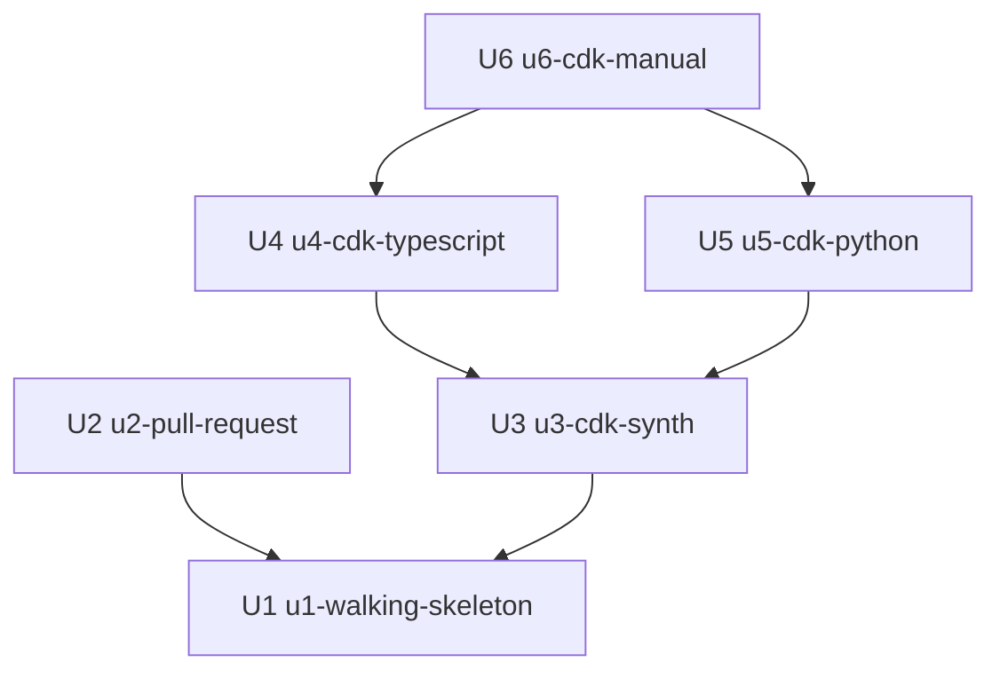

# 作業の単位の依存: iac への CDK の反映とプルリクエストの作成

単位の中身は `unit-of-work.md`、部品は `inception/domain-design/components.md`、設計の決定は `decisions.md`、要件は `requirements.md`、ストーリーは `stories.md` です。ここでは「何が何に依存するか」だけを書きます。作る順番は、作業の計画の段階で決めます。

## 依存の図



<!-- Text fallback: 矢印は「左が右に依存する」。U2 と U3 は U1 に依存する。U4 と U5 は U3 に依存する。U6 は U4 と U5 に依存する。循環はない。 -->

## 依存の一覧

| 単位 | 依存先 | 理由 |
|---|---|---|
| U1 | なし | 最小の一本。ほかのすべての土台 |
| U2 | U1 | U1 の `--pr` の流れ(ブランチ、コミット、push、作成)を広げる |
| U3 | U1 | U1 の synth と対応づけを広げる |
| U4 | U3 | 複数のアプリと対象の決定の規則の上で、TypeScript の書き方を広げる |
| U5 | U3 | 同じく、Python の書き方を足す |
| U6 | U4、U5 | 両方の言語のタグの箇所の読み取りの上で、反映できないものの理由と、その他の書き方を足す |

## つながる点

| 単位の組 | つながる点 | 形 |
|---|---|---|
| U1 → U2 | `IacCommand` の確かめ → 書き換え → 作成の順番、`PullRequestPublisher` の段階の結果 | パッケージの中の関数と型 |
| U1 → U3 | `CdkSynthesizer` のアプリとリソースの一覧、`IacWriter` の対象の決定 | パッケージの中の関数と型 |
| U3 → U4、U5 | `SynthesizedResource`(コンストラクトのパス)、`CdkSourceAnalyzer` の補助のプログラムの JSON の形 | 型と JSON |
| U4、U5 → U6 | `TagSite` の書き方の種類、`ManualItem` の理由 | 型 |

型と JSON の形は、契約の設計の段階で決めます。

## 同時に進められる組

- U2 と U3 は、互いに依存しないので、どちらを先に作ってもよい(UG-Q3)。
- U4 と U5 は、互いに依存しないので、どちらを先に作ってもよい。
- U2 は U4、U5、U6 とも依存しない。

## 最小の一本

- 最初の単位は U1 です(チームの進め方の Walking Skeleton、UG-Q2)。U1 は依存先が無く、DAG の最初に来ます。
- U1 だけで、TypeScript の CDK アプリ1つのキーの名前の変更を反映し、テスト専用のリポジトリにプルリクエストを作るところまで、端から端まで動きます。後の単位が無くても動きます。

## 機械で読む形

```yaml
units:
  - name: u1-walking-skeleton
    kind: service
    depends_on: []
  - name: u2-pull-request
    kind: library
    depends_on: [u1-walking-skeleton]
  - name: u3-cdk-synth
    kind: library
    depends_on: [u1-walking-skeleton]
  - name: u4-cdk-typescript
    kind: library
    depends_on: [u3-cdk-synth]
  - name: u5-cdk-python
    kind: library
    depends_on: [u3-cdk-synth]
  - name: u6-cdk-manual
    kind: library
    depends_on: [u4-cdk-typescript, u5-cdk-python]
```
