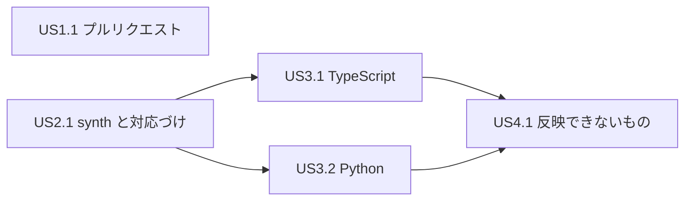

# ユーザーストーリー: iac への CDK の反映とプルリクエストの作成(v0.2.0)

要件は `inception/requirements-analysis/requirements.md`、計画と回答は `user-stories-questions.md`(US-Q…)です。利用者像は `personas.md` の P1(佐藤さん)だけです。優先度は MoSCoW で、`v0.2.0` の完成の定義に入るものは Must です。

## 一覧

| ID | ストーリー | 利用者 | 優先度 | 要件 | 前の作業との対応 |
|---|---|---|---|---|---|
| US1.1 | IaC の修正をプルリクエストで出す | P1 | Must | FR1、NFR1、NFR3、NFR9、NFR10 | 前 US7.3(前 AC7.3.1) |
| US2.1 | CDK のアプリを synth して、リソースとソースを対応づける | P1 | Must | FR2、NFR2、NFR3、NFR8 | 前 US7.2(前 AC7.2.1)の前提 |
| US3.1 | タグの変更を TypeScript の CDK のソースに反映する | P1 | Must | FR3.1〜FR3.3、FR3.6〜FR3.9 | 前 US7.2(前 AC7.2.1) |
| US3.2 | タグの変更を Python の CDK のソースに反映する | P1 | Must | FR3.1〜FR3.3、FR3.6〜FR3.9 | 前 US7.2(前 AC7.2.1) |
| US4.1 | 自動で反映できない CDK のタグを、理由つきで知る | P1 | Must(書き方を増やす部分は Could) | FR3.4、FR3.5、FR2.8〜FR2.11 | 前 US7.2 |

分け方は機能ごと(US-Q1: A)、大きさは大きめ(US-Q2: C)です。

---

## グループ1: プルリクエスト

### US1.1 IaC の修正をプルリクエストで出す

**P1(佐藤さん)として、`iac` で書き換えた IaC の修正を、1回の実行で GitHub のプルリクエストにしたい。それは、ブランチ、コミット、push、作成の手作業なしで、チームのレビューに出すためだ。**

- 優先度: Must
- 要件: FR1.1〜FR1.13、NFR1、NFR3、NFR9、NFR10
- 依存: なし(今の `iac` の Terraform と CloudFormation の書き換えで使える。範囲の定義の S-Q5「プルリクエストを先に」)

| ID | 受け入れ条件 |
|---|---|
| AC1.1.1 | **Given** Terraform か CloudFormation の書き換えがある変更案と、`gh` にログインしたテスト用のリポジトリ **When** `iac --pr` を実行する **Then** 書き換え、新しいブランチの作成、コミット、push、プルリクエストの作成が行われ、確認の問いは出ず、最後にプルリクエストの URL が1行で表示される(FR1.1、FR1.2、FR1.9) |
| AC1.1.2 | **Given** `feature-x` のブランチにいる **When** `iac --pr` を実行する **Then** 今の HEAD から日時を含む名前のブランチが作られ、行き先(base)が `feature-x` のプルリクエストができる。ブランチ名、タイトル、本文のオプションを付けると、その値になる(FR1.3、FR1.4) |
| AC1.1.3 | **Given** リモートが `origin` と `upstream` の2つあり、今のブランチが `upstream` を追跡している **When** `iac --pr` を実行する **Then** `upstream` に push し、そこにプルリクエストを作る。追跡先が無ければ `origin` を使い、どちらも決まらなければ、ファイルを変えずに止まる(FR1.5、US-Q4) |
| AC1.1.4 | **Given** 次のどれかにあたる: `gh` が無い、`gh` にログインしていない、リモートが GitHub でない、HEAD がブランチを指していない、行き先のブランチがリモートに無い、作るブランチと同じ名前のブランチが手元かリモートにある、書き換えるファイルに未コミットの変更がある **When** `iac --pr` を実行する **Then** どのファイルも変わらず、理由と対処が表示され、終了コードは 1(FR1.5、FR1.6、US-Q4) |
| AC1.1.5 | **Given** コミットのフックと署名の設定があるリポジトリで、作業ツリーとステージにほかのファイルの変更がある **When** `iac --pr` を実行する **Then** フックと署名は利用者の設定どおりに動き、コミットには `iac` が書き換えたファイルだけが入る(FR1.7、FR1.8) |
| AC1.1.6 | **Given** 手で直すものが1件ある変更案 **When** `--lang ja` を付けて `iac --pr` を実行する **Then** プルリクエストが作られ、タイトルと本文は日本語で、本文に変更したファイル(IaC の種類つき)と手で直す一覧が載り、終了コードは 2(FR1.10、FR1.13、NFR10) |
| AC1.1.7 | **Given** すでに反映済みで、手で直すものも無い変更案 **When** `iac --pr` を実行する **Then** ブランチもプルリクエストも作られず、「反映するものはありません」と表示され、終了コードは 0(FR1.11) |
| AC1.1.8 | **Given** 書き換えるものは無く、手で直すものだけが残る変更案 **When** `iac --pr` を実行する **Then** ブランチもプルリクエストも作られず、手で直す一覧が表示され、終了コードは 2(FR1.11、FR1.13、US-Q5) |
| AC1.1.9 | **Given** push のあとでプルリクエストの作成が失敗する **When** `iac --pr` を実行する **Then** そこで止まり、書き換えたファイル、手元のブランチ、push したブランチと、プルリクエストを手で作る方法が表示され、済んだことは元に戻されず、終了コードは 1(FR1.12) |
| AC1.1.10 | **Given** 応答しない `gh` や `git` に差し替えた環境 **When** `iac --pr` を実行する **Then** 時間の上限のあとで止まり、出力とログに GitHub のトークンが含まれない(NFR1、NFR3) |
| AC1.1.11 | **Given** テスト専用のリポジトリと、そこにだけ書けるトークンが CI の secret にある **When** CI の結合テストを実行する **Then** テスト専用のリポジトリに実際のプルリクエストができ、テストのあとで閉じて消される。secret の無い実行では、このテストは飛ばされる(NFR9) |

---

## グループ2: CDK のアプリの synth

### US2.1 CDK のアプリを synth して、リソースとソースを対応づける

**P1(佐藤さん)として、`iac` に IaC のフォルダーを渡すだけで、CDK のアプリが見つかり、どのリソースがどのソースから作られたかが分かるようにしたい。それは、論理 ID に生成された文字が付く CDK のリソースでも、ソースを直せるようにするためだ。**

- 優先度: Must
- 要件: FR2.1〜FR2.11、NFR2、NFR3、NFR8
- 依存: なし

| ID | 受け入れ条件 |
|---|---|
| AC2.1.1 | **Given** `--dir` の下に TypeScript と Python の CDK v2 のアプリ(`cdk.json` のあるフォルダー)が1つずつと、`node_modules` の中の `cdk.json` がある **When** `iac` を実行する **Then** 2つのアプリが対象になり、`node_modules` の中は対象にならない。絞り込みのオプションを付けると、指定したアプリだけが対象になる(FR2.1、FR2.2) |
| AC2.1.2 | **Given** 対象のアプリ **When** `iac` を実行する **Then** 利用者の端末の CDK の CLI(と Node.js、Python)で `cdk synth` が動き、標準エラーにアプリごとの状態(待ち、実行中、済み、失敗)と経過時間が文字で表示される(FR2.3、FR2.7) |
| AC2.1.3 | **Given** AWS の認証情報の環境変数とプロファイルの指定がある端末 **When** `iac` が `cdk synth` を動かす **Then** synth に渡す環境に AWS の認証情報は含まれない。AWS から値を引く書き方で値が保存されていないアプリは失敗になり、理由と対処(一度自分で synth して値を保存する)が表示され、AWS への呼び出しは起きない(FR2.4、NFR2) |
| AC2.1.4 | **Given** 時間の上限を短くしたとき、または synth が終わらないアプリ **When** `iac` を実行する **Then** 上限で止まり、そのアプリは時間切れの失敗になる。既定の上限は 10 分(FR2.5、NFR3) |
| AC2.1.5 | **Given** アプリの `cdk.out` に前の出力がある **When** `iac` を実行する(途中で中断した場合も含む) **Then** `cdk.out` の中身は変わらず、synth の一時的なフォルダーは残らない(FR2.6) |
| AC2.1.6 | **Given** CDK のアプリで作ったリソースを含む変更案 **When** `iac` を実行する **Then** 変更案の `aws:cloudformation:stack-name` と `aws:cloudformation:logical-id` のタグを synth の出力に照らして CDK のリソースと決め、そのリソースを作ったソースのファイルと行が分かる(FR2.11) |
| AC2.1.7 | **Given** CI の3つの OS **When** `cdk synth` を動かすテストを実行する **Then** 3つとも通る。Node.js、Python、CDK の CLI が無いと、CI ではテストが失敗になり、手元では理由を出して飛ばされる(NFR8) |

---

## グループ3: CDK のソースへの反映

必ず自動で書き換える書き方は、次の4つです(要件 FR3.3、US-Q3)。

| 書き方 | 必ず扱う形(TypeScript と Python の両方) |
|---|---|
| (1) キーと値が文字列でそのまま | `Tags.of(x).add('キー', '値')`、`Tags.of(x).remove('キー')`、スタックの `tags` のプロパティ(`new Stack(app, 'S', { tags: { キー: '値' } })`、`Stack(app, "S", tags={"キー": "値"})`) |
| (2) 同じファイルの定数 | (1) の形の、キーか値に、同じファイルで文字列を入れただけの定数を使うもの |
| (3) 同じファイルの辞書を回す | 同じファイルの、文字列だけの辞書(オブジェクト)を回して (1) の `Tags.of(x).add` を呼ぶもの |
| (4) 別のファイルからの引数 | 別のファイル(アプリの入口など)からスタックの引数として渡した文字列を、(1) の形の値に使うもの |

L1 のコンストラクトの `tags` のプロパティなど、上にない形は「できるだけ自動」(US4.1)の側です。

### US3.1 タグの変更を TypeScript の CDK のソースに反映する

**P1(佐藤さん)として、`apply` で変えたタグの変更を、TypeScript の CDK のソースにも反映したい。それは、次の `cdk deploy` でタグが元に戻らないようにするためだ。**

- 優先度: Must
- 要件: FR3.1、FR3.2、FR3.3、FR3.6、FR3.7、FR3.8、FR3.9
- 依存: US2.1

| ID | 受け入れ条件 |
|---|---|
| AC3.1.1 | **Given** 上の表の4つの書き方それぞれで書いた TypeScript のテスト用のアプリと、キーの名前の変更、値の変更、必須タグの追加、削除を含む変更案 **When** `iac --write` を実行する **Then** それぞれの変更がソースに反映され、書き換えたあとにもう一度 `cdk synth` すると、対象のリソースのタグが変更後の値になっている(FR3.1〜FR3.3) |
| AC3.1.2 | **Given** 書き換えたあとの同じソース **When** 同じ変更案でもう一度 `iac` を実行する **Then** 差分は出ず、反映済みに数えられる。ソースの値が変更の前の値とも後の値とも違うものは書き換えない(FR3.6) |
| AC3.1.3 | **Given** コメント、引用符の種類、インデント、改行の種類がいろいろなソース **When** `iac --write` を実行する **Then** 書き換えの前後の差分が、変えたキーと値の範囲だけになる。書き換えたあとに読み直して意図した形でなければ、そのファイルは書き換えない(FR3.7) |
| AC3.1.4 | **Given** `aws:` で始まるキーの変更を含む変更案 **When** `iac --write` を実行する **Then** そのキーは足されず、変わらず、消えない(FR3.8) |
| AC3.1.5 | **Given** TypeScript のソースの変更 **When** `iac` を実行する(`--write` なし) **Then** 変える行と前後3行の差分が、今の `iac` と同じ形で表示され、ファイルは変わらない(FR3.9) |

### US3.2 タグの変更を Python の CDK のソースに反映する

**P1(佐藤さん)として、`apply` で変えたタグの変更を、Python の CDK のソースにも反映したい。それは、Python で CDK を書いているチームでも、次の `cdk deploy` でタグが元に戻らないようにするためだ。**

- 優先度: Must
- 要件: FR3.1、FR3.2、FR3.3、FR3.6、FR3.7、FR3.8、FR3.9
- 依存: US2.1

| ID | 受け入れ条件 |
|---|---|
| AC3.2.1 | **Given** 上の表の4つの書き方それぞれで書いた Python のテスト用のアプリと、キーの名前の変更、値の変更、必須タグの追加、削除を含む変更案 **When** `iac --write` を実行する **Then** それぞれの変更がソースに反映され、書き換えたあとにもう一度 `cdk synth` すると、対象のリソースのタグが変更後の値になっている(FR3.1〜FR3.3) |
| AC3.2.2 | **Given** 書き換えたあとの同じソース **When** 同じ変更案でもう一度 `iac` を実行する **Then** 差分は出ず、反映済みに数えられる。ソースの値が変更の前の値とも後の値とも違うものは書き換えない(FR3.6) |
| AC3.2.3 | **Given** コメント、引用符の種類(`'`、`"`)、インデント、改行の種類がいろいろな Python のソース **When** `iac --write` を実行する **Then** 書き換えの前後の差分が、変えたキーと値の範囲だけになる。書き換えたあとに読み直して意図した形でなければ、そのファイルは書き換えない(FR3.7) |
| AC3.2.4 | **Given** `aws:` で始まるキーの変更を含む変更案 **When** `iac --write` を実行する **Then** そのキーは足されず、変わらず、消えない(FR3.8) |
| AC3.2.5 | **Given** Python のソースの変更 **When** `iac` を実行する(`--write` なし) **Then** 変える行と前後3行の差分が、今の `iac` と同じ形で表示され、ファイルは変わらない(FR3.9) |

---

## グループ4: 反映できないもの

### US4.1 自動で反映できない CDK のタグを、理由つきで知る

**P1(佐藤さん)として、自動で書き換えられなかった CDK のタグを、どのファイルのどの行で、なぜできなかったのかとあわせて知りたい。それは、残りを手で直すか、チームに頼むかを判断するためだ。**

- 優先度: Must(上の表にない書き方をできるだけ自動にする部分は Could。FR3.4、範囲の定義の IB-11)
- 要件: FR2.8、FR2.9、FR2.10、FR2.11(対応が取れないもの)、FR3.4、FR3.5
- 依存: US2.1、US3.1、US3.2

| ID | 受け入れ条件 |
|---|---|
| AC4.1.1 | **Given** 値を計算で作る書き方(文字列のつなぎ合わせ、関数の呼び出し、条件)のソース **When** `iac` を実行する **Then** そのタグは書き換えられず、ファイル、行、リソース、理由(「値が式」など)が「手で直す一覧」に表示され、終了コードは 2(FR3.4) |
| AC4.1.2 | **Given** 2つのスタックに同じ引数を渡していて、変更案は一方のスタックのリソースだけを変える **When** `iac` を実行する **Then** その引数は書き換えられず、「同じ値をほかのリソースも使っている」理由で一覧に出る(FR3.5) |
| AC4.1.3 | **Given** 2つのアプリのうち1つで、Python が無い、または synth が失敗する **When** `iac` を実行する **Then** 失敗したアプリのリソースは、無いものの名前や失敗の理由とあわせて一覧に出て、もう1つのアプリと Terraform、CloudFormation の処理は続き、終了コードは 2(FR2.8、FR2.9) |
| AC4.1.4 | **Given** CDK v1 のアプリ、またはリソースとソースの対応の情報が synth の出力に無いアプリ **When** `iac` を実行する **Then** そのアプリのリソースは、理由つきで一覧に出る(FR2.10、FR2.11) |
| AC4.1.5 | **Given** L1 のコンストラクトの `tags` のプロパティに文字列で書いたタグ(必ず扱う形の外) **When** `iac` を実行する **Then** 書き換えられれば反映され、書き換えられなければ理由つきで一覧に出る。どちらの場合も、黙って飛ばされることはない(FR3.4) |

---

## 依存関係

<!-- Text fallback: US1.1(プルリクエスト)は単独で作れる。US2.1(synth と対応づけ)のあとに US3.1(TypeScript)と US3.2(Python)。その2つのあとに US4.1(反映できないもの)。 -->

## INVEST の確認

| 観点 | 確認の結果 |
|---|---|
| 独立している | US1.1 は今の Terraform と CloudFormation の書き換えで単独に作れる。US3.x と US4.1 は US2.1 に依存するが、テスト用のアプリと保存した synth の出力を用意すれば、それぞれ単独でテストできる |
| 話し合える | オプションの名前、ブランチ名の形、本文の詳しい形は決めず、設計で詰める余地を残している |
| 価値がある | すべてのストーリーに「それは〜のためだ」の価値を書いている |
| 見積もれる | 大きめを選んだため(US-Q2: C)、US1.1 と US3.x は見積もりの幅が大きい |
| 小さい | 大きめを選んだため、1つのストーリーが数日以上になるものがある。作業の計画の段階で分ける可能性がある |
| テストできる | 受け入れ条件はすべて Given/When/Then で、合否が判定できる形にしている。CDK の反映は、書き換え後に synth し直してタグを確かめる |
